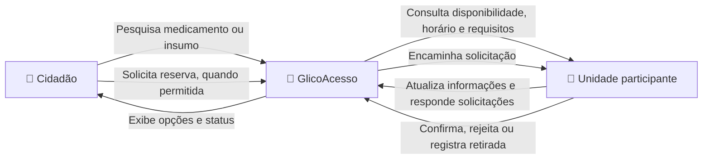

# GlicoAcesso

<p align="center">
    
</p>

> **Encontre. Reserve. Continue seu cuidado.**

O **GlicoAcesso** é uma startup fictícia de impacto social que busca facilitar o acesso de pessoas com diabetes a medicamentos e insumos disponibilizados pela rede pública de saúde.

**Em uma frase:** conectamos cidadãos e unidades públicas de saúde participantes para tornar mais simples descobrir **onde um item está disponível, quando a informação foi atualizada, quais são as regras de retirada e, quando permitido, solicitar uma reserva antes do deslocamento**.

---


## O problema

Imagine uma pessoa que precisa retirar regularmente um medicamento ou insumo para diabetes pela rede pública. Antes de sair de casa, ela precisa responder a perguntas simples:

- **Qual unidade fornece o item de que preciso?**
- **Há disponibilidade informada? Quando ela foi atualizada?**
- **Qual é o horário de retirada?**
- **Quais documentos ou requisitos são necessários?**
- **Existe outra unidade participante caso aquela não possa atender?**

Quando essas informações estão dispersas ou são difíceis de localizar, o cidadão pode se deslocar até uma unidade e descobrir apenas no local que o item não está disponível ou que a retirada depende de outro procedimento. Isso pode gerar **tempo perdido, gasto com transporte e atraso na retirada**.

O GlicoAcesso não parte da ideia de que todas as pessoas com diabetes deixam de obter seus medicamentos. O problema que buscamos enfrentar é mais específico: **a incerteza sobre onde, quando e como acessar itens disponíveis na rede pública participante**.

### Por que esse problema importa?

- Um estudo nacional com dados da Pesquisa Nacional de Saúde identificou que **69,7% da obtenção de insulina analisada ocorreu pelo serviço público** e encontrou desigualdades de acesso associadas a renda, raça/cor e ausência de plano de saúde.
- O Ministério da Saúde informa que, após a distribuição federal de insulinas e agulhas, as localidades respondem pela distribuição, armazenamento e dispensação, podendo existir particularidades e critérios locais.
- Uma pesquisa nacional em 273 municípios encontrou **disponibilidade média de 52,9% para medicamentos traçadores na atenção primária**, com diferenças regionais. O dado é geral e não específico de diabetes ou insulina.
- A **Lei nº 14.654/2023** exige que os estoques das farmácias públicas do SUS sejam divulgados na internet, atualizados quinzenalmente e apresentados de forma acessível ao cidadão.

Esses dados não significam que uma plataforma digital possa resolver todas as desigualdades de acesso ou o desabastecimento. Eles ajudam a mostrar por que **organizar e tornar utilizáveis as informações de disponibilidade e retirada pode ser relevante**.

---


## A solução

O GlicoAcesso reúne, em um único ambiente, informações das **unidades públicas de saúde participantes** e cria um fluxo entre quem precisa encontrar um item e quem gerencia sua disponibilização.



### Para o cidadão

1. Pesquisa o medicamento ou insumo prescrito.
2. Visualiza unidades participantes que informam disponibilidade do item.
3. Consulta **data de atualização, endereço, horário e requisitos para retirada**.
4. Quando permitido, solicita uma reserva antes de se deslocar.
5. Acompanha a confirmação e a situação da retirada.
6. Caso uma unidade não possa atender, consulta outras opções participantes.

### Para a unidade de saúde

1. Mantém as informações de disponibilidade, horários e requisitos atualizadas.
2. Visualiza solicitações recebidas.
3. Confirma ou rejeita reservas conforme a disponibilidade.
4. Registra a retirada dos itens.
5. Acompanha demanda e indisponibilidades.

### De onde vêm os dados?

Nesta fase acadêmica, os dados são **simulados** e poderão ser atualizados pelas próprias unidades no sistema.

Em uma implantação real, a plataforma poderia combinar diferentes formas de atualização conforme a infraestrutura da rede de saúde: atualização manual por profissionais autorizados, importação periódica de dados e integração com sistemas de estoque já existentes quando houver mecanismos de interoperabilidade disponíveis.

Em todos os casos, o GlicoAcesso deve mostrar de forma clara **quando a informação foi atualizada**, evitando apresentar um dado antigo como se fosse uma confirmação em tempo real.

> O GlicoAcesso não precisa começar com todas as unidades do país. A proposta pode ser adotada inicialmente por uma **rede municipal ou conjunto de unidades participantes**, expandindo à medida que novas unidades aderirem.

---


## Impacto social esperado

O objetivo do GlicoAcesso não é criar estoque onde ele não existe, mas **reduzir a incerteza e o custo de encontrar e retirar um item disponível na rede participante**.

Os beneficiários incluem pessoas com diabetes que dependem do SUS, familiares e cuidadores, profissionais das unidades e gestores municipais de saúde. O impacto pode ser especialmente relevante para pessoas com menor renda, mobilidade reduzida ou que vivem longe das unidades de dispensação, para quem um deslocamento sem sucesso pode representar um custo maior.

### Como vamos saber se a ideia funciona?

| Objetivo | Indicador proposto |
| --- | --- |
| Tornar a busca mais rápida | **Tempo para localizar uma unidade apta** |
| Reduzir viagens sem resultado | **Taxa de deslocamentos sem sucesso** |
| Dar previsibilidade à solicitação | **Taxa de reservas confirmadas** |
| Acompanhar o acesso até a retirada | **Tempo entre solicitação e retirada** |
| Melhorar a experiência | **Satisfação do usuário** |
| Apoiar a organização das unidades | **Solicitações atendidas, rejeitadas ou expiradas** |

Esses indicadores medem resultados diretamente relacionados ao que a plataforma se propõe a melhorar. O projeto **não atribui diretamente ao GlicoAcesso a redução de amputações, internações ou mortes**, pois esses resultados dependem de diversos fatores clínicos, sociais e estruturais.

---


## O que o GlicoAcesso é - e o que não é

| O GlicoAcesso **faz** | O GlicoAcesso **não faz** |
| --- | --- |
| Facilita a localização de unidades participantes | Não realiza diagnóstico |
| Organiza informações de disponibilidade e retirada | Não recomenda doses ou altera prescrições |
| Mostra quando a informação foi atualizada | Não cria medicamentos ou resolve desabastecimento |
| Permite solicitar reserva quando a unidade oferecer esse fluxo | Não garante disponibilidade nacional |
| Apoia unidades na gestão das solicitações e retiradas | Não substitui profissionais ou sistemas públicos de saúde |

A proposta é atuar como uma **ponte entre a informação existente na rede participante e o cidadão que precisa utilizá-la**.

> **GlicoAcesso: encontre, reserve e continue seu cuidado.**

---

## Integrantes

- Marcos Vinícius Pereira
- Arthur Soares Marques
- Lana da Silva Miranda
- Guilherme Lirio Miranda

## Documentação

- [Parte 1 — Concepção e pitch](./docs/parte-1-concepcao-e-pitch.md)
- [Parte 2 — Resumo e índice da arquitetura](./docs/parte-2/resumo-arquitetura.md)
- [Decisões compartilhadas](./docs/parte-2/00-decisoes-compartilhadas.md) e [diagrama de arquitetura](./docs/parte-2/02-diagrama-arquitetura.md)
- [Contratos OpenAPI](./docs/parte-2/api/) e [diagramas de sequência](./docs/parte-2/diagramas/)

## Estado do projeto e consulta local

O repositório contém a concepção do projeto e a especificação da arquitetura da Parte 2. A arquitetura documenta quatro serviços de domínio e um Orquestrador da SAGA independente, com PostgreSQL próprio para cada serviço. O portal do cidadão consulta unidades e itens através do Gateway e do BFF Cidadão. Unidades e Estoque usam bancos independentes com dados de demonstração.

Para consultar a documentação localmente, clone o repositório e abra os arquivos Markdown:

```bash
git clone https://github.com/ArthurDp78/GlicoAcesso.git
cd GlicoAcesso
```

## Desenvolvimento local

### Rodar com Docker Compose

Instale o Docker com o Compose v2 e o [uv](https://docs.astral.sh/uv/getting-started/installation/).
Na raiz do repositório, rode os mesmos comandos em Linux, macOS ou Windows:

```sh
uv run --no-project --python 3.14 python scripts/configurar-compose.py
docker compose up --build --wait
```

O script cria o `.env` local e preenche apenas as credenciais ausentes. Use valores
distintos e mantenha o arquivo fora do Git. Em POSIX, novos arquivos são gravados
com permissão `0600`. O Compose passa para cada serviço as credenciais que ele usa.
Os bancos, o RabbitMQ, os BFFs e os serviços de domínio se comunicam por redes Docker.
Só o Gateway publica uma porta, em `127.0.0.1:8000` por padrão. Abra
`/cidadao` ou `/unidade` e consulte no `.env` o token do perfil correspondente.

Para atualizar um ambiente da `main`, pare os contêineres e faça backup dos seis
volumes antes da troca. Mantenha os nomes de projeto e dos volumes e os valores
já usados nos cinco PostgreSQL e no RabbitMQ. Alterar as senhas de inicialização
no `.env` não muda as credenciais gravadas em um volume existente. Os tokens
internos novos são preenchidos separadamente. As migrações rodam na inicialização
e adaptam o esquema legado preservando os registros. Configure
`GLICO_CARREGAR_DEMO=0` se o ambiente deve permanecer sem os dados de exemplo.

No PowerShell, `.\scripts\demo-local.ps1` prepara o ambiente e chama o
Compose. Use `-GatewayPorta 8010` para mudar a porta nesta execução,
`-FalharRetiradas` para simular a compensação ou `-Parar` para parar os
contêineres preservando os volumes. Os logs ficam disponíveis em
`docker compose logs`.

O cadastro administrativo continua interno. Use a rede do projeto em
`GLICO_REDE_ADMINISTRATIVA` se estiver rodando com um nome de projeto customizado:

```sh
docker compose -f compose.admin.yml --profile admin run --rm --build \
  --volume "/caminho/unidade.json:/dados/unidade.json:ro" \
  cadastro-unidades --arquivo /dados/unidade.json --chave "chave-do-cadastro"
```

### Validar a instalação do zero

Em um clone da versão a ser entregue, abra o Docker Desktop e execute na raiz do projeto:

```powershell
.\scripts\validar-compose.ps1
```
