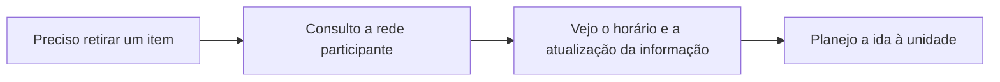
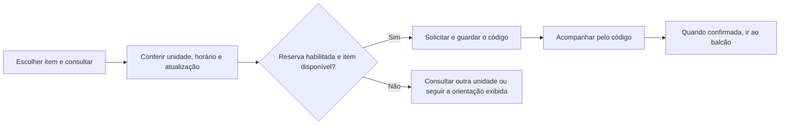
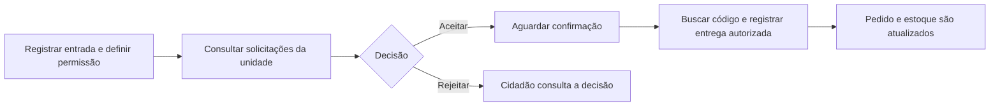
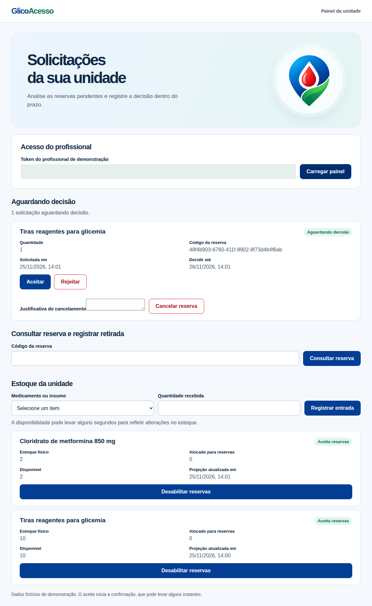

# GlicoAcesso — Apresentação da Solução

## Conheça o GlicoAcesso

O GlicoAcesso é um protótipo desenvolvido para ajudar pessoas com diabetes e seus cuidadores a planejar a retirada de medicamentos e insumos em unidades de saúde participantes.

A pessoa consulta em um portal quais unidades informaram disponibilidade, quando o dado foi atualizado, onde fica a unidade e quais orientações deve seguir. Onde a reserva estiver habilitada, ela pode solicitar o item, acompanhar a decisão e apresentar o código no balcão. Do outro lado, a equipe da unidade tem um painel para organizar solicitações, registrar entradas e dar baixa na entrega pelo mesmo fluxo.

O diferencial é reunir **informação de disponibilidade, orientações da unidade e acompanhamento da reserva**. Para uma rede municipal ou instituição parceira, a proposta também oferece um ponto de partida para organizar como suas unidades publicam e mantêm essa informação.

## Etapa 1 — Entendendo o problema e construindo a solução

A proposta surgiu de uma situação cotidiana. Uma pessoa precisa retirar tiras reagentes ou outro item que já usa. Antes de sair, precisa descobrir onde é atendida, em que horário e se a informação de disponibilidade é recente. Para quem mora longe, depende de transporte ou precisa de um cuidador, uma viagem sem retirada traz custo e exige reorganizar a rotina.

A International Diabetes Federation estimou que **16,6 milhões de pessoas de 20 a 79 anos viviam com diabetes no Brasil em 2024**. Em uma análise da Pesquisa Nacional de Saúde de 2019, **69,7% da obtenção de insulina observada no estudo ocorreu pelo serviço público**. Esses dados ajudam a dimensionar a necessidade de localizar os serviços de dispensação e entender como acessá-los. [IDF Diabetes Atlas](https://idf.org/our-network/regions-and-members/south-and-central-america/members/brazil/) · [Estudo publicado pela Fiocruz](https://periodicos.fiocruz.br/pt-br/node/41168)

Em setembro de 2026, o projeto definiu a marca, o público e o primeiro desenho da jornada. O escopo inicial foi uma rede participante, com a atualização feita pelas próprias unidades e participação de dois públicos, quem precisa retirar e quem atende. O protótipo atual preserva essa ideia e acrescenta a confirmação, o cancelamento e o registro de entrega. [Concepção e identidade do projeto](parte-1-concepcao-e-pitch.md)

### Como acompanhar o impacto

| O que a rede quer melhorar | O que pode acompanhar em um piloto |
| --- | --- |
| Tempo gasto para encontrar um ponto de atendimento | Tempo da primeira busca até a localização de uma unidade apta. |
| Viagens que terminam sem retirada | Percentual de usuários que consultaram, foram à unidade e saíram sem o item. |
| Previsibilidade da retirada | Proporção de solicitações confirmadas e intervalo entre pedido e entrega. |
| Organização da unidade | Solicitações concluídas, recusadas ou vencidas, por unidade. |
| Experiência de quem usa | Avaliação após a retirada e continuidade das retiradas de rotina. |

Esses indicadores foram propostos para acompanhar um piloto. Os materiais disponíveis ainda não trazem resultados medidos em unidades reais.

## Etapa 2 — Desenvolvimento de uma solução confiável

Em outubro, o projeto descreveu como dividir as responsabilidades. Um módulo mantém as informações das unidades, outro controla o estoque, outro acompanha os pedidos e outro registra as entregas. Essa organização permite atualizar cadastro, estoque ou fluxo de atendimento com responsabilidades definidas.

| Experiência ou controle | O que isso significa para quem usa |
| --- | --- |
| Portal do cidadão | Reúne endereço, horário, orientações, disponibilidade informada e acompanhamento da própria reserva. |
| Painel da unidade | Mostra as operações e quantidades necessárias ao trabalho de profissionais vinculados à unidade. |
| Confirmação em etapas | O pedido só aparece como confirmado depois que a quantidade é reservada no sistema e a autorização fica pronta. |
| Tratamento de falhas | Numa falha definitiva após a alocação, o sistema libera a quantidade pela sequência apropriada. Enquanto aguarda uma resposta, o pedido pode seguir em processamento. |
| Controle de acesso | A demonstração exige credenciais nas operações protegidas e aplica regras de vínculo, papel e propriedade da solicitação. |

A separação entre os dois públicos foi mantida no executável de novembro. O acompanhamento das etapas de confirmação e cancelamento passou a ter um componente próprio, enquanto o pedido continua registrado em Reservas. A consulta pública exibe o horário da última atualização do saldo, pois alterações recentes podem levar algum tempo para aparecer. [Arquitetura e evolução](parte-2/resumo-arquitetura.md)

## Etapa 3 — Preparação para funcionamento e implantação

A versão publicada em 24 de novembro foi empacotada para instalação local em um ambiente compatível com Docker Compose. A instalação reúne as interfaces, os módulos da aplicação e os serviços que guardam e distribuem as informações. Uma equipe técnica configura as credenciais, inicia o ambiente e pode verificar os serviços pelo roteiro de demonstração.

Depois da instalação, o portal e o painel são acessados por navegador. O cidadão pode abrir a consulta pública. Pedir ou cancelar reserva exige a credencial de cidadão. A operação do painel exige a credencial de profissional da unidade. O cadastro de uma unidade nova é feito pela administração da rede com uma ferramenta separada.

Os dados ficam em armazenamento persistente. Reiniciar a instalação mantendo a configuração e os volumes preserva os registros. A separação dos módulos oferece pontos claros de manutenção e uma base para ampliar a rede em fases. A demonstração atual utiliza unidades e volumes de teste. A operação em uma rede institucional exige pessoas responsáveis pelo cadastro, pelo estoque, pelo atendimento e pela proteção dos dados. [Execução local do protótipo](../README.md#subir-o-sistema-completo-com-docker-compose)

## Etapa 4 — Integração e inteligência artificial

A versão de **25 de novembro de 2026** reúne a busca, a solicitação de reserva, a decisão da unidade, o cancelamento e o registro da entrega. A equipe pode lançar entradas de estoque e habilitar reserva para cada item no painel. Ao concluir uma entrega, o sistema atualiza o andamento visto pelo cidadão e os registros de estoque. Essas atualizações podem aparecer em instantes distintos.

O portal usa **dados cadastrados pelas unidades e atualizações de estoque**, com dados fictícios para a demonstração. O catálogo inicial tem itens do elenco de diabetes do Programa Farmácia Popular do Brasil e os exemplos de teste. O catálogo ajuda a identificar o item. A unidade participante continua sendo a fonte sobre estoque local e orientações de retirada. [Elenco do Ministério da Saúde](https://www.gov.br/saude/pt-br/composicao/sectics/farmacia-popular/arquivos/lista-de-medicamentos-e-insumos-pfpb.pdf/view)

### Recursos de inteligência artificial

A inteligência artificial faz parte da etapa final do projeto e ainda não está disponível nessa versão. A experiência atual oferece orientações registradas, horário de atendimento, disponibilidade e acompanhamento da reserva na tela. A futura integração ainda precisa demonstrar de quais fontes obtém informações, quando consegue responder e como se comporta se uma fonte estiver indisponível.

### Quando uma operação depende de confirmação

Para o usuário, o pedido pode aparecer como solicitado ou em processamento até a unidade e o sistema concluírem as etapas necessárias. Se a autorização não puder ser criada após a reserva da quantidade no estoque, o sistema aciona a liberação e registra a falha da confirmação. Se o profissional já registrou a entrega, o cancelamento tem de respeitar essa entrega. Em uma falha de conexão, os portais exibem feedback. A pessoa pode consultar a reserva novamente pelo código quando o sistema estiver disponível.

## Como funciona na prática

### Jornada de quem precisa retirar um item

Uma cuidadora quer retirar tiras reagentes para uma pessoa que acompanha. No portal, ela escolhe o item, consulta as unidades participantes e verifica o horário, as orientações e a data de atualização. Se a unidade estiver aceitando reservas para aquele item, a cuidadora informa a quantidade e a credencial de demonstração e recebe um código. Ela usa o código para acompanhar o pedido e, após confirmação, planeja a visita.

*Consulta real no protótipo, com uma unidade fictícia.*

### Jornada da equipe da unidade

A unidade recebeu um lote de um medicamento. O profissional entra no painel com a credencial vinculada, lança a entrada, consulta o estoque e define se aceita reservas para aquele item. Quando chega uma solicitação, pode aceitar ou rejeitar. Após confirmação e comparecimento do cidadão, localiza a reserva pelo código e registra a entrega autorizada.

*Painel real do protótipo, com uma reserva e estoque fictícios. O campo de credencial está oculto na captura.*

A administração da rede cadastra novas unidades e informa os dados de atendimento. A equipe usa o painel para a operação diária. Na versão atual, ajustes manuais de saldo e algumas alterações cadastrais estão disponíveis à equipe técnica pela integração da plataforma.

## Benefícios da solução

- **Planejamento da ida à unidade.** O cidadão pode consultar horário, orientações, disponibilidade informada e o andamento do pedido.
- **Organização do atendimento.** A equipe acompanha solicitações pendentes, consulta reservas pelo código e registra a entrega no mesmo fluxo de trabalho.
- **Clareza sobre a atualização do estoque.** O portal mostra quando a disponibilidade exibida foi atualizada. A equipe tem acesso às quantidades físicas, alocadas e disponíveis na visão operacional.
- **Integridade da confirmação e do cancelamento.** A aplicação coordena a reserva da quantidade e a emissão da autorização, com mecanismos para liberar o saldo quando aplicável.
- **Base para manutenção e expansão.** A implantação local padronizada e a divisão das responsabilidades facilitam avaliar a plataforma em uma primeira rede participante.

## Disponibilidade e evolução

| Situação em 25/11/2026 | O que a instituição pode avaliar |
| --- | --- |
| **Protótipo demonstrável localmente** | Portal cidadão, painel da unidade, cadastro administrativo, estoque, reserva, cancelamento e entrega presencial registrada. |
| **Em evolução** | Integração com os sistemas de estoque da rede, contas individuais, preparação operacional para um piloto com unidades reais e desenvolvimento da funcionalidade de IA. |
| **Resultados a medir** | Tempo de busca, deslocamentos sem retirada, prazo entre solicitação e atendimento e satisfação. |

A disponibilidade depende das unidades cadastradas, do item e da informação de estoque mais recente. A proposta é apoiar o acesso à rede participante. A confirmação final da dispensação segue os requisitos da unidade e as orientações dos profissionais responsáveis.
