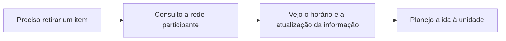
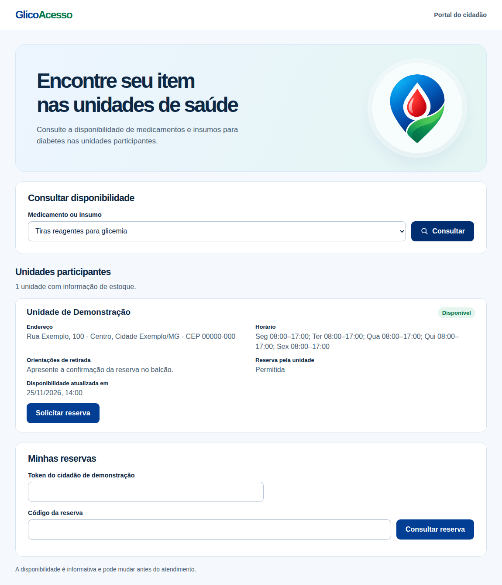

# GlicoAcesso — Documentação para o cliente

O GlicoAcesso é um protótipo que ajuda pessoas com diabetes e seus cuidadores a planejar a retirada de medicamentos e insumos em unidades de saúde participantes. No portal, é possível consultar onde um item aparece como disponível, ver as orientações da unidade e acompanhar uma reserva. A equipe da unidade usa um painel para atualizar o estoque, analisar pedidos e registrar entregas.

## Etapa 1 — Entendendo o problema e construindo a solução

A proposta surgiu de uma situação cotidiana. Uma pessoa precisa retirar tiras reagentes ou outro item que já usa. Antes de sair, precisa descobrir onde é atendida, em que horário e se a informação de disponibilidade é recente. Para quem mora longe, depende de transporte ou precisa de um cuidador, uma viagem sem retirada traz custo e exige reorganizar a rotina.

A International Diabetes Federation estimou que **16,6 milhões de pessoas de 20 a 79 anos viviam com diabetes no Brasil em 2024**. Em uma análise da Pesquisa Nacional de Saúde de 2019, **69,7% da obtenção de insulina observada no estudo ocorreu pelo serviço público**. Esses dados ajudam a dimensionar a necessidade de localizar os serviços de dispensação e entender como acessá-los. [IDF Diabetes Atlas](https://idf.org/our-network/regions-and-members/south-and-central-america/members/brazil/) · [Estudo publicado pela Fiocruz](https://periodicos.fiocruz.br/pt-br/node/41168)

Em setembro de 2026, o projeto definiu a marca, o público e o primeiro desenho da jornada. O escopo inicial foi uma rede participante, com a atualização feita pelas próprias unidades e participação de dois públicos, quem precisa retirar e quem atende. O protótipo atual preserva essa ideia e acrescenta a confirmação, o cancelamento e o registro de entrega. [Concepção e identidade do projeto](parte-1-concepcao-e-pitch.md)

### Como acompanhar o impacto

| O que a rede quer melhorar | O que pode acompanhar em um piloto |
| --- | --- |
| Tempo gasto para encontrar um ponto de atendimento | Tempo da primeira busca até a localização de uma unidade apta. |
| Viagens que terminam sem retirada | Percentual de usuários que consultaram, foram à unidade e saíram sem o item. |
| Previsibilidade da retirada | Proporção de solicitações confirmadas e intervalo entre pedido e entrega. |
| Organização da unidade | Solicitações concluídas, recusadas ou vencidas, por unidade. |
| Experiência de quem usa | Avaliação após a retirada e continuidade das retiradas de rotina. |

Esses indicadores foram propostos para acompanhar um piloto. Os materiais disponíveis ainda não trazem resultados medidos em unidades reais.

## Etapa 2 — Desenvolvimento de uma solução confiável

Em outubro, o projeto descreveu como dividir as responsabilidades. Um módulo mantém as informações das unidades, outro controla o estoque, outro acompanha os pedidos e outro registra as entregas. Essa organização permite atualizar cadastro, estoque ou fluxo de atendimento com responsabilidades definidas.

| Experiência ou controle | O que isso significa para quem usa |
| --- | --- |
| Portal do cidadão | Reúne endereço, horário, orientações, disponibilidade informada e acompanhamento da própria reserva. |
| Painel da unidade | Mostra as operações e quantidades necessárias ao trabalho de profissionais vinculados à unidade. |
| Confirmação em etapas | O pedido só aparece como confirmado depois que a quantidade é reservada no sistema e a autorização fica pronta. |
| Tratamento de falhas | Numa falha definitiva após a alocação, o sistema libera a quantidade pela sequência apropriada. Enquanto aguarda uma resposta, o pedido pode seguir em processamento. |
| Controle de acesso | A demonstração exige credenciais nas operações protegidas e aplica regras de vínculo, papel e propriedade da solicitação. |

A separação entre os dois públicos foi mantida no executável de novembro. O acompanhamento das etapas de confirmação e cancelamento passou a ter um componente próprio, enquanto o pedido continua registrado em Reservas. A consulta pública exibe o horário da última atualização do saldo, pois alterações recentes podem levar algum tempo para aparecer. [Arquitetura e evolução](parte-2/resumo-arquitetura.md)

## Etapa 3 — Preparação para funcionamento e implantação

O projeto passou a usar Docker Compose para iniciar a demonstração em um computador preparado pela equipe técnica. A instalação reúne as interfaces, os módulos da aplicação e os serviços que guardam e distribuem as informações. Uma equipe técnica configura as credenciais, inicia o ambiente e pode verificar os serviços pelo roteiro de demonstração.

Depois da instalação, o portal e o painel são acessados por navegador. O cidadão pode abrir a consulta pública. Solicitar, acompanhar ou cancelar uma reserva exige a credencial de cidadão. A operação do painel exige a credencial de profissional da unidade. O cadastro de uma unidade nova é feito pela administração da rede com uma ferramenta separada.

Os dados ficam em armazenamento persistente. Reiniciar a instalação mantendo a configuração e os volumes preserva os registros. A separação dos módulos oferece pontos claros de manutenção e uma base para ampliar a rede em fases. A demonstração atual utiliza unidades e volumes de teste. A operação em uma rede institucional exige pessoas responsáveis pelo cadastro, pelo estoque, pelo atendimento e pela proteção dos dados. [Instalação local](DOCUMENTACAO_TECNICA.md#executar-do-zero)

## Etapa 4 — Integração e orientação ao cidadão

Nesta etapa, a demonstração reúne o caminho completo. O cidadão consulta o item e solicita a reserva. A equipe da unidade decide, acompanha o estoque e registra a entrega. O cidadão pode verificar o resultado pelo código e pedir ajuda no portal para entender como seguir em cada momento.

O catálogo inicial inclui itens do elenco de diabetes do Programa Farmácia Popular do Brasil, além dos exemplos criados para a demonstração. O catálogo ajuda a identificar o item. As unidades participantes fornecem as informações sobre disponibilidade, horário e retirada. [Elenco do Ministério da Saúde](https://www.gov.br/saude/pt-br/composicao/sectics/farmacia-popular/arquivos/lista-de-medicamentos-e-insumos-pfpb.pdf/view)

### Portal do cidadão

1. Escolha um medicamento ou insumo e clique em **Consultar**.
2. Confira as unidades encontradas, o endereço, o horário de atendimento, as orientações e quando a disponibilidade foi atualizada.
3. Se o item estiver disponível e a unidade aceitar reservas, use a credencial de demonstração, informe a quantidade e envie a solicitação. Guarde o código da reserva.
4. Em **Minhas reservas**, consulte o pedido pelo código. Quando estiver confirmado, siga as orientações da unidade e leve o código ao balcão. Se precisar cancelar, use a opção quando ela estiver disponível e consulte o andamento novamente.

#### Por que a consulta mostra duas informações sobre o item

A **disponibilidade** indica se havia saldo para aquele item na última atualização exibida. A **permissão de reserva** indica se a unidade aceita pedidos pelo portal para aquele item. Uma unidade pode ter saldo e atender diretamente no balcão, conforme as orientações que cadastrou. A data e a hora ajudam a avaliar quão recente é o dado antes de planejar a visita.

#### Por que é preciso acompanhar a reserva

Ao enviar a solicitação, o cidadão recebe um código para consultar aquele pedido. A equipe tem um prazo para analisar a solicitação. Quando ela aceita, o sistema ainda precisa separar a quantidade no estoque e preparar a autorização de retirada. Quando as duas etapas terminam, o portal mostra a confirmação.

| Situação do pedido | O que fazer |
| --- | --- |
| Solicitado ou em confirmação | Guarde o código e consulte novamente em **Minhas reservas**. |
| Confirmado | Confira as instruções da unidade e leve o código ao balcão. |
| Rejeitado, expirado ou com falha na confirmação | Consulte novamente as unidades para verificar as opções disponíveis. |
| Cancelamento em andamento | Consulte pelo código até o portal mostrar o resultado. |
| Retirado | A unidade já registrou a entrega. |

*Exemplo de consulta com dados fictícios.*

#### Orientação sobre o item

A orientação existe para ajudar quando uma dúvida surge no meio do caminho. Por exemplo, a pessoa pode ter encontrado uma unidade e ainda precisar saber como confirmar o andamento ou o que levar na retirada. O recurso consulta os guias do GlicoAcesso para responder em linguagem direta.

Com o item selecionado e a credencial informada em **Minhas reservas**, use **Pedir orientação**. Uma pergunta de exemplo é *“Qual código devo levar ao balcão e onde vejo as orientações para retirar uma reserva confirmada?”*

Quando a resposta usa os guias, o portal mostra os títulos e as seções consultadas para indicar de onde vieram as instruções. A disponibilidade aparece em uma área própria porque vem dos registros de estoque do sistema. Ali é possível conferir a unidade, a permissão para reservar e o horário da última atualização. Se a resposta automática estiver indisponível, a tela indica como continuar pela consulta comum ou por **Minhas reservas**.

Use esse recurso para dúvidas sobre o funcionamento do GlicoAcesso e evite incluir dados pessoais na pergunta. Para dúvidas sobre tratamento, procure um profissional de saúde. Para acompanhar um pedido específico, use o código em **Minhas reservas**.

### Painel da unidade

1. Informe a credencial da unidade e clique em **Carregar painel**.
2. Em **Estoque da unidade**, registre as entradas e ajuste a permissão de reserva para cada item.
3. Em **Aguardando decisão**, aceite ou rejeite as solicitações da unidade. Após o aceite, o pedido pode levar alguns instantes para aparecer como confirmado.
4. Em **Consultar reserva e registrar retirada**, procure o pedido pelo código. Quando a entrega estiver autorizada, registre a retirada no balcão. Se precisar cancelar um pedido e a opção estiver disponível, informe o motivo no painel.

#### Por que a equipe registra cada etapa

- **Entrada e permissão de reserva.** A entrada registra o que chegou à unidade. A permissão permite à equipe escolher, por item, se aceita solicitações pelo portal.
- **Decisão sobre o pedido.** O aceite inicia a separação da quantidade e a preparação da autorização. Assim, a quantidade reservada fica separada do saldo que pode atender outros pedidos.
- **Entrega no balcão.** O código vincula o atendimento ao pedido certo. Ao registrar a entrega, o sistema atualiza o pedido, desconta o que saiu do estoque físico e encerra a separação daquela quantidade. A equipe pode ver essas atualizações em momentos diferentes.

A administração da rede cadastra novas unidades por uma ferramenta própria. A equipe de cada unidade cuida da operação diária no painel.

*Exemplo de painel com dados fictícios.*

### O que o vídeo da Etapa 4 vai mostrar

1. A inicialização do ambiente local com Docker e a abertura do portal do cidadão e do painel da unidade.
2. A consulta a um item, o pedido de reserva, o aceite pela unidade e o acompanhamento pelo código.
3. O registro da entrega no balcão e a atualização da reserva e do estoque.
4. Uma pergunta ao recurso de orientação, com a fonte do guia e os dados de disponibilidade exibidos na tela.

## O que uma instituição pode avaliar em um piloto

A demonstração usa dados fictícios em uma instalação local. Em um piloto, a rede pode acompanhar se as pessoas encontram uma unidade com mais facilidade, quantas viagens terminam sem retirada e quanto tempo decorre entre o pedido e o atendimento. Esses dados ajudam a decidir se o serviço melhora a rotina de quem retira e de quem atende.

Para manter as informações úteis, a rede precisa definir quem atualiza o cadastro, os horários, as orientações e o estoque de cada unidade. A dispensação segue os requisitos e as orientações da unidade responsável.

[Documentação técnica e preparação do ambiente](DOCUMENTACAO_TECNICA.md#roteiro-técnico-do-vídeo)
