# GlicoAcesso — Documentação Técnica


## Sumário

- [Visão geral do projeto](#visão-geral-do-projeto)
- [Etapa 1 — Concepção e fundamentação](#etapa-1--concepção-e-fundamentação)
- [Etapa 2 — Arquitetura e projeto do sistema](#etapa-2--arquitetura-e-projeto-do-sistema)
  - [Arquitetura no congelamento](#arquitetura-no-congelamento)
  - [Gateway, BFFs, REST e HATEOAS](#gateway-bffs-rest-e-hateoas)
  - [Persistência, Outbox e CQRS](#persistência-outbox-e-cqrs)
  - [SAGA e compensações](#saga-e-compensações)
- [Etapa 3 — Infraestrutura e implantação](#etapa-3--infraestrutura-e-implantação)
  - [Executar do zero](#executar-do-zero)
- [Etapa 4 — Integração final e inteligência artificial](#etapa-4--integração-final-e-inteligência-artificial)
  - [Fluxos implementados](#fluxos-implementados)
  - [Inteligência artificial e avaliação](#inteligência-artificial-e-avaliação)
  - [Roteiro técnico do vídeo](#roteiro-técnico-do-vídeo)
- [Visão consolidada do sistema](#visão-consolidada-do-sistema)
  - [Arquitetura e dados atuais](#arquitetura-e-dados-atuais)
  - [Catálogo de APIs](#catálogo-de-apis)
  - [Segurança e operação](#segurança-e-operação)
  - [Testes e evidências](#testes-e-evidências)
- [Matriz de atendimento aos requisitos](#matriz-de-atendimento-aos-requisitos)
- [Histórico de evolução e contribuições](#histórico-de-evolução-e-contribuições)
- [Pendências e limitações](#pendências-e-limitações)
- [Referências](#referências)

## Visão geral do projeto

O GlicoAcesso é uma startup fictícia desenvolvida na disciplina de Sistemas Distribuídos. Sua proposta é facilitar a localização, a reserva e a retirada de medicamentos e insumos para diabetes em unidades participantes. O cidadão consulta onde o item consta como disponível e acompanha a solicitação. A unidade mantém seus dados operacionais, gerencia saldo e reservas e registra a entrega presencial. Um gestor de rede cadastra unidades pela interface administrativa de linha de comando.

O público inclui pessoas com diabetes, familiares, cuidadores, profissionais de dispensação e gestores da rede participante. O escopo inicial é uma rede local, com dados de demonstração no protótipo. O trabalho corresponde a 70% da nota da disciplina. A equipe é formada por **Arthur Soares Marques, Guilherme Lirio Miranda, Lana da Silva Miranda e Marcos Vinícius Pereira**. [README do projeto](../README.md)

**Estado em 26/11/2026.** A `main` conferida em `a2628ab` inclui as correções do backend e a orientação ao cidadão com RAG. O Compose principal reúne oito aplicações HTTP, cinco PostgreSQL e RabbitMQ. O perfil de orientação acrescenta a nona aplicação e um PostgreSQL com pgvector. O Gateway serve os dois portais. [Revisão conferida](https://github.com/ArthurDp78/GlicoAcesso/commit/a2628ab1863755d417838ad73af34ef4aefef2fd) · [`docker-compose.yml`](../docker-compose.yml) · [`compose.orientacao.yml`](../compose.orientacao.yml)

| Marco | Data de referência, horário de Brasília | Evidência disponível |
| --- | --- | --- |
| 1 · Proposta | 17/09/2026 | README, pitch, fundamentação e identidade visual no [snapshot de 17/09](https://github.com/ArthurDp78/GlicoAcesso/tree/422b9ce). |
| 2 · Arquitetura | Congelamento em 21/10 às 23h59. Apresentações em 22 e 27/10. | [Projeto congelado](https://github.com/ArthurDp78/GlicoAcesso/tree/b059d68). [Dois reparos Mermaid em 22/10](https://github.com/ArthurDp78/GlicoAcesso/compare/b059d68...1ca8bef). |
| 3 · Infraestrutura | 17/11/2026 | A última revisão de `main` até a data era [`1ca8bef`](https://github.com/ArthurDp78/GlicoAcesso/tree/1ca8bef). O executável e o Compose entraram nos dias 24 e 25/11. |
| 4 · Integração e IA | Demonstração em 26/11/2026 | [Versão da main](https://github.com/ArthurDp78/GlicoAcesso/tree/a2628ab) · [Roteiro técnico do vídeo](#roteiro-técnico-do-vídeo) |

A reconstrução usa a primeira linha de ancestralidade de `main` para os cortes de entrega e as referências locais e remotas disponíveis para as contribuições. Esses cortes identificam o conteúdo versionado naquela data. Registros de apresentação, avaliações e materiais fora do repositório dependem de evidência própria.

## Etapa 1 — Concepção e fundamentação

### Problema, identidade e proposta de valor

A primeira etapa registrou a marca GlicoAcesso, o logotipo em duas versões e a frase de apresentação “Encontre, reserve e continue seu cuidado”. O pitch apresenta uma pessoa que precisa retirar um item já prescrito e que, antes de sair de casa, precisa localizar uma unidade, confirmar horário e entender como funciona a retirada. Idosos, pessoas de baixa renda, moradores distantes das unidades, familiares e cuidadores são públicos particularmente expostos ao custo de viagens repetidas. [Pitch no corte de setembro](https://github.com/ArthurDp78/GlicoAcesso/blob/422b9ce/docs/parte-1-concepcao-e-pitch.md) · [Identidade visual original](../identidade-visual/logo.png)

A proposta reuniu em uma busca o item, a unidade, o endereço, o horário, as instruções e o momento da última atualização. Quando a unidade habilitasse reservas, o cidadão poderia solicitar pelo portal, aguardar a decisão e usar o código na retirada. A unidade cuidaria de cadastro, disponibilidade, decisão e registro da entrega. A origem proposta era a atualização pelas unidades, com integração a controles de estoque locais como possibilidade futura. Dados simulados seriam usados no desenvolvimento inicial.

O recorte é operacional, em torno do acesso a itens já prescritos. Uma unidade participante continua responsável pelos requisitos de dispensação. Disponibilidade informada e uma reserva confirmada são estados distintos, sujeitos às regras locais e à atualização dos dados.

### Fundamentação do problema

| Fonte | Evidência usada no projeto | Alcance |
| --- | --- | --- |
| International Diabetes Federation, *Diabetes Atlas* | Estimativa de **16,6 milhões** de pessoas de 20 a 79 anos com diabetes no Brasil em 2024. | Dimensiona o público potencial. [IDF](https://idf.org/our-network/regions-and-members/south-and-central-america/members/brazil/) |
| Leal, Galvão e Roncalli (2024), análise da PNS 2019 | O serviço público respondeu por **69,7%** da obtenção de insulina observada no estudo, com desigualdades associadas a fatores como renda, raça/cor e cobertura de saúde. | Evidência sobre vias de obtenção na população estudada. [Fiocruz](https://periodicos.fiocruz.br/pt-br/node/41168) |
| Nascimento et al. (2017), PNAUM–Serviços | Disponibilidade média de **52,9%** para um conjunto de medicamentos traçadores observados na atenção primária do SUS em amostra de 273 municípios. | Retrato da amostra e do conjunto de traçadores. [Revista de Saúde Pública](https://revistas.usp.br/rsp/pt_BR/article/view/139736) |
| Ministério da Saúde | Distribuição e dispensação de insulinas humanas e agulhas envolvem responsabilidades dos entes e procedimentos locais. | Contextualiza a existência de diferentes unidades e orientações. [Ministério da Saúde](https://www.gov.br/saude/pt-br/composicao/sectics/daf/cbaf/insulinas-humanas) |
| Brasil, Lei nº 14.654/2023 | Prevê divulgação eletrônica dos estoques de medicamentos das farmácias públicas do SUS com atualização quinzenal. | Contexto de transparência. [Lei nº 14.654/2023](https://legis.senado.leg.br/norma/37511268/publicacao/37513960) |
| Meiners et al. (2017), PNAUM | Estudo de acesso, gratuidade e adesão a medicamentos entre pessoas com diabetes. | Apoia o contexto da proposta. O DOI e o ano foram corrigidos na documentação posterior. [Revista Brasileira de Epidemiologia](https://www.scielo.br/j/rbepid/a/gjRBy6Q3mX6rnSK8frkTJbv/?lang=pt) |

### Escopo e impacto esperado

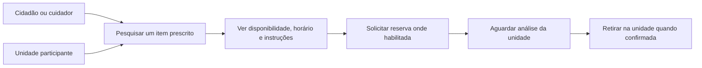

O diagrama representa a **proposta de setembro**. O README já esboçava quatro domínios de software. O material arquivado inclui a contextualização, um cenário ilustrativo, um pitch distribuído em quatro falas, a identidade visual e as referências. No corte de 17/09, o repositório continha esses documentos e a licença, sem sistema executável.

| Objetivo | Indicador proposto | Evidência a coletar em um piloto |
| --- | --- | --- |
| Localizar um ponto de retirada com menos esforço | Tempo da primeira busca à localização de uma unidade apta | Registro da jornada de busca e confirmação do usuário. |
| Reduzir viagens improdutivas | Percentual de viagens iniciadas após consulta que terminam sem retirada | Pesquisa após a visita, inclusive para quem deixou de usar o portal. |
| Dar previsibilidade às solicitações | Confirmadas sobre solicitações e tempo entre pedido e entrega | Estados, timestamps e identificadores de reserva, com recorte por unidade. |
| Organizar atendimento e recorrência | Solicitações concluídas, rejeitadas ou expiradas, continuidade das retiradas e satisfação | Histórico operacional e questionário voluntário após o atendimento. |

São indicadores propostos. O histórico disponível não traz linha de base, piloto controlado ou efeitos clínicos medidos. A evolução posterior refinou a linguagem sobre projeção, explicação de origem do catálogo e fluxos de cadastro, manutenção e retirada. Também corrigiu a referência de Meiners. [Concepção atual](parte-1-concepcao-e-pitch.md) · [Revisão de novembro](https://github.com/ArthurDp78/GlicoAcesso/commit/1360333)

## Etapa 2 — Arquitetura e projeto do sistema

### Arquitetura no congelamento

O desenho congelado em 21/10 organizava os quatro domínios em serviços com propriedade exclusiva de dados. **Unidades** responde sobre a rede e suas regras de atendimento. **Estoque** detém catálogo, saldos e alocações. **Reservas** detém a solicitação e, nesse desenho, coordenava a SAGA. **Retiradas** prepara autorização e responde pelo registro da entrega. Essas fronteiras evitam que o portal tenha de combinar dados internamente ou que a entrega dependa de escritas em bancos alheios. [Diagrama original](https://github.com/ArthurDp78/GlicoAcesso/blob/b059d68/docs/parte-2/02-diagrama-arquitetura.md)

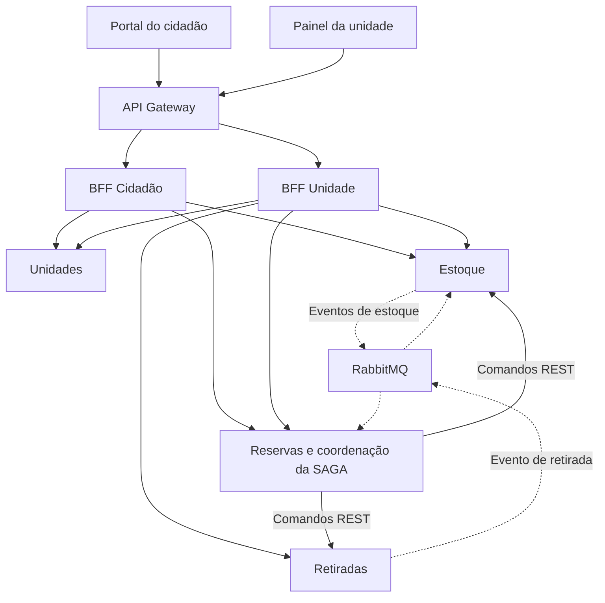

REST atende consultas e comandos que precisam de resposta de um serviço proprietário. RabbitMQ transporta fatos após confirmação de uma transação local. No congelamento, havia quatro bancos projetados, seis arquivos OpenAPI e diagramas lógicos. Em 22/10 dois commits ajustaram a sintaxe dos diagramas da SAGA. Provedor de identidade, topologia de implantação, endereços e parâmetros de execução ainda estavam abertos. A separação do Orquestrador, seu banco próprio e o terceiro consumidor do evento de retirada pertencem à revisão posterior. [Resumo no congelamento](https://github.com/ArthurDp78/GlicoAcesso/blob/b059d68/docs/parte-2/resumo-arquitetura.md) · [Revisão arquitetural de 24/11](https://github.com/ArthurDp78/GlicoAcesso/compare/1ca8bef...3ecb975)

### Gateway, BFFs, REST e HATEOAS

O Gateway concentra a entrada e encaminha as combinações de caminho e método registradas. O BFF Cidadão combina o cadastro e a projeção de estoque por unidade e encaminha as perguntas ao serviço de Orientação. O BFF Unidade apresenta saldos, alocações, solicitações e, para uma reserva confirmada com autorização ativa, a ação de registrar a entrega. [`servicos/gateway/rotas.py`](../servicos/gateway/rotas.py) · [`servicos/bff_cidadao/main.py`](../servicos/bff_cidadao/main.py) · [`servicos/bff_unidade/reservas.py`](../servicos/bff_unidade/reservas.py)

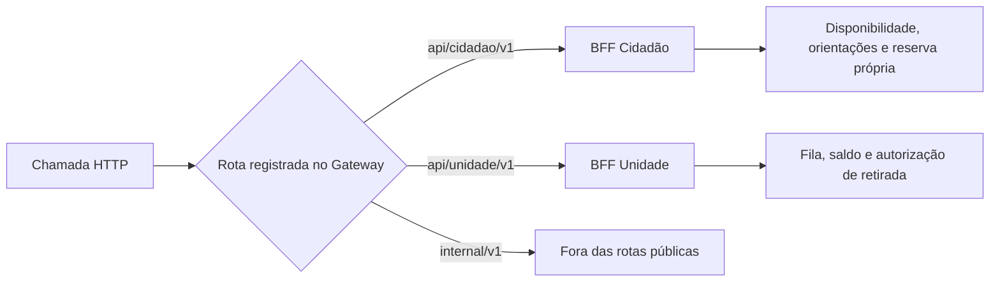

Os prefixos versionados são `/api/cidadao/v1`, `/api/unidade/v1` e `/internal/v1`. Os contratos distinguem consultas `GET`, criações e comandos `POST`, substituições de estado cadastral `PUT`, atualização de situação `PATCH` e liberação de alocação `DELETE`. `201` indica criação, `202` indica processamento aceito, `204` indica conclusão sem corpo, e `409` indica incompatibilidade de estado ou conflito de idempotência. Consulte o [catálogo](#catálogo-de-apis) para autenticação e respostas por operação.

HATEOAS coloca em `_links` o método, a rota e, no painel, o corpo quando necessário. O cidadão recebe `self` e pode receber `cancelar`. A unidade pode receber `aceitar`, `rejeitar` e `cancelar`, além de `autorizacao-retirada` quando a reserva está confirmada e a autorização ativa. O cliente monta as ações com esses links. Reservas e Retiradas revalidam o estado ao receber o comando. [`servicos/bff_cidadao/main.py`](../servicos/bff_cidadao/main.py) · [`servicos/bff_unidade/reservas.py`](../servicos/bff_unidade/reservas.py) · [`servicos/reservas/main.py`](../servicos/reservas/main.py) · [`servicos/retiradas/entregas.py`](../servicos/retiradas/entregas.py)

**Rastreio no código atual.** O [Gateway](../servicos/gateway/main.py) repassa método, corpo, parâmetros e cabeçalhos selecionados. [BFF Cidadão](../servicos/bff_cidadao/main.py) e [BFF Unidade](../servicos/bff_unidade/main.py) compõem as respostas. Consulte o mesmo UUID pelos dois caminhos de reserva com as credenciais de demonstração compatíveis para comparar os contratos. O BFF Cidadão faz uma requisição por unidade ativa na busca, com concorrência limitada a 12. Um par sem projeção é omitido. A indisponibilidade de uma dependência pode interromper toda a busca. Os BFFs podem apresentar o detalhe da reserva com complementos ausentes em falhas temporárias. No painel, a consulta da autorização é exigida para uma reserva confirmada. [`servicos/bff.py`](../servicos/bff.py) · [`servicos/bff_unidade/reservas.py`](../servicos/bff_unidade/reservas.py) [Projeto do Gateway](parte-2/03-api-gateway.md) · [Projeto dos BFFs](parte-2/04-bffs.md) · [HATEOAS](parte-2/07-hateoas.md)

### Persistência, Outbox e CQRS

**Banco por serviço.** O desenho previa quatro PostgreSQL independentes. Transações, unicidade, chaves locais e restrições de saldo apoiam a integridade de cada domínio. Identificadores de outros domínios são referências mantidas via API ou eventos. A revisão posterior acrescentou o banco do Orquestrador para separar estado de execução do estado de negócio. A topologia atual pode ser demonstrada no Compose consultando o banco próprio de cada serviço. [Projeto de bancos](parte-2/09-bancos.md) · [Topologia atual](#arquitetura-e-dados-atuais)

**Consistência eventual e Transactional Outbox.** Gravar a entrega em PostgreSQL e publicar separadamente no broker cria um dual write. Uma falha entre as duas ações poderia perder o fato ou publicar um efeito que o banco não confirmou. O desenho registra o efeito e o evento na mesma transação local e delega a publicação posterior ao worker. O padrão se aplica à entrega física em Retiradas e às alterações de saldo em Estoque. A Inbox registra consumo por par consumidor/evento junto da aplicação local. Se a publicação for confirmada e o status da Outbox não puder ser gravado, a mesma mensagem pode sair novamente. [`servicos/retiradas/entregas.py`](../servicos/retiradas/entregas.py) · [`servicos/estoque/saldos.py`](../servicos/estoque/saldos.py) · [`servicos/mensageria.py`](../servicos/mensageria.py)

**CQRS de Estoque.** O saldo e as alocações atendem aos comandos. A tabela `disponibilidade` atende à leitura no mesmo PostgreSQL, com esquema e atualização separados. O consumidor usa o snapshot de saldo no evento, a identidade do evento e a versão crescente por par unidade/item. A disponibilidade é o físico menos o alocado. Uma baixa de retirada reduz as duas parcelas na mesma quantidade, pois a disponibilidade já havia sido reduzida na alocação. O instante `atualizadoEm` pertence ao estado projetado. O projeto definiu cerca de **5 s** em condições normais como meta de defasagem. O script de validação usa uma janela de espera de 60 s, e o repositório não publica medições dessa meta. [Consistência e dual write](parte-2/10-consistencia.md) · [Outbox e Inbox](parte-2/11-outbox.md) · [CQRS](parte-2/12-cqrs.md)

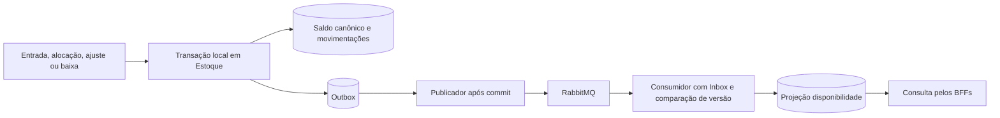

No código, [eventos de Estoque](../servicos/estoque/eventos.py) gravam e projetam o estado, [Retiradas](../servicos/retiradas/main.py) grava o evento de entrega, [mensageria](../servicos/mensageria.py) implementa publicação e consumo. Para demonstrar, registre uma entrada pelo painel e observe a alteração saindo da resposta da escrita e aparecendo na consulta. Use a disponibilidade projetada para informar a busca e o saldo canônico para validar o comando. Falhas do broker podem atrasar a projeção, e mensagens inválidas exigem inspeção da fila de erro.

### SAGA e compensações

Uma SAGA coordena transações locais de vários serviços e usa comandos compensatórios quando uma transação posterior não pode ser concluída. A equipe escolheu orquestração para tornar explícita a ordem de alocação, autorização e confirmação, simplificar a auditoria e concentrar decisões sobre falha. Na alternativa coreografada os serviços reagiriam a eventos de etapa e distribuiriam essas decisões. A ordem continua explícita na implementação de novembro, agora em um Orquestrador independente. [Decisão original](https://github.com/ArthurDp78/GlicoAcesso/blob/b059d68/docs/parte-2/06-saga.md)

| Resultado projetado em outubro | Decisão |
| --- | --- |
| Caminho feliz | Reservas coordena, Estoque aloca, Retiradas autoriza e Reservas confirma. |
| Recusa de estoque | Encerra a confirmação em falha sem criar autorização. |
| Recusa conclusiva de autorização após alocação | Libera a quantidade alocada e conclui a compensação. |
| Autorização possivelmente criada em falha definitiva posterior | Revoga a autorização antes de liberar a alocação. |
| Timeout ou resposta perdida | Repete o comando com chave e conteúdo idempotentes para recuperar o resultado. |

Os diagramas históricos explicitam os participantes e a ordem. [Caminho feliz no corte de outubro](https://github.com/ArthurDp78/GlicoAcesso/blob/b059d68/docs/parte-2/diagramas/saga-caminho-feliz.md) · [Compensação no corte de outubro](https://github.com/ArthurDp78/GlicoAcesso/blob/b059d68/docs/parte-2/diagramas/saga-compensacao.md) · [Correções dos diagramas em 22/10](https://github.com/ArthurDp78/GlicoAcesso/compare/b059d68...1ca8bef)

A seção [Fluxos implementados](#fluxos-implementados) traz esses caminhos no executável, aponta o executor e descreve como reproduzi-los. O custo da coordenação explícita é operar um trabalhador durável e lidar com estados intermediários, indisponibilidade temporária e reconciliação. Os componentes de borda encaminham ou compõem respostas. O coordenador detém o progresso da transação distribuída.

## Etapa 3 — Infraestrutura e implantação

### Corte de novembro e evolução posterior

Na data de apresentação de **17/11**, o histórico disponível ainda terminava nos ajustes de diagramas de 22/10. Os arquivos de implantação e testes atuais documentam a execução **posterior à data da etapa**. Em 24/11 entraram a base Python, as primeiras rotas e portais, a SAGA, o primeiro consumidor CQRS, oito Dockerfiles e o Compose. Em 25/11 foram integrados cancelamento, eventos de retirada, mais consumidores e a verificação da compensação. O README passou a orientar a execução pela `main`. [Primeira base Python](https://github.com/ArthurDp78/GlicoAcesso/commit/db56a65) · [Dockerfiles](https://github.com/ArthurDp78/GlicoAcesso/commit/8b265b7) · [Compose](https://github.com/ArthurDp78/GlicoAcesso/commit/3cf7772) · [Validação](https://github.com/ArthurDp78/GlicoAcesso/commit/b4c2130)

As capturas de 25/11 mostram a consulta pública e o painel com uma solicitação pendente. Um vídeo de apresentação entrou no repositório no commit `973cbb4`, anterior aos merges de backend e RAG. A data, a participação e a execução da apresentação de 17/11 exigem evidência própria. [Portal do cidadão](assets/portal-cidadao.png) · [Painel da unidade](assets/painel-unidade.png) · [Vídeo versionado de 25/11](../v%C3%ADdeo/video-sistemas-distribuidos.mp4)

### Topologia Compose

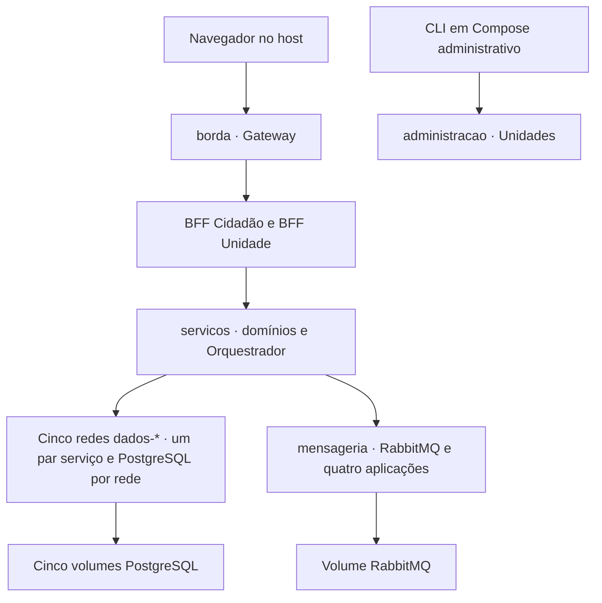

O diagrama resume as redes do [Compose principal](../docker-compose.yml) e do [Compose administrativo](../compose.admin.yml). A CLI é um contêiner avulso no perfil `admin`, com a imagem de Unidades e montagem de arquivo JSON somente leitura. Na rede de mensageria estão Estoque, Retiradas, Reservas, Orquestrador e RabbitMQ. A rede de administração conecta Unidades e a CLI. A rede de serviços conecta os BFFs, os quatro domínios e o Orquestrador. Com exceção de `borda`, as redes do Compose principal são internas.

| Aplicação ou dependência | Porta e exposição no Compose |
| --- | --- |
| Gateway | Contêiner `8000`. Publicação somente em `127.0.0.1:${GLICO_GATEWAY_PORTA:-8000}`. |
| BFF Cidadão e BFF Unidade | `8001` e `8005`, sem publicação no host. |
| Unidades, Estoque, Reservas e Retiradas | `8002`, `8003`, `8004` e `8007`, respectivamente, na rede interna. |
| Orquestrador | `8006`, na rede interna. |
| PostgreSQL 17 | Cinco instâncias, porta interna `5432`, volumes `postgres-unidades`, `postgres-estoque`, `postgres-reservas`, `postgres-orquestrador` e `postgres-retiradas`. |
| Orientação e PostgreSQL com pgvector | Perfil `orientacao`. Serviço HTTP interno em `8008`, banco interno em `5432` e volume `dados-orientacao`. [`compose.orientacao.yml`](../compose.orientacao.yml) |
| RabbitMQ 4 management | AMQP interno em `5672`, volume `rabbitmq`. A interface de administração da imagem também fica sem publicação no host. |

Cada serviço tem seu Dockerfile. São três estágios nomeados, uma base Python 3.14 slim, instalação travada via `uv sync --locked` e runtime com ambiente virtual e código necessário. O `uv` e o cache da instalação ficam na etapa de dependências. As imagens executam com UID/GID 10001. O Gateway carrega os HTML, CSS, JavaScript e a marca. As aplicações persistentes do Compose principal e do perfil de orientação executam as migrações SQL antes de iniciar o Uvicorn. [`servicos/migracoes.py`](../servicos/migracoes.py) · [`compose.orientacao.yml`](../compose.orientacao.yml) O migrador aplica os nomes em ordem, registra cada arquivo aplicado e usa lock transacional. A carga opcional de demonstração roda em Unidades e Estoque. [Dockerfile do Gateway](../servicos/gateway/Dockerfile) · [Dockerfile de Estoque](../servicos/estoque/Dockerfile)

Os bancos usam `pg_isready`, RabbitMQ usa `rabbitmq-diagnostics -q ping` e cada aplicação expõe `/health`. As dependências declaradas usam `service_healthy`. Essas rotas HTTP confirmam a resposta do processo. A subida com `--wait` precisa ser complementada por uma operação real através dos BFFs para atestar disponibilidade funcional de banco, broker e serviços a jusante.

### Configuração

Use `python3 scripts/configurar-compose.py` para criar ou completar o `.env`. O script gera credenciais distintas para campos internos vazios, preserva valores existentes e deixa a chave do provedor a cargo de quem opera a instalação. Conserve as senhas enquanto reutilizar os volumes. [`scripts/configurar-compose.py`](../scripts/configurar-compose.py) · [`.env.example`](../.env.example)

| Variável | Uso |
| --- | --- |
| `POSTGRES_UNIDADES_PASSWORD`, `POSTGRES_ESTOQUE_PASSWORD`, `POSTGRES_RESERVAS_PASSWORD`, `POSTGRES_ORQUESTRADOR_PASSWORD`, `POSTGRES_RETIRADAS_PASSWORD` | Uma senha hexadecimal por banco do Compose principal. |
| `RABBITMQ_PASSWORD` | Senha do broker, usada nas URLs AMQP de Estoque, Reservas, Retiradas e Orquestrador. |
| `GLICO_CIDADAO_TOKEN`, `GLICO_PROFISSIONAL_TOKEN`, `GLICO_PROFISSIONAL_UNIDADE_ID` | Credenciais dos portais e vínculo do profissional com a unidade de demonstração. |
| `GLICO_BFF_CIDADAO_TOKEN`, `GLICO_BFF_UNIDADE_TOKEN` | Credenciais técnicas distintas dos BFFs. As chamadas protegidas entre serviços podem incluir a identidade do ator autenticado em cabeçalhos internos. |
| `GLICO_RESERVAS_SERVICE_TOKEN`, `GLICO_ORQUESTRADOR_SERVICE_TOKEN`, `GLICO_RETIRADAS_SERVICE_TOKEN` | Credenciais dos serviços para validação de reserva, execução da SAGA e leitura do estado canônico antes da entrega. |
| `GLICO_ADMIN_SERVICE_TOKEN` | Cadastro de unidades pela CLI e administração interna do catálogo. |
| `GLICO_GATEWAY_PORTA`, `GLICO_REDE_ADMINISTRATIVA`, `GLICO_CARREGAR_DEMO`, `GLICO_FALHA_PREPARAR_AUTORIZACAO` | Porta local, nome da rede administrativa, carga fictícia e injeção de falha de autorização. |
| `ORIENTACAO_DB_PASSWORD`, `GLICO_ORIENTACAO_SERVICE_TOKEN` | Senha hexadecimal para o pgvector e token interno de pelo menos 32 caracteres compartilhado pelo BFF Cidadão e Orientação. |
| `GOOGLE_API_KEY`, `ORIENTACAO_MODELO_EMBEDDING`, `ORIENTACAO_MODELO_GERACAO` | Chave do Google AI Studio e modelos opcionais para substituir os padrões do Compose. A geração com RAG exige chave e índice compatível. |

A configuração dos serviços fica em [`docker-compose.yml`](../docker-compose.yml), [`compose.admin.yml`](../compose.admin.yml) e [`compose.orientacao.yml`](../compose.orientacao.yml). As regras de validação das credenciais ficam em [`servicos/identidade_demo.py`](../servicos/identidade_demo.py).

### Executar do zero

Pré-requisitos da execução local incluem Git, Docker com daemon acessível, Compose, acesso aos registros das imagens e navegador. O bloco usa Bash e Python 3 para preparar o `.env`. Ele sobe o ambiente principal. O [roteiro técnico do vídeo](#roteiro-técnico-do-vídeo) inclui a subida com RAG.

```bash
git clone --branch main https://github.com/ArthurDp78/GlicoAcesso.git
cd GlicoAcesso
python3 scripts/configurar-compose.py
docker compose config --quiet
docker compose up --build -d --wait
docker compose ps
curl --fail-with-body http://127.0.0.1:8000/health
curl --fail-with-body http://127.0.0.1:8000/api/cidadao/v1/itens
```

Ajuste a porta dos comandos se usar outro valor em `GLICO_GATEWAY_PORTA`. [`scripts/configurar-compose.py`](../scripts/configurar-compose.py) · [`docker-compose.yml`](../docker-compose.yml) · [`servicos/gateway/main.py`](../servicos/gateway/main.py)

Abra `http://127.0.0.1:8000/cidadao` e `http://127.0.0.1:8000/unidade`, ajustando a porta quando necessário. O catálogo e a busca são públicos. Para reservar, informe no portal o valor local de `GLICO_CIDADAO_TOKEN`. Para operar a unidade, informe `GLICO_PROFISSIONAL_TOKEN` no painel. Comece com “Tiras reagentes para glicemia”, o item de exemplo indicado no README. Uma unidade ativa aparece na busca quando existe projeção para a combinação consultada. No ambiente sem demonstração, cadastre uma unidade, vincule o perfil local, registre estoque e habilite reservas. [Sequência de cadastro via CLI e exemplo de JSON](../README.md#cadastrar-uma-unidade-pelo-comando-administrativo)

```bash
# Após criar unidade.json no diretório atual
chave="$(python3 -c 'import uuid; print(uuid.uuid4())')"
docker compose -f compose.admin.yml --profile admin run --build --rm \
  --volume "$PWD/unidade.json:/dados/unidade.json:ro" cadastro-unidades \
  --arquivo /dados/unidade.json --chave "$chave"
```

Guarde o valor de `chave` para repetir o cadastro após timeout. Mesmo arquivo e mesma chave recuperam o resultado idempotente. Para reproduzir a suíte isolada com PowerShell, execute `pwsh -File scripts/validar-compose.ps1`. O script cria projeto, rede, credenciais e volumes de teste e os descarta ao final, inclusive em falha. `docker compose down` encerra a instalação principal e preserva os volumes. Use o mesmo `.env` ao reiniciar com volumes existentes. [Script integrado](../scripts/validar-compose.ps1)

| Sintoma | Checagem |
| --- | --- |
| Porta ocupada | Ajuste `GLICO_GATEWAY_PORTA` e use a nova porta no navegador. O script isolado aceita `-Porta`. |
| Compose reclama de variável ausente | Preencha as linhas vazias do modelo com valores distintos antes de subir. |
| Banco ou broker falham após troca de senha | Confira se as credenciais coincidem com a configuração dos volumes existentes e examine os logs. |
| Consulta abre, mas reserva ou retirada falha | Confira tokens, papel, unidade vinculada e autorização. Use `docker compose logs reservas retiradas orquestrador`. |
| Saúde responde, mas saldo público permanece antigo | Consulte `atualizadoEm`, os logs de Estoque e RabbitMQ e a publicação e o consumo das filas. O estado projetado é assíncrono. |
| A CLI não encontra Unidades | Suba primeiro o Compose principal e confirme `GLICO_REDE_ADMINISTRATIVA` nos dois arquivos. |

## Etapa 4 — Integração final e inteligência artificial

### Fluxos implementados

A versão da Etapa 4 reúne busca, gestão de estoque, reserva, cancelamento, entrega e orientação. As correções incorporadas pelo PR #5 alteraram a comunicação entre serviços, os contratos dos BFFs e o tratamento de falhas. O PR #6 incorporou Orientação, o banco vetorial e a avaliação. [PR #5](https://github.com/ArthurDp78/GlicoAcesso/pull/5) · [PR #6](https://github.com/ArthurDp78/GlicoAcesso/pull/6)

**Consulta e estoque.** A busca do cidadão cruza unidades ativas com a projeção por unidade e item. No painel, entrada e permissão de reserva seguem para Estoque. O comando altera o saldo canônico e grava o evento correspondente. O consumidor reflete a mudança na projeção consultada pelos BFFs. [`servicos/bff_cidadao/main.py`](../servicos/bff_cidadao/main.py) · [`servicos/bff_unidade/administracao.py`](../servicos/bff_unidade/administracao.py) · [`servicos/estoque/administracao.py`](../servicos/estoque/administracao.py) · [`servicos/estoque/eventos.py`](../servicos/estoque/eventos.py)

**Criação e decisão.** Reservas consulta o prazo de uma unidade ativa (1 a 720 horas) e a permissão canônica do par unidade/item. Grava `SOLICITADA` e `decisaoAte` em transação local. O prazo é preservado na reserva. O profissional vinculado pode rejeitar ou pedir confirmação no prazo. Rejeitar é local em Reservas. Um trabalhador marca solicitações vencidas como `EXPIRADA`. O aceite preliminar autoriza o BFF Unidade a encaminhar ao Orquestrador, que responde `202`. O trabalhador revalida e executa a transição para `EM_CONFIRMACAO`. [`servicos/reservas/main.py`](../servicos/reservas/main.py) · [`servicos/reservas/segundo_plano.py`](../servicos/reservas/segundo_plano.py) · [`servicos/bff_unidade/reservas.py`](../servicos/bff_unidade/reservas.py) · [`servicos/orquestrador/main.py`](../servicos/orquestrador/main.py)

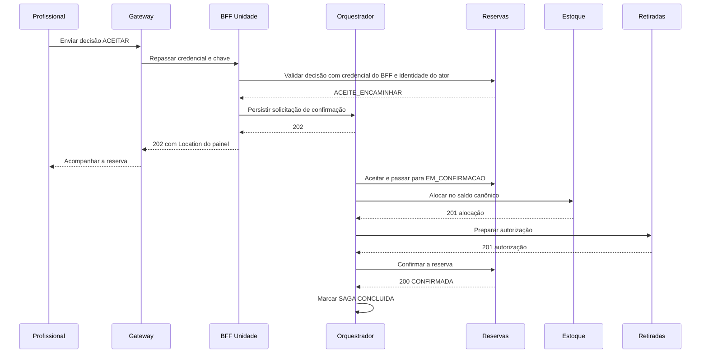

**Compensação.** Cada etapa guarda a intenção e uma chave estável antes da chamada. O executor serializa o progresso com lock e `SKIP LOCKED`. Falha conclusiva de Retiradas com `AUTORIZACAO_NAO_CRIADA` libera a alocação antes de encerrar a reserva em `FALHA_CONFIRMACAO` e a SAGA em `COMPENSADA`. Se a autorização pode existir e o resultado já é conclusivo para compensar, a revogação vem antes da liberação. Timeout, erro de rede e resposta incerta repetem a etapa e usam espera exponencial até 30 s entre tentativas. `COMPENSACAO_PENDENTE` ou `CANCELAMENTO_PENDENTE` identifica a espera quando aplicável. [Executor](../servicos/orquestrador/executor.py) · [Diagrama detalhado atual](parte-2/diagramas/saga-falha.md)

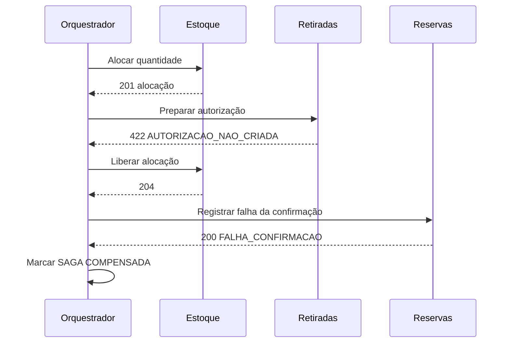

**Retirada.** O profissional busca a reserva pelo código e registra a entrega autorizada. Retiradas confere a unidade, o estado canônico e a autorização. A transação local grava a entrega, faz a autorização passar a `UTILIZADA` na leitura e inclui `retirada.concluida.v1` na Outbox. Reservas consome e marca `RETIRADA`, Estoque baixa o físico e encerra a alocação, e Orquestrador guarda evidência de entrega. O trabalhador de Estoque emite um segundo evento para atualizar a projeção. [`servicos/retiradas/entregas.py`](../servicos/retiradas/entregas.py) · [`servicos/retiradas/main.py`](../servicos/retiradas/main.py) · [Consumidor de Reservas](../servicos/reservas/eventos.py) · [Consumidor de Estoque](../servicos/estoque/retiradas.py) · [Consumidor do Orquestrador](../servicos/orquestrador/eventos.py)

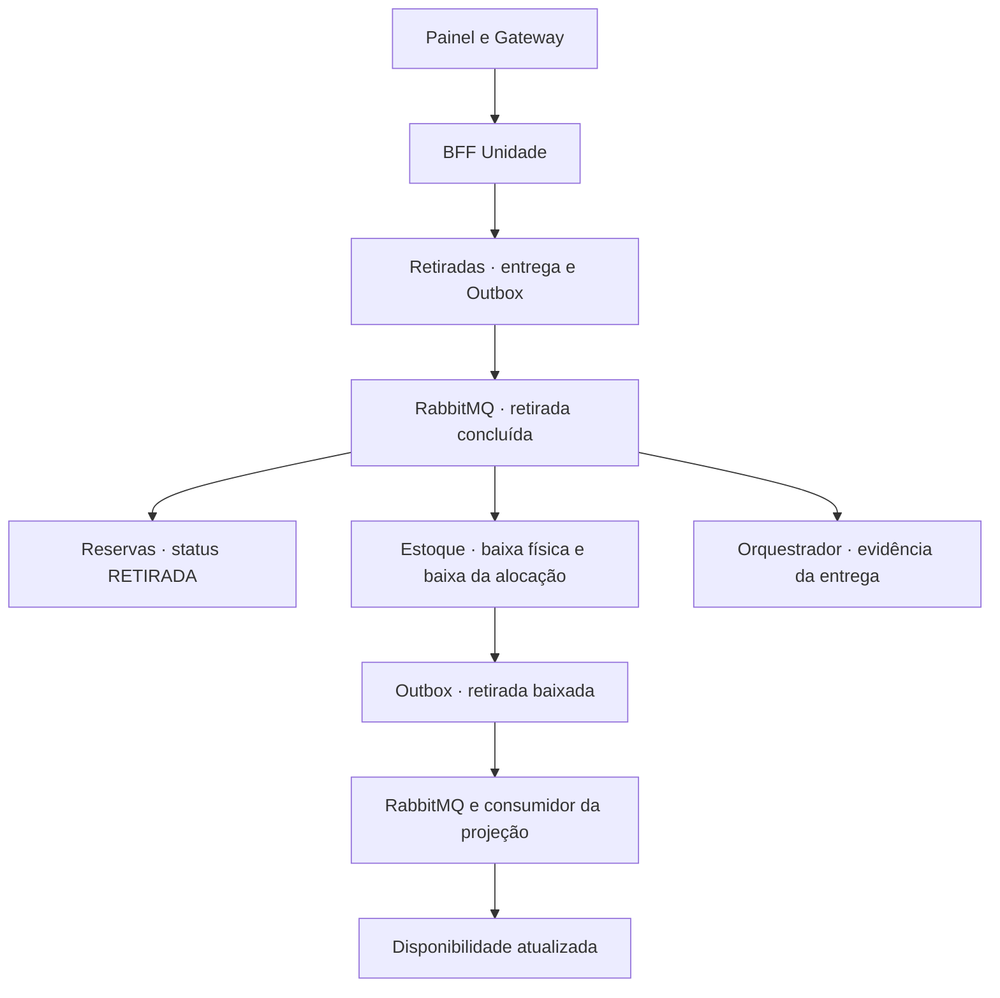

**Cancelamento.** O cidadão cancela a própria reserva, e o profissional da unidade informa uma justificativa válida de pelo menos cinco caracteres. Em `SOLICITADA` dentro do prazo, a transição é local e pode retornar `200`. Se a confirmação começou ou terminou, o BFF encaminha ao Orquestrador com credencial própria e os cabeçalhos do ator. O Orquestrador responde `202`. O cancelamento aguarda uma confirmação ativa, sinaliza `CANCELAMENTO_EM_ANDAMENTO`, revoga a autorização antes de liberar a alocação e pede a conclusão a Reservas. Uma entrega já registrada interrompe o cancelamento e o evento leva a reserva a `RETIRADA`. Para o cidadão a confirmação ou o cancelamento podem exigir consulta posterior. [`servicos/bff.py`](../servicos/bff.py) · [`servicos/reservas/cancelamento.py`](../servicos/reservas/cancelamento.py) · [`servicos/orquestrador/cancelamento.py`](../servicos/orquestrador/cancelamento.py) · [Diagrama concorrência entrega/cancelamento](parte-2/diagramas/saga-cancelamento-retirada.md)

**Como demonstrar com a validação do repositório.** O script integrado cadastra unidade, registra quatro unidades de um item, habilita a reserva, solicita duas, acompanha o aceite e observa a projeção de duas disponíveis. Em seguida registra a retirada e espera físico 2, alocado 0 e disponível 2. Exercita cancelamento local e distribuído. Na seção de compensação, recria Retiradas com `GLICO_FALHA_PREPARAR_AUTORIZACAO=1` em ambiente isolado, aceita outra reserva e confere liberação canônica, ausência de autorização, `COMPENSADA` e projeção. Por fim recria os contêineres mantendo os volumes e confere persistência e repetição idempotente. Esse é o comportamento programado do roteiro. O [registro de verificação](#testes-e-evidências) indica o que foi executado nesta análise. [Roteiro executável](../scripts/validar-compose.ps1)

### Inteligência artificial e avaliação

A orientação usa RAG, sigla para geração aumentada por recuperação. Para cada pergunta sobre o item selecionado, o serviço consulta a disponibilidade via BFF e recupera trechos dos guias antes de gerar a resposta. Assim, o portal pode apresentar as fontes das instruções e o estado da projeção de estoque com seu horário de atualização. [`servicos/orientacao/rag.py`](../servicos/orientacao/rag.py) · [`servicos/orientacao/disponibilidade.py`](../servicos/orientacao/disponibilidade.py) · [`servicos/gateway/portal/portal.js`](../servicos/gateway/portal/portal.js)

| Passo | Comportamento na versão atual | Onde acontece no Git |
| --- | --- | --- |
| Base própria | Quatro guias em Markdown cobrem disponibilidade, solicitação, confirmação e retirada. As âncoras dão IDs estáveis às seções, como `retirada#balcao`. | [`docs/parte-4/base-conhecimento/`](parte-4/base-conhecimento/) · [`docs/parte-4/base-conhecimento/retirada.md#balcao`](parte-4/base-conhecimento/retirada.md#balcao) |
| Ingestão | O indexador separa as seções, gera embeddings de 1.536 dimensões com `gemini-embedding-2` por padrão e guarda conteúdo, modelo e vetor em `trechos_conhecimento`. Reaproveita vetores de conteúdo e modelo iguais e sincroniza o índice com a base. | [`servicos/orientacao/ingestao.py`](../servicos/orientacao/ingestao.py) · [`servicos/orientacao/embeddings.py`](../servicos/orientacao/embeddings.py) · [`servicos/orientacao/migrations/001_base_conhecimento.sql`](../servicos/orientacao/migrations/001_base_conhecimento.sql) |
| Entrada | O portal envia a pergunta e o UUID do item no `POST /api/cidadao/v1/orientacoes`. O Gateway exige Bearer e encaminha a requisição. O BFF autentica o cidadão, confirma o item no catálogo e chama `POST /internal/v1/orientacoes` com a credencial interna e a correlação. | [`servicos/gateway/portal/portal.js`](../servicos/gateway/portal/portal.js) · [`servicos/gateway/rotas.py`](../servicos/gateway/rotas.py) · [`servicos/bff_cidadao/main.py`](../servicos/bff_cidadao/main.py) · [`servicos/orientacao/main.py`](../servicos/orientacao/main.py) |
| Disponibilidade | A chain invoca a ferramenta LangChain `consultar_disponibilidade` com o UUID do item. A ferramenta chama `GET /api/cidadao/v1/explorar` no BFF, que combina as unidades ativas e a projeção de Estoque. Uma consulta bem-sucedida pode retornar lista vazia. | [`servicos/orientacao/disponibilidade.py`](../servicos/orientacao/disponibilidade.py) · [`servicos/bff_cidadao/main.py`](../servicos/bff_cidadao/main.py) · [`servicos/estoque/main.py`](../servicos/estoque/main.py) |
| Recuperação | O embedding da pergunta é comparado a vetores do mesmo modelo no pgvector. A busca retorna até quatro seções com distância de cosseno de até 0,60. Trocas no modelo de embeddings exigem reindexação. | [`servicos/orientacao/embeddings.py`](../servicos/orientacao/embeddings.py) · [`servicos/orientacao/rag.py`](../servicos/orientacao/rag.py) · [`servicos/orientacao/ingestao.py`](../servicos/orientacao/ingestao.py) |
| Geração e validação | O LangChain envia pergunta, trechos e consulta ao Gemini via Google AI Studio. O padrão de geração é `gemini-3.5-flash-lite`. A chain pede JSON estruturado e publica o modo `rag` quando recebe uma resposta preenchida com citações de trechos recuperados. O payload da consulta é construído pelo serviço. | [`servicos/orientacao/rag.py`](../servicos/orientacao/rag.py) · [`servicos/contratos_orientacao.py`](../servicos/contratos_orientacao.py) · [`pyproject.toml`](../pyproject.toml) |
| Limites e degradação | O BFF limita a dez chamadas por cidadão em uma janela de minuto por processo. Orientação aceita até três simultâneas e usa 12 s de prazo total, com até 3 s para consultar o BFF. Embedding e geração podem repetir falhas transitórias com backoff e `Retry-After` dentro dos prazos. O BFF espera até 14 s na chamada interna. O cliente HTTP do Gateway usa 20 s. | [`servicos/bff_cidadao/main.py`](../servicos/bff_cidadao/main.py) · [`servicos/orientacao/main.py`](../servicos/orientacao/main.py) · [`servicos/orientacao/rag.py`](../servicos/orientacao/rag.py) · [`servicos/orientacao/resiliencia.py`](../servicos/orientacao/resiliencia.py) · [`servicos/gateway/main.py`](../servicos/gateway/main.py) |

O contrato devolve `modo`, `resposta`, `fontes` e `consulta`. Com chave ausente, falha tratada do provedor ou do índice, ou evidência insuficiente, a resposta segue em `orientacao_basica` e preserva a consulta quando obtida. Se a consulta falhar, seu estado fica `indisponivel`. Quando o modelo classifica a pergunta como `fora_do_escopo`, o retorno orienta a usar o portal e vem com `consulta.status` igual a `nao_consultada`. Se o serviço Orientação estiver inacessível, o BFF pode retornar `503` nessa rota e o portal direciona para as funções convencionais. [`servicos/contratos_orientacao.py`](../servicos/contratos_orientacao.py) · [`servicos/orientacao/rag.py`](../servicos/orientacao/rag.py) · [`servicos/bff_cidadao/main.py`](../servicos/bff_cidadao/main.py) · [`servicos/gateway/portal/portal.js`](../servicos/gateway/portal/portal.js)

A chain executa uma consulta de leitura por pergunta. O prompt restringe o assunto ao uso do portal e orienta o modelo a sinalizar pedidos clínicos, posologia, substituições e consultas sobre reservas individuais. A validação de citações verifica os IDs recebidos. Verificar se uma fonte sustenta integralmente o texto exige revisão de conteúdo. [`servicos/orientacao/rag.py`](../servicos/orientacao/rag.py) · [Avaliação do conteúdo](parte-4/02-avaliacao-rag.md)

**Avaliação de qualidade.** A bateria compara seis perguntas com e sem recuperação, mantendo o mesmo retrato de disponibilidade por par. Com Gemini, os cinco casos operacionais recuperaram e citaram a seção esperada. Houve omissões na confirmação e na disponibilidade e uma imprecisão nas instruções de solicitação. O relatório também registra o experimento histórico com Ollama e a diferença entre o texto bruto e o resultado aceito pela chain. [`servicos/orientacao/avaliacao.py`](../servicos/orientacao/avaliacao.py) · [Avaliação pareada](parte-4/02-avaliacao-rag.md) · [Respostas Gemini](parte-4/avaliacao-rag-gemini.json) · [Respostas Ollama](parte-4/avaliacao-rag-ollama.json)

**Latência e custo.** Três chamadas da mesma pergunta passaram pelo Gateway em processos locais com chamadas reais ao Gemini e retornaram `rag`, com latências de 1,376 s, 1,739 s e 7,356 s. A amostra tem mediana de **1,739 s**. A projeção registrada para Gemini é **US$ 0,000520 por consulta com geração concluída**, ou **US$ 0,52 por mil** e **US$ 52,04 por cem mil**, segundo os tokens e as tarifas da avaliação. O cálculo cobre embedding da pergunta e geração, com indexação, retries e infraestrutura fora da estimativa. [Relatório de desempenho e custo](parte-4/03-desempenho-e-custo.md) · [Amostras no Gateway](parte-4/medicao-gateway-gemini.json) · [`servicos/orientacao/desempenho.py`](../servicos/orientacao/desempenho.py)

### Roteiro técnico do vídeo

Execute o bloco na raiz do repositório com Docker acessível, Python 3 para preparar o `.env` e Bash. Use o mesmo projeto Compose para a indexação e para o `up`. A chave do Google AI Studio é lida sem eco. As credenciais dos portais vêm do `.env`. [`scripts/configurar-compose.py`](../scripts/configurar-compose.py) · [`docker-compose.yml`](../docker-compose.yml) · [`compose.orientacao.yml`](../compose.orientacao.yml)

```bash
python3 scripts/configurar-compose.py
read -rsp 'Chave do Google AI Studio: ' GOOGLE_API_KEY
printf '\n'
export GOOGLE_API_KEY
export GLICO_GATEWAY_PORTA=18083
export GLICO_REDE_ADMINISTRATIVA=glico-parte4-admin
export GLICO_CARREGAR_DEMO=1
export GLICO_FALHA_PREPARAR_AUTORIZACAO=0

compose=(-p glico-parte4 -f docker-compose.yml -f compose.orientacao.yml --profile orientacao)
docker compose "${compose[@]}" --profile indexacao run --build --rm indexar-orientacao &&
  docker compose "${compose[@]}" up --build -d --wait &&
  docker compose "${compose[@]}" ps &&
  curl --fail-with-body http://127.0.0.1:18083/health
```

O indexador inicializa o banco vetorial e carrega os guias no volume do projeto. Confira se a indexação terminou com sucesso antes de subir a API. O `ps` da configuração com Orientação deve mostrar 16 serviços em execução, com nove aplicações HTTP, seis bancos e RabbitMQ. A única porta publicada é a do Gateway, em `127.0.0.1:18083`. [`compose.orientacao.yml`](../compose.orientacao.yml) · [`servicos/orientacao/Dockerfile`](../servicos/orientacao/Dockerfile)

| No vídeo | O que conferir | Onde acontece no Git |
| --- | --- | --- |
| 1. Inicialização e rotas | Mostre o `up`, o `ps` e a resposta de `GET /health`. Abra [o portal](http://127.0.0.1:18083/cidadao), [o painel](http://127.0.0.1:18083/unidade) e, para mostrar as rotas do Gateway, [o Swagger](http://127.0.0.1:18083/docs). | [`docker-compose.yml`](../docker-compose.yml) · [`servicos/gateway/main.py`](../servicos/gateway/main.py) · [`servicos/gateway/rotas.py`](../servicos/gateway/rotas.py) |
| 2. Consulta e reserva | Escolha **Tiras reagentes para glicemia**, confira disponibilidade, permissão e horário. Solicite uma unidade e use o código para acompanhar. Mostre `GET /api/cidadao/v1/explorar`, `POST /api/cidadao/v1/reservas` e `GET /api/cidadao/v1/reservas/{reservaId}` na lista de requisições do navegador, com método e status. | [`servicos/gateway/portal/portal.js`](../servicos/gateway/portal/portal.js) · [`servicos/bff_cidadao/main.py`](../servicos/bff_cidadao/main.py) |
| 3. Aceite e entrega | Aceite no painel (`POST /api/unidade/v1/reservas/{reservaId}/decisao`, `202`). Aguarde `CONFIRMADA`, observe a quantidade alocada e registre a retirada (`POST /api/unidade/v1/retiradas`, `201`). Depois, confira `RETIRADA` e a baixa de físico e alocado. | [`servicos/bff_unidade/reservas.py`](../servicos/bff_unidade/reservas.py) · [`servicos/orquestrador/executor.py`](../servicos/orquestrador/executor.py) · [`servicos/retiradas/entregas.py`](../servicos/retiradas/entregas.py) · [`servicos/estoque/retiradas.py`](../servicos/estoque/retiradas.py) |
| 4. Orientação | Com o item selecionado e a credencial de cidadão preenchida, pergunte *“Qual código devo levar ao balcão e onde vejo as orientações para retirar uma reserva confirmada?”*. Mostre o `POST /api/cidadao/v1/orientacoes`, o modo `rag`, a fonte esperada `retirada#balcao` e os dados consultados com seu horário de atualização. | [`servicos/orientacao/rag.py`](../servicos/orientacao/rag.py) · [`servicos/orientacao/disponibilidade.py`](../servicos/orientacao/disponibilidade.py) · [`docs/parte-4/base-conhecimento/retirada.md`](parte-4/base-conhecimento/retirada.md) |

O [roteiro de entrega da Etapa 4](parte-4/04-roteiro-de-entrega.md) inclui os comandos PowerShell para provocar a compensação, demonstrar o fallback sem chave e ensaiar uma réplica adicional de Unidades. Para rodar a validação isolada, execute `pwsh -File scripts/validar-compose.ps1 -ComOrientacao`. Com `GOOGLE_API_KEY` no ambiente, o script também exige uma resposta em modo RAG e verifica que o índice sobrevive à recriação. Ao encerrar a gravação, `docker compose "${compose[@]}" down` para os serviços e preserva os volumes do ensaio. [`scripts/validar-compose.ps1`](../scripts/validar-compose.ps1)

## Visão consolidada do sistema

### Arquitetura e dados atuais

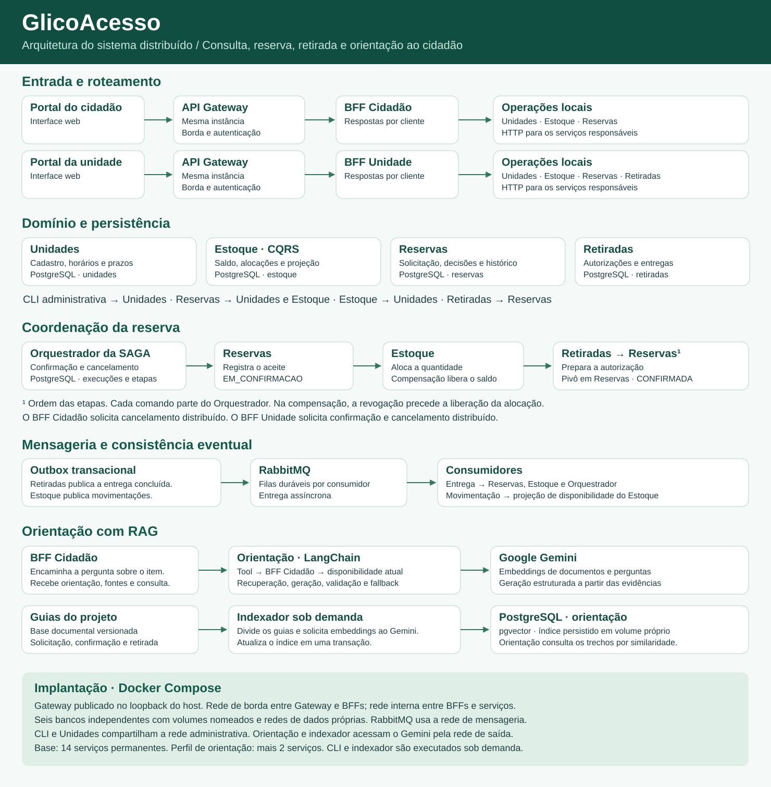

O diagrama reúne a borda HTTP, a confirmação e o cancelamento por SAGA, os bancos por serviço, a publicação de eventos e a orientação com pgvector e Gemini. [`docs/arquitetura-glicoacesso.svg`](arquitetura-glicoacesso.svg) · [`docker-compose.yml`](../docker-compose.yml) · [`compose.orientacao.yml`](../compose.orientacao.yml)

<details>
<summary>Mapa de chamadas e eventos em Mermaid</summary>

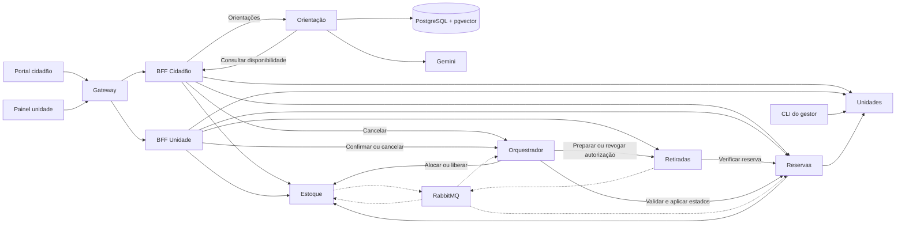

</details>

O mapa também mostra a CLI administrativa, a validação da unidade por Reservas e o retorno da ferramenta de Orientação ao BFF Cidadão para consultar a disponibilidade. As interfaces do cidadão e do profissional são portais web servidos pelo Gateway. Os clientes usam as rotas dos BFFs e os links de ação que eles retornam. [Código dos portais](../servicos/gateway/portal/) · [Cadastro administrativo](../servicos/unidades/cli.py) · [Diagrama do repositório](parte-2/02-diagrama-arquitetura.md)

| Componente | Responsabilidade | Dados sob sua autoridade | Implementação |
| --- | --- | --- | --- |
| Gateway | Servir portais, validar perfil na borda, rotear chamadas | Sem persistência de domínio | [Gateway](../servicos/gateway/) |
| BFF Cidadão | Agregar consulta pública, apresentar a reserva própria e encaminhar pedidos de orientação | Sem persistência de domínio | [BFF Cidadão](../servicos/bff_cidadao/) |
| BFF Unidade | Apresentar fila, saldos, autorizações e ações por unidade | Sem persistência de domínio | [BFF Unidade](../servicos/bff_unidade/) |
| Unidades | Manter cadastro, situação, horário, contato e prazo | `unidades`, `contatos_unidade`, `horarios_unidade`, comandos idempotentes | [Migrações de Unidades](../servicos/unidades/migrations/) |
| Estoque | Manter catálogo, controlar quantidade e alocações e projetar disponibilidade | `itens`, `saldos`, `alocacoes`, `movimentacoes`, `disponibilidade`, Outbox e Inbox | [Migrações de Estoque](../servicos/estoque/migrations/) |
| Reservas | Manter solicitação, prazos, estado de negócio e histórico | `reservas`, `historico_reserva`, Inbox e comandos idempotentes | [Migrações de Reservas](../servicos/reservas/migrations/) |
| Retiradas | Autorizar e registrar entrega | `autorizacoes`, `retiradas`, Outbox e comandos idempotentes | [Migrações de Retiradas](../servicos/retiradas/migrations/) |
| Orquestrador | Persistir e executar confirmações, compensações e cancelamentos | `saga_execucoes`, `saga_etapas`, `entregas_observadas`, Inbox e comandos idempotentes | [`servicos/orquestrador/migrations/`](../servicos/orquestrador/migrations/) |
| Orientação | Recuperar guias, consultar disponibilidade e gerar respostas com fontes | `trechos_conhecimento` no PostgreSQL com pgvector | [`servicos/orientacao/main.py`](../servicos/orientacao/main.py) · [`servicos/orientacao/migrations/001_base_conhecimento.sql`](../servicos/orientacao/migrations/001_base_conhecimento.sql) |

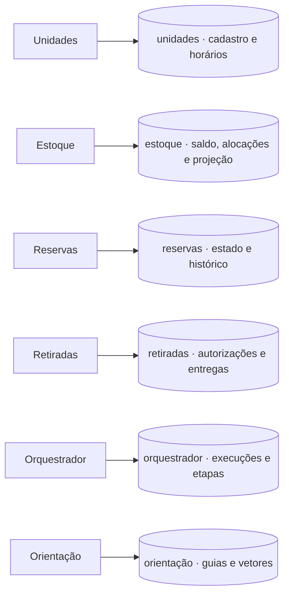

A persistência usa PostgreSQL 17, SQL e Psycopg. Cada domínio, o Orquestrador e a Orientação acessam seu próprio banco. Estoque garante saldo físico não negativo e alocado entre zero e o físico. Uma entrada positiva cria ou aumenta o saldo. A permissão de reserva é controlada por unidade e item. Ajuste exige motivo e respeita alocações e limite do saldo. A presença de um item no catálogo não implica existência de saldo nem disponibilidade em unidade específica. A migração inclui medicamentos para diabetes do Farmácia Popular, e a carga fictícia inclui tiras reagentes. O catálogo é carregado localmente. [`servicos/estoque/migrations/007_catalogo_diabetes_pfpb.sql`](../servicos/estoque/migrations/007_catalogo_diabetes_pfpb.sql) · [Dados de demonstração](../servicos/estoque/demo.sql)

### Mensageria e operação

RabbitMQ usa a exchange topic durável `glico.eventos`. `retirada.concluida.v1` vai a filas independentes de Reservas, Estoque e Orquestrador. A fila `estoque.projecao-disponibilidade` recebe `estoque.#`, que inclui `estoque.alocacao-criada.v1`, `estoque.alocacao-liberada.v1`, `estoque.entrada-registrada.v1`, `estoque.ajustado.v1`, `estoque.permissao-reserva-alterada.v1` e `estoque.retirada-baixada.v1`. Cada evento inclui identidade, tipo e versão, agregado, correlação, instante e conteúdo. [Implementação de mensageria](../servicos/mensageria.py) · [Eventos de estoque](../servicos/estoque/eventos.py)

Mensagens persistentes, confirmação de publicação, atualização posterior da Outbox, ACK após o commit, deduplicação e dead letter tratam falhas comuns. O envio pode ser repetido. Banco temporariamente indisponível causa reentrega, enquanto falha permanente de validação segue para a fila de erro. A `main` oferece o comando `python -m servicos.estoque.projecao` para reconstruir a disponibilidade com base em `saldos`. Também oferece `python -m servicos.reprocessar <fila>` para devolver mensagens da fila de erro à fila principal. Ambos são comandos operacionais. [`servicos/estoque/projecao.py`](../servicos/estoque/projecao.py) · [`servicos/reprocessar.py`](../servicos/reprocessar.py) · [`servicos/mensageria.py`](../servicos/mensageria.py)

### Catálogo de APIs

O catálogo abaixo enumera as rotas de negócio da revisão. Os contratos por serviço trazem schemas e exemplos. Para conferir um campo ou status em caso de divergência, prevalecem os modelos Pydantic, os handlers e as respostas de execução. `/health` responde `200` em cada aplicação. O Gateway também serve `GET /cidadao`, `GET /unidade`, a marca dos portais e os arquivos estáticos em `/cidadao/assets` e `/unidade/assets`. O Swagger do Gateway fica em `/docs`. Os schemas dos BFFs ficam nos contratos OpenAPI versionados. [`servicos/gateway/main.py`](../servicos/gateway/main.py) · [`servicos/gateway/rotas.py`](../servicos/gateway/rotas.py) · [`docs/parte-2/api/`](parte-2/api/)

#### Rotas públicas pelo Gateway

| Prefixo | Método e caminho relativo | Principais entradas e respostas | Implementação no BFF |
| --- | --- | --- | --- |
| `/api/cidadao/v1` | `GET /itens`, `GET /unidades` | Catálogo e unidades ativas em listas públicas. `200`. | [`servicos/bff_cidadao/main.py`](../servicos/bff_cidadao/main.py) |
| `/api/cidadao/v1` | `GET /explorar` | `itemId` em query, UUID. `200` com dados da unidade, booleanos `disponivel` e `permiteReserva`, orientação e `atualizadoEm`. `422` para UUID ausente/inválido. | [`servicos/bff_cidadao/main.py`](../servicos/bff_cidadao/main.py) |
| `/api/cidadao/v1` | `POST /reservas` | Token do cidadão, chave, `unidadeId`, `itemId` e `quantidade` inteira positiva. `201` com representação, `Location` e links. Retorna `422` para unidade inativa, prazo legado inválido ou reserva sem permissão e `409` para conflito de chave. | [`servicos/bff_cidadao/main.py`](../servicos/bff_cidadao/main.py) |
| `/api/cidadao/v1` | `GET /reservas/{reservaId}` | Token do cidadão e UUID. `200` com a própria reserva ou `404` quando não pertence ao perfil. | [`servicos/bff_cidadao/main.py`](../servicos/bff_cidadao/main.py) |
| `/api/cidadao/v1` | `POST /reservas/{reservaId}/cancelar` | Token e chave, sem justificativa de cidadão. `200` para conclusão local, `202` para cancelamento distribuído e `409` para conflito de estado ou chave. | [`servicos/bff_cidadao/main.py`](../servicos/bff_cidadao/main.py) |
| `/api/cidadao/v1` | `POST /orientacoes` | Bearer do cidadão, `itemId` UUID e `pergunta` de 1 a 500 caracteres após remoção de espaços nas bordas. `200` com modo, fontes e consulta. `404` para item fora do catálogo, `422` para corpo inválido, `429` para limite e `503` para indisponibilidade de integração. | [`servicos/bff_cidadao/main.py`](../servicos/bff_cidadao/main.py) |
| `/api/unidade/v1` | `GET /painel/reservas`, `GET /painel/reservas/{reservaId}` | Token profissional e UUID no detalhe. `200` com fila de pendentes ou detalhe, `404` para reserva inexistente e `403` para reserva de outra unidade. | [`servicos/bff_unidade/reservas.py`](../servicos/bff_unidade/reservas.py) |
| `/api/unidade/v1` | `POST /reservas/{reservaId}/decisao` | Token, chave, `decisao` igual a `ACEITAR` ou `REJEITAR`. `202` no aceite encaminhado e `200` na rejeição concluída. | [`servicos/bff_unidade/reservas.py`](../servicos/bff_unidade/reservas.py) |
| `/api/unidade/v1` | `POST /reservas/{reservaId}/cancelar` | Token, chave e `justificativa`. `200` ou `202`. Estado incompatível retorna `409`. | [`servicos/bff_unidade/reservas.py`](../servicos/bff_unidade/reservas.py) |
| `/api/unidade/v1` | `GET /painel/estoque`, `GET /painel/estoque/catalogo` | Token profissional. `200` com saldos projetados da unidade ou catálogo com identificador da unidade vinculada. | [`servicos/bff_unidade/administracao.py`](../servicos/bff_unidade/administracao.py) |
| `/api/unidade/v1` | `POST /painel/estoque/{unidadeId}/itens/{itemId}/entradas` | Token, chave, `quantidade` positiva e `motivo` opcional. `201` com movimentação e versão. | [`servicos/bff_unidade/administracao.py`](../servicos/bff_unidade/administracao.py) |
| `/api/unidade/v1` | `PUT /painel/estoque/{unidadeId}/itens/{itemId}/permissao` | Token, chave e booleano `permiteReserva`. `200` com a permissão. | [`servicos/bff_unidade/administracao.py`](../servicos/bff_unidade/administracao.py) |
| `/api/unidade/v1` | `POST /painel/estoque/{unidadeId}/itens/{itemId}/ajustes` | Token, chave, `variacaoFisica` inteira diferente de zero e `motivo`. `201` com movimentação. Pode retornar `409` por saldo incompatível. | [`servicos/bff_unidade/administracao.py`](../servicos/bff_unidade/administracao.py) |
| `/api/unidade/v1` | `GET /unidade`, `PUT /unidade` | Perfil profissional vinculado. `200` com o cadastro. PUT exige chave, nome, endereço estruturado, orientações, contatos, horários e prazo. | [`servicos/bff_unidade/administracao.py`](../servicos/bff_unidade/administracao.py) |
| `/api/unidade/v1` | `PUT /unidade/horarios`, `PATCH /unidade/status`, `PUT /unidade/prazo-analise` | Token, chave e `horarios`, `ativa` ou `prazoAnaliseHoras`, respectivamente. `200` com cadastro. | [`servicos/bff_unidade/administracao.py`](../servicos/bff_unidade/administracao.py) |
| `/api/unidade/v1` | `POST /retiradas` | Token, chave e `autorizacaoId`. `201` com `autorizacaoId`, `retiradaId` e `realizadaEm`. Pode retornar `409` por situação incompatível. | [`servicos/bff_unidade/reservas.py`](../servicos/bff_unidade/reservas.py) |

Credencial ausente ou inválida nas rotas protegidas retorna `401`. Papel incorreto, unidade fora do vínculo ou autorização insuficiente podem retornar `403`, com `404` usado em algumas consultas para limitar divulgação. Validação do framework retorna `422`, inclusive chave obrigatória ausente onde declarada como header. Na borda, falhas de integração ou timeout são tratadas como indisponibilidade `503`. Os erros conclusivos dos domínios podem ser propagados pelo BFF. O cabeçalho `Idempotency-Key` aceita de 1 a 128 caracteres nos comandos principais. A orientação é uma consulta por POST e dispensa essa chave. [Contrato BFF Cidadão](parte-2/api/bff-cidadao.yaml) · [Contrato BFF Unidade](parte-2/api/bff-unidade.yaml) · [Gateway](../servicos/gateway/main.py)

#### Rotas entre serviços e administração

Os prefixos da tabela abreviam rotas. `I` indica `/internal/v1`, `C` indica `/api/cidadao/v1` e `U` indica `/api/unidade/v1`. Os caminhos com `C` e `U` abaixo são usados entre processos e o Gateway publica apenas a lista anterior.

| Serviço | Operações | Contrato e autorização |
| --- | --- | --- |
| Unidades | `GET C/unidades`. `GET I/unidades/{unidadeId}`. `POST I/unidades`. `PUT I/unidades/{unidadeId}` e `/horarios`. `PATCH I/unidades/{unidadeId}/status`. `GET` e `PUT I/unidades/{unidadeId}/prazo-analise`. | Listagem pública. Cadastro administrativo `201`, manutenção vinculada e consulta de prazo por Reservas. [OpenAPI](parte-2/api/unidade.yaml) · [Handler](../servicos/unidades/main.py) |
| Estoque | `GET C/estoque/itens` e `C/estoque/disponibilidade`. `GET U/estoque/itens` e `U/estoque/{unidadeId}/itens`. `POST U/estoque/{unidadeId}/itens/{itemId}/entradas` e `/ajustes`. `PUT` no mesmo recurso, em `/permissao`. `GET I/unidades/{unidadeId}/itens/{itemId}/permissao-reserva`. `POST I/itens` e `PUT I/itens/{itemId}` para administração. `POST I/alocacoes`. `DELETE I/alocacoes/{reservaId}`. | Consulta pública, ações e saldos com perfil profissional, permissão para Reservas e comandos de alocação `201` e liberação `204` para o Orquestrador. Liberação identifica SAGA em `X-Saga-Id`. [OpenAPI](parte-2/api/estoque.yaml) · [`servicos/estoque/main.py`](../servicos/estoque/main.py) · [`servicos/estoque/administracao.py`](../servicos/estoque/administracao.py) |
| Reservas | `POST C/reservas` e `C/reservas/{reservaId}/cancelar`. `GET U/reservas`. `POST U/reservas/{reservaId}/decisao` e `/cancelar`. `GET I/reservas/{reservaId}`, `/estado` e `/permissao-cancelamento`. `POST I/reservas/{reservaId}` com sufixos `/aceite`, `/confirmar`, `/falhar-confirmacao`, `/iniciar-cancelamento` e `/finalizar-cancelamento`. | Respostas de operação `200` ou `201` quando concluídas. Comandos de SAGA por credencial do Orquestrador, estado canônico para Retiradas e verificação de vínculo nas consultas e decisões de ator. `ACEITE_ENCAMINHAR` é o sinal interno `409` para o BFF iniciar o fluxo. [OpenAPI](parte-2/api/reserva.yaml) · [Handler](../servicos/reservas/main.py) |
| Retiradas | `POST I/autorizacoes`. `GET I/autorizacoes/{reservaId}`. `POST I/autorizacoes/{reservaId}/cancelar`. `POST U/retiradas`. | Orquestrador prepara `201` e revoga `200`. Profissional consulta `200` e registra entrega `201` mediante autorização vinculada. `409 ENTREGA_JA_REGISTRADA` pode interromper reversão. [OpenAPI](parte-2/api/retirada.yaml) · [Handler](../servicos/retiradas/main.py) |
| Orquestrador | `POST I/reservas/{reservaId}/confirmacoes` e `/cancelamentos`. `GET I/sagas/{sagaId}`. | BFFs enviam token próprio, cabeçalhos com identidade do ator e chave idempotente. Aceite de execução `202`. Consulta de execução `200`, restrita ao ator autorizado. [OpenAPI](parte-2/api/orquestrador.yaml) · [`servicos/orquestrador/main.py`](../servicos/orquestrador/main.py) · [`servicos/orquestrador/pedidos.py`](../servicos/orquestrador/pedidos.py) |
| Orientação | `POST I/orientacoes`. | Credencial técnica de Orientação, UUID e pergunta. `200` com a resposta, `429` se o limite de concorrência for atingido. [`servicos/orientacao/main.py`](../servicos/orientacao/main.py) · [`servicos/contratos_orientacao.py`](../servicos/contratos_orientacao.py) |

#### Exemplos de contrato

A requisição abaixo usa identificadores da carga fictícia. Configure o token no terminal de teste. Leia o UUID de reserva e a unidade vinculada a partir do fluxo. Reutilize a chave para repetir a mesma solicitação.

```bash
BASE=http://127.0.0.1:8000
curl -sS -i "$BASE/api/cidadao/v1/explorar?itemId=20000000-0000-4000-8000-000000000001"
curl -sS -i -X POST "$BASE/api/cidadao/v1/reservas" \
  -H "Authorization: Bearer ${GLICO_CIDADAO_TOKEN:?Defina a credencial local}" \
  -H 'Idempotency-Key: reserva-demo-001' \
  -H 'Content-Type: application/json' \
  -d '{"unidadeId":"10000000-0000-4000-8000-000000000001","itemId":"20000000-0000-4000-8000-000000000001","quantidade":2}'
```

| Informação de exemplo | BFF Cidadão | BFF Unidade |
| --- | --- | --- |
| Consulta de Estoque | `{"disponivel":true,"permiteReserva":true,"atualizadoEm":"2026-11-25T15:00:00Z"}` | `{"estoqueFisicoAtual":4,"quantidadeAlocada":2,"quantidadeDisponivel":2,"permiteReserva":true,"atualizadoEm":"2026-11-25T15:00:00Z"}` |
| Pendente · ações disponibilizadas | `self` e `cancelar` | `self`, `aceitar`, `rejeitar` e `cancelar` |
| Identidade e autorização | Campos públicos da reserva, sem `cidadaoId` | Identificador do cidadão de demonstração, nome do item quando disponível e dados de autorização quando aplicável |

Com o perfil de Orientação ativo e a base indexada, a chamada de leitura abaixo usa a mesma credencial de cidadão. Observe `modo`, `fontes` e `consulta` no JSON. [`servicos/bff_cidadao/main.py`](../servicos/bff_cidadao/main.py) · [Contrato de orientação](parte-2/api/bff-cidadao.yaml)

```bash
curl -sS -i "$BASE/api/cidadao/v1/orientacoes" \
  -H "Authorization: Bearer ${GLICO_CIDADAO_TOKEN:?Defina a credencial local}" \
  -H 'Content-Type: application/json' \
  -d '{"itemId":"20000000-0000-4000-8000-000000000001","pergunta":"Qual código devo levar ao balcão e onde vejo as orientações para retirar uma reserva confirmada?"}'
```

Um recorte de `_links` no painel para uma reserva pendente usa o corpo de decisão explícito.

```json
{
  "_links": {
    "aceitar": {
      "href": "/api/unidade/v1/reservas/00000000-0000-4000-8000-000000000010/decisao",
      "method": "POST",
      "body": {"decisao": "ACEITAR"}
    }
  }
}
```

### Segurança e operação

O Gateway exige Bearer nas rotas protegidas e encaminha somente os cabeçalhos permitidos. Os BFFs validam as credenciais de cidadão ou profissional. As chamadas protegidas entre serviços usam o token técnico do chamador e, quando a operação é em nome de um usuário, os cabeçalhos `X-Ator-*`. O serviço de destino valida primeiro a credencial técnica e então aplica as regras de papel, propriedade e unidade. A CLI usa a credencial administrativa. [`servicos/gateway/rotas.py`](../servicos/gateway/rotas.py) · [`servicos/identidade_demo.py`](../servicos/identidade_demo.py) · [`servicos/bff.py`](../servicos/bff.py) · [`servicos/unidades/cli.py`](../servicos/unidades/cli.py)

A publicação do Gateway é limitada ao loopback. O Gateway gera ou propaga `X-Correlation-Id` e encaminha a credencial somente até o BFF. Nas respostas sensíveis, os BFFs usam `Cache-Control: no-store`. A Orientação envia ao provedor o texto digitado, os trechos e os dados públicos consultados. O portal orienta a evitar dados pessoais no texto. [`docker-compose.yml`](../docker-compose.yml) · [`servicos/correlacao.py`](../servicos/correlacao.py) · [`servicos/orientacao/rag.py`](../servicos/orientacao/rag.py) · [`servicos/gateway/portal/index.html`](../servicos/gateway/portal/index.html)

As interfaces pedem o token de demonstração quando necessário. O perfil usa identificadores fixos e a execução local usa HTTP. Para uso institucional com pessoas e equipes distintas ainda são necessários identidade individual, gestão de credenciais, transporte seguro, avaliação de privacidade, auditoria e procedimentos de restauração e operação. O repositório descreve um protótipo local.

### Organização e tecnologias

| Caminho | Conteúdo |
| --- | --- |
| [`docs/`](./) | Concepção e pitch, decisões arquiteturais, contratos OpenAPI, diagramas e documentação central. |
| [`identidade-visual/`](../identidade-visual/) | Marca original em duas versões PNG. |
| [`servicos/`](../servicos/) | Oito aplicações FastAPI no Compose principal e uma no perfil de Orientação. HTTPX, Pydantic, Psycopg, Pika e LangChain. |
| [`servicos/gateway/portal/`](../servicos/gateway/portal/) | Dois portais com HTML, CSS e JavaScript. |
| [`scripts/`](../scripts/) | Demonstração local com processos Python e validação da instalação Compose em PowerShell. |
| [`tests/`](../tests/) | Testes unitários e roteiro separado de decisões do executor. |
| [`pyproject.toml`](../pyproject.toml), [`uv.lock`](../uv.lock) e [`.python-version`](../.python-version) | Dependências, versões travadas e Python. |
| [`docker-compose.yml`](../docker-compose.yml), [`compose.admin.yml`](../compose.admin.yml) e [`compose.orientacao.yml`](../compose.orientacao.yml) | Compose principal, CLI administrativa e perfil de Orientação com pgvector. |

### Testes e evidências

| Evidência | Alcance |
| --- | --- |
| Validação desta revisão dos guias | O script gerou a configuração temporária a partir do modelo da `main`. `docker compose config --quiet` aceitou o ambiente principal, o perfil de orientação, a configuração com indexação e o Compose administrativo. A validação foi estática. O acesso ao daemon Docker ficou indisponível nesta revisão. [`scripts/configurar-compose.py`](../scripts/configurar-compose.py) · [`docker-compose.yml`](../docker-compose.yml) · [`compose.orientacao.yml`](../compose.orientacao.yml) · [`compose.admin.yml`](../compose.admin.yml) |
| Validador integrado | O roteiro sobe um projeto isolado, testa rotas e persistência, força a compensação e limpa os recursos temporários. Com `-ComOrientacao`, testa o fallback. Se a chave do provedor estiver no ambiente, também verifica indexação, resposta RAG e persistência do índice. [`scripts/validar-compose.ps1`](../scripts/validar-compose.ps1) · [Roteiro da Etapa 4](parte-4/04-roteiro-de-entrega.md) |
| Suíte e contratos | A CI prevê PostgreSQL 17, RabbitMQ e `unittest discover -s tests -v`, seguido da validação das trocas de negócio capturadas. Os testes específicos da chain podem ser executados com `uv run --locked --group orientacao python -m unittest tests.orientacao_disponibilidade tests.orientacao_embeddings tests.orientacao_rag tests.orientacao_resiliencia`. [`.github/workflows/ci.yml`](../.github/workflows/ci.yml) · [`tests/contratos.py`](../tests/contratos.py) · [`tests/`](../tests/) |
| Evidências da orientação | A avaliação pareada e as medições com Gemini e Ollama registram chamadas e respostas em processos locais. A amostra de Gemini no Gateway inclui três respostas em modo RAG. [Avaliação de qualidade](parte-4/02-avaliacao-rag.md) · [Medições e custo](parte-4/03-desempenho-e-custo.md) |
| Validação anterior do domínio | No corte `9d18a62`, uma execução em processos isolados com PostgreSQL e RabbitMQ conferiu consulta, cadastro, estoque, confirmação, entrega, cancelamento, compensação e persistência. O ensaio de interface usou Chromium. [Revisão executada](https://github.com/ArthurDp78/GlicoAcesso/tree/9d18a62) · [Captura do portal](assets/portal-cidadao.png) · [Captura do painel](assets/painel-unidade.png) |

## Matriz de atendimento aos requisitos

As classificações da Etapa 2 se referem ao projeto no congelamento de outubro. Para as Etapas 3 e 4, a coluna de evidência informa quando o artefato apareceu e o que esteve disponível para verificação. **Implementado** indica código ou material entregue no repositório. Resultados de execução têm evidência própria na seção [Testes e evidências](#testes-e-evidências).

| Etapa | Requisito do professor | Status | Implementação no projeto | Evidência |
| --- | --- | --- | --- | --- |
| 1 | Nome e identidade da startup | Implementado | Marca, frase de apresentação e duas imagens do logotipo. | [Identidade e pitch de setembro](https://github.com/ArthurDp78/GlicoAcesso/tree/422b9ce) |
| 1 | Problema e motivação com quatro referências ou mais | Implementado | Pesquisa, publicação institucional e base legal embasam a proposta. Uma citação foi corrigida depois. | [Fundamentação](#fundamentação-do-problema) |
| 1 | Público beneficiado | Implementado | Cidadãos, familiares, cuidadores e rede local participante. | [Concepção](parte-1-concepcao-e-pitch.md) |
| 1 | Impacto e indicadores | Documentado/projetado | Indicadores de acesso e organização propostos para avaliação. | [Escopo e impacto esperado](#escopo-e-impacto-esperado) |
| 1 | Esboço da solução | Documentado/projetado | Consulta, análise, reserva, atendimento presencial e atualização de dados. | [Pitch de setembro](https://github.com/ArthurDp78/GlicoAcesso/blob/422b9ce/docs/parte-1-concepcao-e-pitch.md) |
| 1 | Repositório público e README inicial | Implementado | README inicial e revisão no dia da apresentação. | [Primeiro commit](https://github.com/ArthurDp78/GlicoAcesso/commit/60e5032) · [README em setembro](https://github.com/ArthurDp78/GlicoAcesso/blob/422b9ce/README.md) |
| 1 | Quatro integrantes e contribuições | Implementado | Integrantes listados e contribuições rastreáveis por Git. | [Histórico de evolução e contribuições](#histórico-de-evolução-e-contribuições) |
| 2 | Pelo menos quatro domínios, fronteiras e responsabilidades | Documentado/projetado | Unidades, Estoque, Reservas e Retiradas no congelamento. | [Desenho de outubro](https://github.com/ArthurDp78/GlicoAcesso/blob/b059d68/docs/parte-2/01-microsservicos.md) |
| 2 | Diagramas de componentes e comunicação | Documentado/projetado | Gateway, BFFs, domínios, REST, RabbitMQ e bancos. | [Diagrama de outubro](https://github.com/ArthurDp78/GlicoAcesso/blob/b059d68/docs/parte-2/02-diagrama-arquitetura.md) |
| 2 | Contratos REST, verbos e códigos | Documentado/projetado | Seis arquivos OpenAPI e comandos de domínio. A configuração física permaneceu em aberto. | [OpenAPI congelado](https://github.com/ArthurDp78/GlicoAcesso/tree/b059d68/docs/parte-2/api) |
| 2 | Estratégia de versionamento e HATEOAS | Documentado/projetado | Prefixos v1 e links do recurso Reserva por estado e papel. | [HATEOAS congelado](https://github.com/ArthurDp78/GlicoAcesso/blob/b059d68/docs/parte-2/07-hateoas.md) |
| 2 | Gateway, funções e roteamento | Documentado/projetado | Entrada por público, segregação de caminhos internos e autenticação na borda. | [Gateway congelado](https://github.com/ArthurDp78/GlicoAcesso/blob/b059d68/docs/parte-2/03-api-gateway.md) |
| 2 | Dois BFFs, justificativa e diferença de respostas | Documentado/projetado | Visão de disponibilidade pública e visão operacional da unidade, com campos e links próprios. | [BFFs congelados](https://github.com/ArthurDp78/GlicoAcesso/blob/b059d68/docs/parte-2/04-bffs.md) |
| 2 | Banco por serviço e justificativa | Documentado/projetado | Quatro PostgreSQL previstos, com transações e isolamento dos domínios. | [Banco por serviço em outubro](https://github.com/ArthurDp78/GlicoAcesso/blob/b059d68/docs/parte-2/09-bancos.md) |
| 2 | Consistência eventual, dual write e Transactional Outbox | Documentado/projetado | Commit local, publicação posterior e deduplicação. | [PR #4](https://github.com/ArthurDp78/GlicoAcesso/pull/4) |
| 2 | SAGA de três domínios, escolha e justificativa | Documentado/projetado | Reservas coordena Estoque e Retiradas no desenho de outubro. | [PR #2](https://github.com/ArthurDp78/GlicoAcesso/pull/2) |
| 2 | Compensações, caminho feliz e falha | Documentado/projetado | Ordem inversa, idempotência e diagramas de sequência. Ajustes Mermaid entraram em 22/10. | [SAGA e compensações](#saga-e-compensações) |
| 2 | CQRS, modelos, atualização e defasagem | Documentado/projetado | Saldo e projeção em tabelas distintas, atualização via broker, meta aproximada de 5 s. | [CQRS congelado](https://github.com/ArthurDp78/GlicoAcesso/blob/b059d68/docs/parte-2/12-cqrs.md) |
| 3 | Dockerfile por serviço e multi-stage | Implementado | Oito Dockerfiles posteriores à apresentação. | [Commit de 24/11](https://github.com/ArthurDp78/GlicoAcesso/commit/8b265b7) |
| 3 | Volumes e redes isoladas | Implementado | Cinco volumes de bancos, um do broker e redes por camada. | [Compose de 24/11](https://github.com/ArthurDp78/GlicoAcesso/commit/3cf7772) |
| 3 | Compose com um único comando para a aplicação | Implementado | `docker compose up --build -d --wait` após configuração. | [Executar do zero](#executar-do-zero) |
| 3 | Vídeo de até dez minutos com quatro integrantes | Arquivo versionado | Um vídeo foi incluído em 25/11. Duração e participação precisam de evidência própria. | [Vídeo](../v%C3%ADdeo/video-sistemas-distribuidos.mp4) · [Commit](https://github.com/ArthurDp78/GlicoAcesso/commit/973cbb4) |
| 3 | Demonstração funcional na entrega | Implementado parcialmente | Roteiro de validação e interfaces posteriores a 17/11. Execução na apresentação sem evidência versionada. | [Testes e evidências](#testes-e-evidências) |
| 4 | Fluxo ponta a ponta por Gateway, BFF e domínios | Implementado | Busca, reserva, confirmação, retirada e cancelamento atravessam a borda. | [Fluxos implementados](#fluxos-implementados) |
| 4 | Caminho feliz da SAGA | Implementado | Executor durável aloca, prepara autorização e confirma. | [Executor](../servicos/orquestrador/executor.py) |
| 4 | Falha da SAGA com compensação efetiva | Implementado | Recusa de autorização aciona liberação e grava falha. Há cenário automatizado específico. | [Teste de compensação](https://github.com/ArthurDp78/GlicoAcesso/commit/b4c2130) |
| 4 | Escrita refletida na leitura CQRS | Implementado | Entrada, alocação, configuração e entrega repercutem na projeção. | [Eventos de estoque](../servicos/estoque/eventos.py) |
| 4 | Bancos separados | Implementado | Instância PostgreSQL e volume por serviço persistente. | [Topologia Compose](#topologia-compose) |
| 4 | LLM e utilidade no domínio | Implementado | O Gemini responde perguntas operacionais sobre o item selecionado no portal. | [`servicos/orientacao/rag.py`](../servicos/orientacao/rag.py) |
| 4 | Base própria, ingestão, embeddings, banco vetorial, recuperação e geração | Implementado | Quatro guias Markdown, embeddings de 1.536 dimensões em pgvector, busca por cosseno e geração estruturada. | [Base](parte-4/base-conhecimento/) · [`servicos/orientacao/ingestao.py`](../servicos/orientacao/ingestao.py) · [`servicos/orientacao/rag.py`](../servicos/orientacao/rag.py) |
| 4 | Cinco perguntas e avaliação com e sem recuperação | Documentado com resultados | Seis pares avaliados, com resultados de Gemini e Ollama. | [Avaliação pareada](parte-4/02-avaliacao-rag.md) · [`servicos/orientacao/avaliacao.py`](../servicos/orientacao/avaliacao.py) |
| 4 | LangChain, chain e ferramenta com dados do sistema | Implementado | A chain chama o BFF para obter a projeção por item e reúne os dados com os guias. | [`servicos/orientacao/disponibilidade.py`](../servicos/orientacao/disponibilidade.py) · [`servicos/orientacao/rag.py`](../servicos/orientacao/rag.py) |
| 4 | Justificativa do agente, se usado | Não aplicável | A aplicação controla a sequência da chain e a chamada de leitura. | [`servicos/orientacao/rag.py`](../servicos/orientacao/rag.py) |
| 4 | Dois mecanismos de resiliência de IA | Implementado | Prazo total e por etapa, retries seletivos com backoff e fallback de orientação básica. | [`servicos/orientacao/resiliencia.py`](../servicos/orientacao/resiliencia.py) · [`servicos/orientacao/rag.py`](../servicos/orientacao/rag.py) |
| 4 | Latência, custo por operação e projeção de escala | Documentado com resultados | Amostras por etapa e pela rota de orientação, com estimativas por volume e hipóteses registradas. | [Desempenho e custo](parte-4/03-desempenho-e-custo.md) |
| Geral | Repositório público e único, README e /docs | Implementado | Um repositório público de referência com README, decisões, diagramas e contratos. | [Repositório](https://github.com/ArthurDp78/GlicoAcesso) · [README](../README.md) |
| Geral | Quatro autores, configuração de autoria e coautoria | Implementado | Commits dos quatro integrantes, variantes de nome e trailers de coautoria em commits de novembro. | [Histórico de evolução e contribuições](#histórico-de-evolução-e-contribuições) |
| Geral | Desenvolvimento em branches e histórico distribuído | Implementado | Entregas em setembro, outubro e novembro, com os merges de backend e RAG em 26/11. | [Histórico de evolução e contribuições](#histórico-de-evolução-e-contribuições) |
| Geral | Pull requests e revisões | Implementado parcialmente | Seis PRs integrados no histórico analisado e revisões de código ou conteúdo registradas em commits. | [Pull requests](https://github.com/ArthurDp78/GlicoAcesso/pulls?q=is%3Apr) |
| Geral | Execução por terceiro a partir do zero | Implementado | Instruções, Compose, modelo de variáveis e script isolado disponíveis. | [Executar do zero](#executar-do-zero) |
| Geral | Incorporação de correções do professor | Não identificado | Ajustes arquiteturais e de contratos são rastreáveis. O histórico não registra quais corresponderam a pareceres do professor. | [PR #3](https://github.com/ArthurDp78/GlicoAcesso/pull/3) · [Revisão de novembro](https://github.com/ArthurDp78/GlicoAcesso/commit/3ecb975) |
| Geral | Demonstração funcional dos padrões | Implementado parcialmente | Domínio e orientação têm evidências de execução em processos locais, além do roteiro para repetir a demonstração via Compose. | [Testes e evidências](#testes-e-evidências) |

## Histórico de evolução e contribuições

| Data | Mudança verificável | Evidência |
| --- | --- | --- |
| 07 a 17/09 | Início do repositório, fundamentação, revisão de pitch e README, marca e primeiros domínios. | [Histórico até 17/09](https://github.com/ArthurDp78/GlicoAcesso/compare/60e5032...422b9ce) |
| 09 a 21/10 | Arquitetura, Gateway, BFFs, contratos, HATEOAS, sequência SAGA, persistência, Outbox e CQRS. | [PR #1](https://github.com/ArthurDp78/GlicoAcesso/pull/1) · [PR #2](https://github.com/ArthurDp78/GlicoAcesso/pull/2) · [PR #3](https://github.com/ArthurDp78/GlicoAcesso/pull/3) · [PR #4](https://github.com/ArthurDp78/GlicoAcesso/pull/4) |
| 22/10 | Ajustes de sintaxe dos diagramas de sucesso e compensação após o congelamento. | [Diff](https://github.com/ArthurDp78/GlicoAcesso/compare/b059d68...1ca8bef) |
| 24/11 | Orquestrador separado, quinto banco, portais e serviços, catálogo, cadastro via CLI, projeção e Compose. | [Revisão](https://github.com/ArthurDp78/GlicoAcesso/commit/fc72d2c) · [Portal cidadão](https://github.com/ArthurDp78/GlicoAcesso/commit/999869a) · [Infraestrutura](https://github.com/ArthurDp78/GlicoAcesso/commit/3cf7772) |
| 25/11 | Retirada assíncrona, cancelamento durável, limites de prazo e correções de idempotência e vínculo. Teste de compensação no Compose. | [Domínio](https://github.com/ArthurDp78/GlicoAcesso/commit/8f4c8f7) · [Prazo](https://github.com/ArthurDp78/GlicoAcesso/commit/01d9fcc) · [Vínculo](https://github.com/ArthurDp78/GlicoAcesso/commit/015ccff) · [Compensação](https://github.com/ArthurDp78/GlicoAcesso/commit/b4c2130) |
| 26/11 | Merges de backend e da orientação RAG na `main`. Entraram credenciais por serviço, correções de confiabilidade, testes, pgvector e resultados de avaliação. | [PR #5](https://github.com/ArthurDp78/GlicoAcesso/pull/5) · [PR #6](https://github.com/ArthurDp78/GlicoAcesso/pull/6) |

| Integrante | Contribuições com evidência |
| --- | --- |
| Marcos Vinícius Pereira | Fundamentação, decisões de microsserviços e Gateway, documentação central e correções de integração e contratos do backend. [Fundamentação](https://github.com/ArthurDp78/GlicoAcesso/commit/d615242) · [PR #1](https://github.com/ArthurDp78/GlicoAcesso/pull/1) · [Documentação](https://github.com/ArthurDp78/GlicoAcesso/commit/7dbe14c) · [Backend](https://github.com/ArthurDp78/GlicoAcesso/commit/06ca4ab) |
| Arthur Soares Marques | Repositório e README iniciais, especificação e diagramas da SAGA, integração das frentes em PRs e correções de diagramas. [README](https://github.com/ArthurDp78/GlicoAcesso/commit/289df4a) · [SAGA](https://github.com/ArthurDp78/GlicoAcesso/commit/1dc99b8) · [Correção](https://github.com/ArthurDp78/GlicoAcesso/commit/1ca8bef) |
| Lana da Silva Miranda | Marca e concepção, persistência, consistência, Outbox e CQRS, delegação de identidade, correções de contratos e testes dos BFFs no backend incorporado na `main`. [Identidade](https://github.com/ArthurDp78/GlicoAcesso/commit/fb75f21) · [PR #4](https://github.com/ArthurDp78/GlicoAcesso/pull/4) · [PR #5](https://github.com/ArthurDp78/GlicoAcesso/pull/5) |
| Guilherme Lirio Miranda | Contratos dos BFFs e HATEOAS em outubro, arquitetura executável, Compose e orientação com RAG. [HATEOAS](https://github.com/ArthurDp78/GlicoAcesso/commit/992a544) · [Contratos](https://github.com/ArthurDp78/GlicoAcesso/commit/351129f) · [Compose](https://github.com/ArthurDp78/GlicoAcesso/commit/3cf7772) · [RAG](https://github.com/ArthurDp78/GlicoAcesso/commit/529d15d) |

O histórico registra variações de nomes e coautorias. Os PRs #1 a #4 documentam a construção da arquitetura. O PR #5 integrou `feat/backend-microsservicos` e o PR #6 integrou `feat/ia-rag`. [Histórico da main](https://github.com/ArthurDp78/GlicoAcesso/commits/main/) · [Pull requests](https://github.com/ArthurDp78/GlicoAcesso/pulls?q=is%3Amerged)

## Pendências e limitações

- **Gravação da Etapa 4.** A sequência e os resultados esperados do vídeo estão no [roteiro técnico](#roteiro-técnico-do-vídeo). A evidência da gravação corresponde à execução da versão demonstrada.
- **Configuração em guias anteriores.** O README e o roteiro PowerShell da Parte 4 ainda mencionam `GLICO_GESTOR_REDE_TOKEN` ou chaves `GLICO_BFF_*_SIGNING_KEY` de uma configuração anterior. Use o [`.env.example`](../.env.example) e o [configurador atual](../scripts/configurar-compose.py) para a `main`. [README](../README.md) · [Roteiro PowerShell](parte-4/04-roteiro-de-entrega.md)
- **Cobertura dos contratos.** O Swagger do Gateway descreve as rotas do proxy. Os schemas de negócio ficam nos contratos versionados e nos modelos dos serviços. Para indisponibilidade da Orientação, o YAML do BFF Cidadão registra `502`. O handler atual retorna `503` nas falhas de integração descritas no catálogo. [`servicos/gateway/rotas.py`](../servicos/gateway/rotas.py) · [`docs/parte-2/api/bff-cidadao.yaml`](parte-2/api/bff-cidadao.yaml) · [`servicos/bff_cidadao/main.py`](../servicos/bff_cidadao/main.py)
- **Operação da unidade.** O painel oferece fila, consulta e retirada pelo código, registro de entrada e permissão de reserva. A API profissional também oferece manutenção cadastral, de horários, situação, prazo e ajuste de saldo. [`servicos/gateway/portal/unidade.html`](../servicos/gateway/portal/unidade.html) · [`servicos/bff_unidade/administracao.py`](../servicos/bff_unidade/administracao.py)
- **Falhas e qualidade.** A compensação pode aguardar uma dependência indisponível. O `/health` confirma a resposta do processo, e a verificação do domínio exige chamadas reais. A avaliação do RAG cobre seis perguntas, com omissões de conteúdo registradas no relatório. [`servicos/orquestrador/executor.py`](../servicos/orquestrador/executor.py) · [`scripts/validar-compose.ps1`](../scripts/validar-compose.ps1) · [Avaliação pareada](parte-4/02-avaliacao-rag.md)
- **Transição para piloto.** Identidade individual, gestão de perfis, integração com estoques da rede, operação segura e requisitos locais precisam ser avaliados antes de usar dados reais. Os indicadores de impacto são propostas para acompanhamento. [`servicos/identidade_demo.py`](../servicos/identidade_demo.py) · [Documentação para o cliente](DOCUMENTACAO_CLIENTE.md)

## Referências

### Materiais do projeto

- [Repositório público e README](https://github.com/ArthurDp78/GlicoAcesso) · [Versão conferida de 26/11](https://github.com/ArthurDp78/GlicoAcesso/tree/a2628ab)
- [Concepção e pitch](parte-1-concepcao-e-pitch.md) · [Decisões arquiteturais compartilhadas](parte-2/00-decisoes-compartilhadas.md) · [Resumo arquitetural](parte-2/resumo-arquitetura.md)
- [Contratos OpenAPI](parte-2/api/) · [Diagramas originais](parte-2/diagramas/) · [Licença MIT](../LICENSE)
- [Orientação com RAG](parte-4/01-orientacao-com-rag.md) · [Avaliação](parte-4/02-avaliacao-rag.md) · [Desempenho e custo](parte-4/03-desempenho-e-custo.md) · [Roteiro da Etapa 4](parte-4/04-roteiro-de-entrega.md)

### Referências científicas, institucionais e legais

- International Diabetes Federation. *IDF Diabetes Atlas*, estimativas nacionais para o Brasil em 2024. [Relatório de país](https://idf.org/our-network/regions-and-members/south-and-central-america/members/brazil/)
- Leal, Galvão e Roncalli. Acesso a medicamentos para o tratamento de hipertensão arterial sistêmica e diabetes mellitus tipo 2 na população brasileira. *Cadernos de Saúde Pública*, 2024. [Artigo e DOI 10.1590/0102-311XPT241022](https://www.scielo.br/j/csp/a/cfqPFJcpwpWPGCtsgVWdKWm/abstract/?lang=pt)
- Nascimento, R. C. R. M. et al. Disponibilidade de medicamentos essenciais na atenção primária do Sistema Único de Saúde. *Revista de Saúde Pública*, 2017. [DOI](https://doi.org/10.11606/S1518-8787.2017051007062)
- Ministério da Saúde. Insulinas humanas e agulhas para caneta. [Página institucional](https://www.gov.br/saude/pt-br/composicao/sectics/daf/cbaf/insulinas-humanas)
- Brasil. Lei nº 14.654, de 23 de agosto de 2023. Publicidade dos estoques das farmácias públicas do SUS. [Texto no Senado Federal](https://legis.senado.leg.br/norma/37511268/publicacao/37513960)
- Meiners, M. M. M. A. et al. Acesso e adesão a medicamentos entre pessoas com diabetes no Brasil. *Revista Brasileira de Epidemiologia*, 2017. [DOI](https://doi.org/10.1590/1980-5497201700030008)
- Ministério da Saúde. Programa Farmácia Popular do Brasil. Lista de medicamentos e insumos que fundamenta a inclusão do recorte de diabetes. [Elenco oficial](https://www.gov.br/saude/pt-br/composicao/sectics/farmacia-popular/arquivos/lista-de-medicamentos-e-insumos-pfpb.pdf/view)
