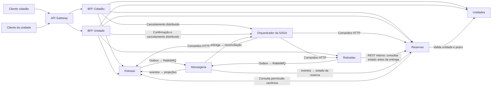

# GlicoAcesso - decisões arquiteturais compartilhadas

**Etapa:** 2 — Arquitetura\
**Versão:** 1.2\
**Situação:** contrato-base para os documentos da Etapa 2\
**Última revisão:** 24 de novembro de 2026

> Este documento estabelece a linguagem e as decisões que devem ser usadas por todas as pessoas do grupo. Os documentos de APIs, persistência, SAGA, Gateway e BFFs detalham estas decisões; não podem redefinir o mesmo conceito de outra forma. Se uma decisão precisar mudar, a alteração deve ser registrada aqui e propagada aos documentos afetados antes de ser considerada válida.

> **Arquitetura revisada.** O [resumo e índice](./resumo-arquitetura.md) reúne os documentos, contratos e diagramas da Parte 2.

## 1. Para que serve este documento

Uma pessoa que não participou das conversas do grupo deve conseguir entender, somente por esta documentação:

1. qual problema o GlicoAcesso atende e qual é o limite do sistema;
2. quais são os quatro microsserviços de domínio, o papel do Orquestrador e quem é dono de cada informação;
3. como uma solicitação de item passa de pedido a confirmação e retirada;
4. como a SAGA confirma a reserva e desfaz etapas concluídas quando há falha;
5. como os serviços se comunicam sem compartilhar bancos;
6. quais identificadores, estados e eventos devem ser usados nos demais documentos;
7. quais decisões técnicas já estão fixadas e quais detalhes pertencem a cada documento especializado.

Este é um contrato arquitetural da Etapa 2. O enunciado avalia o projeto documentado nesta etapa; a implementação executável será demonstrada nas etapas posteriores. Ainda assim, as decisões foram escolhidas para poderem ser implementadas depois sem trocar a semântica do sistema.

## 2. Base e força das decisões

As decisões deste arquivo cobrem os requisitos da Parte 2 do enunciado: decomposição e fronteiras (4.1), API REST e HATEOAS (4.2), Gateway (4.3), BFFs (4.4), bancos por serviço, consistência eventual e Outbox (4.5), SAGA (4.6) e CQRS (4.7).

Para interpretar o texto:

- **DEVE** indica regra obrigatória para os documentos e para a futura implementação.
- **NÃO DEVE** indica comportamento proibido pela arquitetura.
- **PODE** indica escolha permitida desde que não contradiga uma regra obrigatória.
- Uma sugestão feita em outro documento não substitui uma decisão deste arquivo.
- A palavra “reserva” sempre se refere à solicitação de uma quantidade de um item (medicamento ou insumo) para retirada em uma unidade; não significa entrega domiciliar nem recomendação clínica.

## 3. Problema, objetivo e limites do sistema

O GlicoAcesso organiza a consulta de disponibilidade e a solicitação de medicamentos e insumos para diabetes em unidades públicas de saúde. O cidadão pode localizar unidades, verificar a disponibilidade informada, solicitar uma reserva e acompanhar o resultado. A equipe de uma unidade pode administrar seu estoque, avaliar solicitações, preparar autorizações e registrar a retirada presencial.

O sistema coordena informações e etapas administrativas. Ele **não** diagnostica, prescreve, substitui a avaliação de profissionais de saúde nem garante que uma consulta de disponibilidade equivale a uma reserva confirmada. A consulta pode estar alguns segundos atrasada; a confirmação depende de uma alocação validada pelo serviço de Estoque.

### 3.1 Atores

| Ator | O que pode fazer no escopo da Etapa 2 |
|---|---|
| Cidadão | Consultar unidades e disponibilidade; criar, acompanhar e cancelar a própria solicitação antes da retirada física. |
| Profissional da unidade | Consultar solicitações destinadas à sua unidade; rejeitar ou aceitar uma solicitação; administrar o estoque da unidade; registrar uma retirada autorizada. |
| Serviços internos | Executar a confirmação distribuída, publicar eventos e atualizar projeções de leitura. |

As credenciais e a identidade do ator são verificadas na borda/API. Nos dados de domínio, os serviços usam um identificador estável do ator, sem copiar perfil, senha ou dados de autenticação para os bancos dos microsserviços.

### 3.2 Unidade de solicitação

Uma reserva contém **exatamente um item, uma unidade de retirada e uma quantidade positiva**. O item pode ser medicamento ou insumo. Se o cidadão precisar de dois itens, cria duas reservas independentes. Essa regra evita confirmação parcial de itens e torna o resultado da SAGA inequívoco.

Cada solicitação tem um cidadão solicitante e uma unidade de retirada. O vínculo entre cidadão, unidade, item e quantidade é referencial: cada serviço mantém apenas os identificadores externos necessários, não cópias das tabelas de outro serviço.

## 4. Vocabulário canônico

| Termo | Significado único neste projeto |
|---|---|
| Unidade | Estabelecimento público em que o estoque é mantido e a retirada ocorre. |
| Item | Medicamento ou insumo do catálogo administrado pelo serviço de Estoque. |
| Estoque físico | Quantidade registrada fisicamente como pertencente à unidade. |
| Quantidade alocada | Parte do estoque físico reservada para uma reserva confirmada, ainda não retirada. |
| Disponibilidade | Quantidade calculada para consulta: estoque físico menos alocações ativas, conforme a projeção de leitura. Pode estar defasada. |
| Reserva | Solicitação de um item e quantidade em uma unidade, identificada por `reservaId`. Cada reserva contém exatamente um item. |
| Alocação | Retenção de quantidade no Estoque, vinculada a uma única reserva. Não representa entrega física. |
| Autorização de retirada | Registro criado por Retiradas após a alocação. Sua existência não basta para entregar: no balcão, Retiradas consulta Reservas e exige estado canônico `CONFIRMADA`, além de autorização local não revogada nem utilizada. |
| Retirada | Entrega presencial efetivamente registrada pela unidade. |
| SAGA | Processo distribuído de confirmação de uma reserva, coordenado pelo Orquestrador da SAGA e compensado quando uma etapa posterior falha. |
| Compensação | Operação de negócio que desfaz o efeito de uma etapa concluída. Não é rollback de uma transação única entre bancos. |
| Evento | Fato passado e imutável publicado por um serviço para que outros serviços atualizem suas próprias projeções. |

“Confirmada” e “retirada” não são sinônimos: uma reserva confirmada tem estoque alocado e autorização preparada; só passa a retirada quando a unidade registra a entrega física.

## 5. Serviços e propriedade dos dados

Existem quatro microsserviços de domínio e um serviço independente de orquestração. Cada um dos cinco serviços tem seu próprio PostgreSQL em instância separada. Um serviço é o único responsável por gravar seus dados; os demais consultam sua API ou recebem eventos. **É proibido** que um serviço leia ou escreva diretamente no banco de outro serviço.

| Serviço | Responsabilidade e dados que possui | Não possui |
|---|---|---|
| **Unidades** | Cadastro e consulta de unidades, endereço, contatos institucionais, horários e informações de atendimento. Também configura o prazo de análise `prazoAnalise` para solicitações da unidade. | Estoque de itens, configuração de `permiteReserva`, reservas, autorização ou histórico de retirada. |
| **Estoque** | Catálogo de medicamentos e insumos; estoque físico por unidade e item; movimentações; configuração de `permiteReserva` por unidade/item; alocações associadas a `reservaId`; modelo de leitura de disponibilidade; Outbox de eventos de estoque. | Dados pessoais do cidadão, decisão de aceitar uma solicitação, autorização ou prova de retirada. |
| **Reservas** | Solicitações e seu estado de negócio; decisão da unidade; histórico e resultado da confirmação; referências a cidadão, unidade e item. | Saldo canônico de estoque, registro da entrega física ou andamento técnico da SAGA. |
| **Retiradas** | Autorizações preparadas/canceladas; registro de quem e quando realizou a entrega; identificador da reserva associada. | Saldo do estoque ou decisão de disponibilidade. |

| **Orquestrador da SAGA** | Execuções e etapas duráveis de confirmação e cancelamento distribuído, tentativas, resultados, compensações e Inbox de retirada. | Estado canônico da reserva, regras de transição de domínio, saldo ou autorização de retirada. |

**Horários de atendimento.** Em Unidades, cada período DEVE ter início estritamente anterior ao fim no mesmo dia, sem duração nula e sem atravessar a meia-noite. Uma unidade PODE ter vários períodos por dia, desde que NÃO se sobreponham; períodos consecutivos (08:00–12:00 e 12:00–17:00) e horários iguais em dias diferentes são permitidos. Um período inválido rejeita a operação inteira.

### 5.1 Regras de fronteira

1. Cada serviço mantém a verdade do seu domínio. Por exemplo, Reservas pode exibir `itemId`, mas o nome, o tipo e a descrição canônicos do item pertencem a Estoque.
2. Uma chave estrangeira entre bancos não é usada. Relações entre serviços são referências por UUID, validadas por contrato de API ou evento.
3. Não se faz transação ACID distribuída entre os bancos dos serviços. Cada serviço confirma suas próprias transações locais.
4. BFFs podem combinar respostas de serviços para cada cliente, mas não se tornam donos dos dados nem armazenam cópias como fonte de verdade.
5. A aplicação da Etapa 2 não prevê um serviço próprio de identidade. Autenticação pode ser fornecida por um provedor externo; identidade e autorização de chamadas são tratadas na borda e propagadas aos serviços conforme necessário.

## 6. Arquitetura de comunicação

### 6.1 Componentes e caminhos



O diagrama é lógico: cada microsserviço de domínio e o Orquestrador têm sua própria instância PostgreSQL, não desenhada para manter o desenho legível. Os diagramas dos documentos especializados podem mostrar bancos, filas e fluxos de erro com mais detalhe, sem alterar estas fronteiras.

### 6.2 Regras de chamada

- O Gateway expõe apenas os dois BFFs. Clientes não chamam microsserviços de domínio diretamente.
- Os BFFs fazem consultas e comandos próprios de cada tipo de cliente e podem agregar respostas. Eles não implementam a SAGA.
- O **Orquestrador** coordena confirmação e cancelamento distribuído por REST interno com Reservas, Estoque e Retiradas. Reservas valida e grava suas próprias transições. Consultas, criação, rejeição e cancelamento pendente sem efeitos distribuídos seguem diretamente ao serviço responsável. O registro no balcão vai do BFF Unidade a Retiradas.
- Para registrar a entrega, Retiradas consulta o estado canônico de Reservas por REST interno. Essa dependência síncrona mantém a validação simples e não altera os participantes da SAGA de confirmação.
- RabbitMQ é infraestrutura transversal e propaga fatos em filas independentes para projeção, atualização de estado, baixa física e reconciliação. Elas não substituem o comando de confirmação nem transferem a coordenação da SAGA para os participantes.
- As APIs públicas são versionadas sob `/api/cidadao/v1` e `/api/unidade/v1`. As chamadas entre serviços usam rotas internas versionadas sob `/internal/v1`; essas rotas não são publicadas pelo Gateway.
- As APIs usam JSON UTF-8. Os nomes dos campos JSON são `camelCase`; identificadores são UUID em formato textual; instantes são ISO 8601 em UTC.

### 6.3 Decisões tecnológicas compartilhadas

| Decisão | Padrão adotado | Razão e consequência |
|---|---|---|
| Bancos | PostgreSQL, uma instância independente por serviço. | Os dados são relacionais e exigem transações locais; instâncias separadas evidenciam Database per Service e impedem acoplamento acidental. A escolha não obriga que os quatro serviços tenham esquemas idênticos. |
| Mensageria | RabbitMQ, com filas duráveis e entrega pelo menos uma vez. | É suficiente para os eventos de integração e projeções do projeto e é simples de executar no ambiente local. Consumidores devem tolerar duplicatas. |
| SAGA | Orquestrada por serviço independente, em camada de coordenação entre os BFFs e os serviços de domínio. | Há uma sequência curta e conhecida; um único coordenador torna a ordem, o estado de recuperação e a compensação demonstráveis. |
| CQRS | Serviço de Estoque. | Escritas precisam validar a quantidade canônica; consultas de disponibilidade podem ser otimizadas e aceitam pequena defasagem. |
| Outbox | Obrigatória para publicar eventos derivados de alterações persistidas. O fluxo de estoque é a implementação/projeto mínimo exigido. | A gravação do dado e do evento ocorre na mesma transação local, evitando dual write entre banco e broker. |

A tecnologia específica do Gateway, a linguagem dos serviços e bibliotecas/frameworks podem ser especificados nos documentos de implementação de cada frente, desde que preservem estes contratos. Se o grupo escolher um broker ou banco diferente, a mudança precisa ser justificada e revisada nos documentos de persistência, eventos, Compose e apresentação; não pode ser alterada silenciosamente em apenas um arquivo.

## 7. Identificadores e formatos canônicos

| Campo | Tipo/forma | Criado e controlado por | Uso |
|---|---|---|---|
| `unidadeId` | UUID | Unidades | Referência estável à unidade em Estoque, Reservas e Retiradas. |
| `itemId` | UUID | Estoque | Referência estável a um medicamento ou insumo em Reservas e Retiradas. |
| `reservaId` | UUID | Reservas | Chave de correlação da solicitação, da alocação e da autorização/retirada. |
| `cidadaoId` | UUID/string estável do provedor de identidade | Provedor de identidade | Referência ao solicitante; Reservas não copia credenciais ou perfil completo. |
| `alocacaoId` | UUID | Estoque | Identifica a alocação criada para uma reserva; no máximo uma alocação ativa por `reservaId`. |
| `autorizacaoId` | UUID | Retiradas | Identifica a autorização de retirada vinculada a uma reserva. |
| `retiradaId` | UUID | Retiradas | Identifica a entrega presencial efetivamente registrada. |
| `sagaId` | UUID | Orquestrador | Identifica uma execução da SAGA. Confirmação e cancelamento são execuções distintas, vinculadas ao mesmo `reservaId`; retries da mesma execução reutilizam o mesmo `sagaId`. Só pode haver uma execução ativa por reserva. |
| `eventId` | UUID | Serviço produtor | Identificador global de uma mensagem; consumidores registram-no para deduplicação. |
| `correlationId` | UUID | BFF/Gateway na entrada, se não recebido | Agrupa logs e chamadas da mesma requisição ponta a ponta. |
| `Idempotency-Key` | Cabeçalho HTTP com string opaca | Chamador da operação | Identifica um comando lógico e permite repetir o mesmo comando sem duplicar efeitos. O valor recebido é persistido como `idempotencyKey` no banco quando aplicável. |

### 7.1 Convenção de idempotência

Todo comando HTTP que cria ou altera estado exige o cabeçalho `Idempotency-Key`; consultas `GET` não o exigem. O cabeçalho é o único transporte da chave: ela não é repetida no corpo JSON. Seu escopo é o par serviço/operação, o principal autenticado e o valor da chave. Chaves iguais em operações diferentes não colidem.

O chamador cria uma chave para cada comando lógico e a persiste antes do envio. Retries do mesmo comando reutilizam a mesma chave e o mesmo conteúdo canônico; uma nova ação de negócio, inclusive uma compensação ou um cancelamento separado, recebe outra chave. Para cada operação de SAGA, o Orquestrador persiste a chave junto da etapa antes de enviar o comando.

O destinatário do comando registra atomicamente a chave, a impressão digital do conteúdo canônico e o resultado HTTP conclusivo junto do efeito local. Se duas requisições iguais chegarem ao mesmo tempo, apenas uma aplica o efeito; a outra aguarda ou lê o resultado persistido. A mesma chave com conteúdo diferente retorna `409 Conflict`. Uma repetição idêntica retorna o mesmo status e corpo da resposta original, inclusive depois de timeout ou reinício. Erros transitórios sem resultado conclusivo não são armazenados como resultado final e podem ser repetidos com a mesma chave.

Os registros idempotentes permanecem disponíveis pelo período de retenção do recurso/histórico a que pertencem; não se expiram enquanto uma SAGA ou compensação puder ser recuperada. Compensações mantêm sua própria chave e resultado original: uma resposta repetida não reaplica a liberação nem reativa uma autorização. Eventos usam `eventId` para deduplicação, independente desta convenção HTTP.

Identificadores de outras fronteiras são tratados como referências opacas. Um consumidor não deduz informações de negócio a partir dos caracteres de um UUID.

## 8. Fluxo de negócio e estados da reserva

### 8.1 Caminho normal

1. O cidadão consulta a disponibilidade e escolhe uma unidade e um item (medicamento ou insumo). A consulta é informativa, não uma garantia de estoque.
2. A solicitação só pode ser criada se a unidade permitir reservas para aquele item (`permiteReserva = true`). O BFF Cidadão envia a Reservas `unidadeId`, `itemId`, `quantidade` e a identidade autenticada do cidadão.
3. Reservas consulta Unidades para confirmar que a unidade existe e está ativa e obter seu `prazoAnalise`; consulta em Estoque a permissão canônica `permiteReserva` para a combinação `unidadeId`/`itemId`. Não usa a projeção de disponibilidade para autorizar a criação. Registra `SOLICITADA` e `decisaoAte = criadaEm + prazoAnalise` e devolve seu `reservaId`. Uma unidade só pode habilitar reservas se tiver configurado esse prazo.
4. Um profissional da unidade analisa a solicitação. Pode rejeitá-la ou aceitá-la. A decisão é autorizada para a unidade indicada na reserva.
5. O BFF Unidade solicita a confirmação ao Orquestrador. Ele persiste a execução e a intenção de comando antes de chamar Reservas, que valida e registra o aceite e `EM_CONFIRMACAO` em sua transação local.
6. Estoque tenta alocar atomicamente a quantidade solicitada para `reservaId`. A verificação é feita no modelo de escrita atual, não na projeção de disponibilidade.
7. Se a alocação funcionar, Retiradas cria uma autorização de retirada ligada a `reservaId` e `autorizacaoId`.
8. Com a alocação e a autorização confirmadas, o Orquestrador solicita a finalização. Reservas grava `CONFIRMADA`, o ponto de compromisso da confirmação. O Orquestrador registra sua execução como `CONCLUIDA` após confirmar o resultado.
9. No balcão, Retiradas consulta Reservas e só prossegue se o estado canônico retornado for `CONFIRMADA`. Revalida a autorização na transação local da entrega, serializando com sua revogação. A reserva passa a `RETIRADA` após o evento de retirada concluída ser processado por Reservas.

O aceite registra a decisão da unidade e dá início à confirmação. O cidadão só recebe o estado `CONFIRMADA` depois da alocação, da preparação da autorização e da finalização em Reservas.

### 8.2 Estados e transições permitidas

O campo `status` é o estado de negócio visível da reserva. Somente estas transições são válidas:

| Estado atual | Ação e condição | Estado seguinte |
|---|---|---|
| — | Pedido válido registrado | `SOLICITADA` |
| `SOLICITADA` | Profissional da unidade rejeita | `REJEITADA` |
| `SOLICITADA` | Cidadão cancela, profissional autorizado cancela com justificativa, ou o prazo de decisão vence | `CANCELADA` ou `EXPIRADA` |
| `SOLICITADA` | Profissional autorizado aceita; SAGA iniciada | `EM_CONFIRMACAO` |
| `EM_CONFIRMACAO` | Estoque alocado, autorização criada e finalização local gravada | `CONFIRMADA` |
| `EM_CONFIRMACAO` | Uma etapa falha e todas as compensações necessárias terminam | `FALHA_CONFIRMACAO` |
| `EM_CONFIRMACAO` | Cancelamento autorizado após a reconciliação dos comandos de confirmação já emitidos | `CANCELAMENTO_EM_ANDAMENTO` |
| `CONFIRMADA` | Cidadão solicita cancelamento ou profissional autorizado solicita cancelamento com justificativa | `CANCELAMENTO_EM_ANDAMENTO` |
| `CANCELAMENTO_EM_ANDAMENTO` | Cancelamento da autorização e liberação da alocação confirmados, quando aplicáveis | `CANCELADA` |
| `CANCELAMENTO_EM_ANDAMENTO` | `retirada.concluida.v1` comprova que a retirada física venceu o cancelamento | `RETIRADA` |
| `CONFIRMADA` | Retirada física registrada e evento processado | `RETIRADA` |

Estados terminais: `REJEITADA`, `CANCELADA`, `EXPIRADA`, `FALHA_CONFIRMACAO` e `RETIRADA`. No escopo desta etapa, não há reabertura de uma reserva terminal; deve ser criada outra solicitação.

Regras adicionais:

- Não existe transição direta de `SOLICITADA` para `CONFIRMADA`: a unidade precisa decidir e a SAGA precisa concluir.
- O cidadão pode cancelar a própria reserva enquanto ela estiver ativa e antes da retirada física. Um profissional autenticado e vinculado à unidade da reserva também pode cancelar; para esse ator, `justificativa` é obrigatória e fica registrada na auditoria. Uma reserva rejeitada, expirada, cancelada, retirada ou com falha de confirmação já é terminal e não aceita cancelamento adicional.
- A expiração automática ocorre somente enquanto a reserva está `SOLICITADA`: quando `agora >= decisaoAte` e nenhuma decisão venceu a corrida, Reservas muda o estado para `EXPIRADA`. O prazo é configurado por unidade em `prazoAnalise` e copiado para `decisaoAte` ao criar a solicitação. Como a SAGA ainda não começou, não há estoque a liberar. Reserva `EM_CONFIRMACAO` não expira por relógio: é finalizada ou cancelada pela SAGA.
- `CONFIRMADA` pode ser cancelada, mas o cancelamento coordena a revogação da autorização e a liberação da alocação antes de mudar para `CANCELADA`.
- `CANCELAMENTO_EM_ANDAMENTO` informa que o pedido foi aceito, mas efeitos distribuídos ainda estão sendo revertidos. Só passa a `CANCELADA` depois da confirmação de todas as operações aplicáveis.
- Retirada e cancelamento são concorrentes: Retiradas deve garantir que apenas um deles possa vencer. Se a entrega física for registrada primeiro, o cancelamento é recusado e o consumo de `retirada.concluida.v1` leva a reserva de `CONFIRMADA` ou `CANCELAMENTO_EM_ANDAMENTO` para `RETIRADA`; se o cancelamento concluir primeiro, a autorização não pode mais ser usada.
- `RETIRADA`, `REJEITADA`, `CANCELADA`, `EXPIRADA` e `FALHA_CONFIRMACAO` não voltam a estados anteriores.
- Os estados da execução da SAGA são distintos do estado de negócio e são descritos na seção 9. Uma SAGA com retry ou compensação pendente não deve ser apresentada como falha final.

## 9. SAGA de confirmação

### 9.1 Modelo escolhido

A SAGA é **orquestrada** por um serviço independente. Ele controla a ordem dos comandos HTTP, registra o progresso e executa compensações. A confirmação atravessa três serviços de domínio: Reservas, Estoque e Retiradas. Cada participante valida e confirma seus efeitos localmente. O Orquestrador fica na camada de coordenação. Os BFFs também acessam diretamente os serviços para operações locais.

A sequência conhecida e a necessidade de demonstrar falhas e compensações justificam a orquestração. Na coreografia, as decisões de avanço e compensação estariam distribuídas entre consumidores de eventos. Aqui, os eventos propagam fatos e apoiam a reconciliação, enquanto o Orquestrador decide os próximos comandos.

### 9.2 Etapas, efeitos e compensações

| Ordem | Serviço | Ação | Efeito local e recuperação |
|---:|---|---|---|
| 0 | Orquestrador | Receber o pedido do BFF Unidade | Persiste a execução, o pedido idempotente e a intenção do primeiro comando em sua própria transação. |
| 1 | Reservas | `AceitarReserva` | Valida o ator, o prazo e o estado atual. Registra o aceite e muda para `EM_CONFIRMACAO`. Rejeição conclusiva do aceite encerra a execução sem chamar Estoque ou Retiradas. |
| 2 | Estoque | `AlocarEstoque` | Valida o saldo canônico e cria a alocação. A compensação é `LiberarAlocacao` para a mesma reserva. |
| 3 | Retiradas | `PrepararAutorizacao` | Registra a autorização. A compensação é `CancelarAutorizacao`, preservando o histórico. |
| 4 | Reservas | `FinalizarConfirmacao` | Valida a transição e grava `CONFIRMADA`. A gravação é o ponto de compromisso da confirmação. |
| 5 | Orquestrador | Registrar conclusão | Persiste `CONCLUIDA` após recuperar o resultado conclusivo da finalização. |

A gravação da execução e o aceite em Reservas ocorrem em transações independentes. O Orquestrador persiste a intenção, os dados e a chave antes de cada chamada. O participante grava o efeito e seu resultado idempotente na mesma transação local. Uma interrupção entre a chamada e o registro do resultado permite recuperar o efeito já gravado pela repetição do comando.

Antes do ponto de compromisso, uma falha definitiva leva à compensação dos efeitos confirmados em ordem inversa. Se a autorização existir, sua revogação deve ser confirmada antes de liberar a alocação. Reservas só grava `FALHA_CONFIRMACAO` depois de concluídas as compensações aplicáveis. Após a gravação de `CONFIRMADA`, o Orquestrador recupera o resultado e conclui a confirmação. Um cancelamento posterior tem execução própria.

### 9.3 Fluxo distribuído de cancelamento

O cancelamento de `SOLICITADA` é local a Reservas e usa uma transição condicional. O BFF encaminha ao Orquestrador quando Reservas devolve `CANCELAMENTO_DISTRIBUIDO` com base no estado canônico. Reservas persiste o encaminhamento por chave e conteúdo para que a repetição siga o mesmo caminho. A rejeição e a expiração também são locais.

1. O BFF encaminha ao Orquestrador o pedido de cancelamento de uma reserva `EM_CONFIRMACAO` ou `CONFIRMADA`. O Orquestrador registra o pedido duravelmente e serializa o trabalho por `reservaId`.
2. Se a confirmação estiver ativa, o Orquestrador valida o pedido com Reservas antes de interromper seu avanço, pausa novos passos e reconcilia todos os comandos já emitidos. Se a finalização já tiver gravado `CONFIRMADA`, conclui a confirmação e trata o cancelamento como uma execução posterior. Se a confirmação já estiver compensando por falha definitiva, conclui a recuperação e reavalia o pedido pelo estado canônico.
3. O Orquestrador atribui um novo `sagaId` ao cancelamento e registra os efeitos conhecidos da confirmação. Persiste a intenção de pedir a Reservas a transição para `CANCELAMENTO_EM_ANDAMENTO`. Reservas valida o ator e o estado na própria transação e, para profissional, exige e registra justificativa. Os contratos exigem pelo menos cinco caracteres após remover espaços externos. Se houver confirmação ainda ativa, o pedido e a intenção ficam vinculados a ela até o resultado conclusivo. Se Reservas aceitar, o Orquestrador grava `INTERROMPIDA` e ativa a execução sucessora na mesma transação local. Se Reservas rejeitar, encerra o pedido e retoma a confirmação quando aplicável. Sem confirmação ativa, a própria execução de cancelamento mantém a intenção e seu resultado.
4. O Orquestrador solicita `CancelarAutorizacao` a Retiradas se houver autorização. Retiradas serializa revogação e entrega na mesma fronteira transacional. Só após confirmação durável da revogação, ou evidência conclusiva de que nunca houve autorização, o Orquestrador pode pedir a liberação da alocação aplicável.
5. Após confirmar as operações aplicáveis, o Orquestrador pede a Reservas que grave `CANCELADA` e então conclui a execução. Resultado incerto mantém o cancelamento em andamento e exige repetição com a mesma chave e conteúdo.

Se Retiradas comprovar que a entrega física venceu, o Orquestrador encerra o cancelamento como `INTERROMPIDA` e preserva a alocação para baixa por Estoque. Reservas muda `CONFIRMADA` ou `CANCELAMENTO_EM_ANDAMENTO` para `RETIRADA` ao processar o evento. Mensagens tardias não reativam a execução. A cópia do evento na fila do Orquestrador auxilia a reconciliação. A decisão de liberar estoque exige a confirmação obtida de Retiradas, mesmo quando a mensagem ainda não tiver chegado.

### 9.4 Estados da execução da SAGA

O registro interno da SAGA usa os estados:

- `EM_EXECUCAO`: um passo ainda será tentado ou está em processamento;
- `COMPENSANDO`: houve falha de negócio/terminal após um ou mais efeitos e as compensações estão sendo aplicadas;
- `COMPENSACAO_PENDENTE`: uma compensação não foi confirmada; o sistema continuará tentando e alertará a operação;
- `CANCELANDO`: um pedido explícito de cancelamento está revertendo efeitos distribuídos;
- `CANCELAMENTO_PENDENTE`: não foi possível confirmar uma operação de cancelamento; o sistema continuará tentando;
- `INTERROMPIDA`: execução encerrada sem prosseguir em suas etapas, seja uma confirmação interrompida por solicitação de cancelamento após reconciliar chamadas em voo ou com resultado desconhecido, seja um cancelamento inviabilizado pela entrega comprovada em Retiradas, seja uma execução cujo comando inicial foi rejeitado sem efeitos;
- `CONCLUIDA`: reserva confirmada;
- `COMPENSADA`: efeitos distribuídos revertidos após falha de confirmação; reserva marcada `FALHA_CONFIRMACAO`;
- `CANCELADA`: efeitos distribuídos revertidos por solicitação de cancelamento; reserva marcada `CANCELADA`.

`INTERROMPIDA` encerra uma execução técnica. Quando uma confirmação dá lugar ao cancelamento, a nova execução recebe os efeitos a reverter. Quando uma entrega inviabiliza o cancelamento, o Orquestrador registra a evidência e encerra a execução.

`COMPENSACAO_PENDENTE` e `CANCELAMENTO_PENDENTE` representam operações em recuperação. A equipe pode localizar a execução por `sagaId` ou `reservaId` e consultar a etapa, as tentativas e o erro técnico. O cidadão acompanha o estado da reserva.

### 9.5 Falhas, timeouts e recuperação

- **Estoque rejeita a alocação.** O Orquestrador deixa de avançar para Retiradas, pede que Reservas grave `FALHA_CONFIRMACAO` e encerra a execução como `COMPENSADA`, sem efeito de estoque a reverter.
- **Retiradas rejeita a preparação após a alocação.** Com evidência de que a autorização não foi criada, o Orquestrador libera a alocação e pede que Reservas registre a falha. Se a autorização foi criada, revoga antes de liberar.
- **A resposta de um comando se perde.** O Orquestrador mantém o resultado como desconhecido e repete o comando com a mesma chave e conteúdo. Isso se aplica também à finalização em Reservas: se a gravação de `CONFIRMADA` ocorreu, recupera seu resultado e conclui a execução sem compensar.
- **Uma compensação ou um cancelamento ainda não foi confirmado.** O Orquestrador mantém a etapa pendente, retenta com backoff e gera alerta operacional quando necessário.
- **O Orquestrador reinicia.** Retoma do último registro durável, incluindo a intenção de comando, as chaves e os efeitos já conhecidos. A recuperação independe da requisição HTTP original.

### 9.6 Idempotência e concorrência

- O banco do Orquestrador garante no máximo uma execução ativa por reserva. A seleção de trabalho e o avanço de etapas usam controle transacional e versão da execução, inclusive entre réplicas. Um trabalhador que perdeu a posse não pode decidir ou persistir o passo seguinte. Chamadas repetidas de uma intenção já registrada reutilizam a mesma chave e conteúdo.
- O Orquestrador persiste `correlationId`. Comandos entre serviços incluem `sagaId` e `reservaId` como referências do fluxo e usam `Idempotency-Key` para deduplicação.
- Reservas serializa aceite, expiração, cancelamento local e demais transições por atualização condicional do estado. Retiradas serializa entrega e revogação na autorização. Leituras remotas não substituem essas garantias locais.
- Estoque garante unicidade da alocação ativa por `reservaId`. Retiradas garante uma autorização por `reservaId`. Comandos repetidos retornam o resultado registrado sem reaplicar seu efeito.

### 9.7 Diagramas da SAGA

Os diagramas detalhados de sucesso e falha ficam em `docs/parte-2/diagramas/saga-sucesso.md` e `docs/parte-2/diagramas/saga-falha.md`. Na refatoração, eles devem espelhar os participantes, comandos, estados e compensações definidos aqui.

### 9.8 Validação da Reserva no registro da retirada

Retiradas obtém o `reservaId` da autorização e consulta `GET /internal/v1/reservas/{reservaId}/estado`, autenticado como serviço. Reservas retorna apenas `reservaId` e `status` de sua fonte canônica, sem cache ou projeção. Só uma resposta válida com o mesmo identificador e `status = CONFIRMADA` permite prosseguir. Estado diferente, reserva inexistente, timeout ou indisponibilidade impedem o registro naquele momento; nova tentativa exige nova consulta. O GET não exige chave idempotente; `X-Correlation-Id` é opcional para rastreamento.

Após a consulta, Retiradas revalida localmente que a autorização não foi revogada nem utilizada e confirma entrega e Outbox na mesma transação. A consulta não bloqueia a Reserva: se retornar `CANCELAMENTO_EM_ANDAMENTO`, a entrega é recusada; se retornar `CONFIRMADA` e o cancelamento começar depois, revogação e entrega disputam a autorização em Retiradas. Se a entrega vencer, aplica-se a transição e o encerramento do cancelamento definidos na seção 9.3. Essa dependência síncrona evita sincronização adicional de estado e mantém os três serviços na SAGA de confirmação.

## 10. Eventos, Outbox e consistência eventual

### 10.1 Envelope de evento

Todo evento publicado usa um envelope JSON com estes campos obrigatórios:

```json
{
  "eventId": "UUID",
  "eventType": "estoque.alocacao-criada.v1",
  "eventVersion": 1,
  "occurredAt": "2026-10-09T12:00:00Z",
  "aggregateType": "AlocacaoEstoque",
  "aggregateId": "UUID",
  "correlationId": "UUID",
  "causationId": "UUID",
  "payload": {}
}
```

O exemplo ilustra o formato, não um evento de teste com IDs reais. `eventId` identifica a mensagem; `aggregateId` identifica o objeto de domínio; `correlationId` une o fluxo; `causationId` aponta o comando ou evento que causou a publicação. Eventos são fatos já ocorridos, escritos no passado, e não comandos.

### 10.2 Eventos canônicos da primeira versão

| Produtor | `eventType` | Quando publicar | Consumidor/uso inicial |
|---|---|---|---|
| Retiradas | `retirada.concluida.v1` | A entrega física e o evento foram persistidos na mesma transação local, pela Outbox. | Reservas muda `CONFIRMADA` ou `CANCELAMENTO_EM_ANDAMENTO` para `RETIRADA` quando aplicável. O Orquestrador reconcilia o cancelamento distribuído conforme a seção 9.3. Estoque baixa a quantidade física e encerra a alocação ativa da reserva como consumida. |
| Estoque | `estoque.retirada-baixada.v1` | Estoque processou a retirada, baixou a quantidade física e encerrou a alocação na mesma transação local. | Atualizar a projeção de disponibilidade e informar outros consumidores interessados. |

O evento `retirada.concluida.v1` deve incluir no `payload` `retiradaId`, `reservaId`, `unidadeId`, `itemId` e `quantidade`. Esses dados identificam o item entregue e a alocação que Estoque deve encerrar. O evento não deve incluir dados pessoais do cidadão. `occurredAt` registra o instante do fato no envelope.

O evento `estoque.retirada-baixada.v1` deve incluir `retiradaId`, `reservaId`, `unidadeId`, `itemId` e `quantidadeBaixada`. A quantidade é positiva e representa o valor retirado do estoque físico e encerrado da alocação daquela reserva. A projeção de disponibilidade aplica a baixa física e a redução da alocação ativa ao processar esse evento.

RabbitMQ entrega `retirada.concluida.v1` em três filas duráveis independentes, para Reservas, Estoque e Orquestrador. A projeção de disponibilidade tem sua própria fila para eventos de Estoque. Cada consumidor persiste a deduplicação por `eventId` em sua Inbox junto do efeito local e confirma a mensagem após o commit.

O consumidor de `retirada.concluida.v1` em Estoque deve, em uma única transação local:

1. deduplicar a mensagem por `eventId`;
2. validar que existe uma alocação ativa para o `reservaId` com os mesmos `unidadeId`, `itemId` e `quantidade` do evento;
3. registrar a movimentação de saída, reduzir o estoque físico e encerrar a alocação;
4. gravar na Outbox o evento `estoque.retirada-baixada.v1`, para atualização da projeção de disponibilidade.

Se a mensagem já tiver sido processada, o consumidor não repete a baixa. Se a alocação não existir ou seus dados não corresponderem ao evento, Estoque não realiza uma baixa parcial ou arbitrária: registra a ocorrência para reconciliação operacional e mantém o evento observável para reprocessamento após correção. O evento da retirada continua sendo a prova de que a entrega física aconteceu em Retiradas.

Os eventos produzidos por Estoque devem incluir no `payload` os identificadores `unidadeId`, `itemId`, `reservaId` quando aplicável e a alteração quantitativa necessária para reconstruir a projeção. Não devem incluir dados pessoais do cidadão.

### 10.3 Outbox e publicação

- O serviço produtor grava a alteração de negócio e a linha da Outbox na **mesma transação PostgreSQL local**.
- Um publicador separado lê linhas pendentes, envia o evento ao RabbitMQ, aguarda confirmação do broker e marca a linha como publicada.
- Se publicar e cair antes de marcar como publicada, a mensagem poderá ser enviada novamente. A entrega é pelo menos uma vez; consumidores deduplicam por `eventId`.
- Se o broker estiver fora do ar, a alteração local continua válida, o evento permanece pendente e será reenviado quando o broker voltar. O publicador aplica backoff e não descarta a linha automaticamente.
- Falhas permanentes após retries devem ficar observáveis em fila de erro/DLQ ou estado de falha operacional, com procedimento de reprocessamento documentado; não se apaga silenciosamente um evento necessário.
- A tabela Outbox e os detalhes do publicador são descritos em `11-outbox.md`; seu contrato não pode mudar o envelope ou o significado dos eventos acima.

### 10.4 Onde existe consistência eventual

1. A disponibilidade consultada pelo cidadão é uma projeção de leitura de Estoque, atualizada após eventos. Pode atrasar em relação ao saldo canônico.
2. O estado `RETIRADA` em Reservas é atualizado após Reservas consumir `retirada.concluida.v1`; pode haver um intervalo em que Retiradas já registrou a entrega e Reservas ainda exibe `CONFIRMADA` ou `CANCELAMENTO_EM_ANDAMENTO`.
3. As etapas da SAGA e seus efeitos nos participantes são gravados separadamente. O Orquestrador reconcilia o progresso a partir dos resultados idempotentes e de sua Inbox de retirada.
4. Qualquer BFF ou visão de pesquisa que combine eventos pode ficar temporariamente defasada em relação ao serviço de origem.

O atraso-alvo para projeções é de até **5 segundos em condições normais**. A resposta de leitura deve informar `atualizadoEm` para que um cliente possa reconhecer a idade da informação. Se a projeção exceder 5 segundos, deve ser sinalizada como desatualizada/monitorada; essa defasagem não pode ser escondida como se fosse informação atual.

**Regra de segurança:** comandos de alocação consultam e atualizam atomicamente o modelo de escrita de Estoque. Nunca aceitam ou negam uma reserva apenas com base no número da projeção lida pelo cidadão. Se a disponibilidade exibida estiver desatualizada, a alocação é a validação final e a API deve devolver resultado de negócio explícito.

## 11. CQRS no serviço de Estoque

Estoque separa modelos de escrita e de leitura, ainda que ambos possam residir na mesma instância PostgreSQL do serviço:

| Modelo de escrita (autoridade) | Modelo de leitura (projeção) |
|---|---|
| Saldo físico e movimentações por unidade/item. | Quantidade disponível por unidade/item para pesquisa. |
| Alocações e liberações identificadas por `reservaId`. | Visão agregada para BFF Cidadão e consultas operacionais. |
| Valida invariantes e concorrência em transação local. | Otimiza leitura e pode refletir eventos alguns segundos depois. |

O modelo de leitura é atualizado por eventos persistidos na Outbox e publicados no RabbitMQ. O consumidor é idempotente e atualiza sua projeção antes de confirmar a mensagem. `12-cqrs.md` detalha tabelas, atualização e comportamento diante de atraso; deve preservar o limite de 5 segundos e a regra de que a escrita é a autoridade.

## 12. Contratos HTTP, Gateway, BFFs e HATEOAS

Os contratos OpenAPI são a definição detalhada dos endpoints. O [contrato do Orquestrador](./api/orquestrador.yaml) define sua API interna. Os contratos seguem as regras compartilhadas abaixo:

1. APIs públicas seguem `/api/cidadao/v1/...` ou `/api/unidade/v1/...`; operações internas usam `/internal/v1/...` e não são roteadas publicamente.
2. Gateway encaminha cada cliente para seu BFF. Ele aplica responsabilidades transversais definidas em `03-api-gateway.md`, mas não contém regra de negócio da reserva.
3. BFF Cidadão apresenta somente dados e ações úteis ao cidadão; BFF Unidade apresenta dados operacionais e ações autorizadas à equipe. Ambos consomem APIs dos serviços, nunca bancos.
4. HATEOAS deve ser demonstrado no recurso Reserva. O cidadão proprietário pode cancelar enquanto a reserva estiver ativa e antes da retirada física; profissional autorizado da unidade também pode cancelar e deve fornecer justificativa. A ação não é oferecida para `CANCELAMENTO_EM_ANDAMENTO`, `RETIRADA`, `REJEITADA`, `CANCELADA`, `EXPIRADA` ou `FALHA_CONFIRMACAO`.
5. Criar uma solicitação não é sinônimo de confirmação. O contrato deve devolver `SOLICITADA`; aceitar uma solicitação inicia um processo assíncrono. O cliente acompanha o recurso até obter o resultado de negócio, inclusive se houver cancelamento concorrente. A aceitação HTTP de um pedido pelo Orquestrador exige registro durável e não implica conclusão da SAGA.
6. Resultados de negócio esperados — como estoque insuficiente — devem ser distinguíveis de falhas técnicas, autorização negada e recurso inexistente.
7. A API de disponibilidade retorna `atualizadoEm` e pode incluir indicador de defasagem. A API de comando de alocação é decisiva para confirmar.

8. Nos BFFs, a operação local concluída retorna `200`. Um pedido distribuído persistido retorna `202` e `Location` para consultar a Reserva. Reservas registra `ACEITE_ENCAMINHAR` ou `CANCELAMENTO_DISTRIBUIDO` para fixar o destino de uma repetição idempotente. O encaminhamento de aceite em si preserva o estado de negócio até o comando do Orquestrador.

Os detalhes de status HTTP, esquemas, parâmetros, autenticação, limites e exemplos completos ficam nos arquivos OpenAPI, `07-hateoas.md`, `03-api-gateway.md` e `04-bffs.md`.

## 13. Persistência, privacidade e integridade

- Há cinco instâncias independentes de PostgreSQL: Unidades, Estoque, Reservas, Retiradas e Orquestrador.
- `saga_execucoes`, `saga_etapas` e a Inbox de reconciliação pertencem ao Orquestrador. Reservas mantém a reserva, seu histórico, registros de idempotência local e a Inbox para retirada. IDs entre serviços são referências, sem chaves estrangeiras entre bancos.
- Estoque e Retiradas publicam seus eventos por Outbox local. Os comandos HTTP do Orquestrador são recuperados pelo registro durável de intenção e resultado em suas etapas.
- Cada microsserviço pode alterar somente seu banco. Uma integração não pode contornar a API/evento para consultar uma tabela alheia.
- Dados pessoais são limitados ao identificador estável do cidadão e ao necessário para cumprir a retirada. O sistema não armazena cópia de receita ou documentos de saúde; requisitos são apresentados ao cidadão e conferidos pela unidade. Senhas e tokens nunca são armazenados nos bancos de domínio nem publicados em eventos.
- Estoque deve impedir alocação superior ao saldo disponível por operação atômica/controle de concorrência no banco de escrita.
- Retiradas exige consulta canônica de `CONFIRMADA` e autorização local válida, vinculada à mesma unidade e reserva. A transação local revalida revogação e uso; uma entrega só pode ser confirmada uma vez.
- Reservas registra ator e instante das decisões de unidade, confirmação e cancelamento. Quando o cancelamento for solicitado por profissional da unidade, também registra uma justificativa não vazia.
- Cada serviço valida novamente os dados e permissões relevantes à própria operação; confiar no BFF como única barreira não é suficiente.

## 14. Divisão de trabalho e dependências

O contrato-base é responsabilidade de **Marcos** e deve ser estabilizado antes da implementação paralela. A divisão abaixo associa cada frente aos critérios e reduz sobreposição:

| Pessoa | Frente e entregáveis principais | Dependência |
|---|---|---|
| **Marcos** | Fronteiras e justificativa dos quatro serviços; arquitetura geral; fluxo e estados; SAGA, compensações e diagramas de sucesso/falha. `01`, `02`, `05`, `06` e `diagramas/`. | Define primeiro este contrato-base. Depois alinha nomes de comandos/eventos com Guilherme e Lana. |
| **Guilherme** | Contratos REST/OpenAPI dos quatro serviços de domínio e do Orquestrador, além de HATEOAS da Reserva. `api/*.yaml` e `07-hateoas.md`. | Usa serviços, estados, campos e transições definidos aqui. |
| **Arthur** | API Gateway e dois BFFs, com rotas, autenticação e respostas específicas dos dois clientes. `03-api-gateway.md` e `04-bffs.md`. | Usa os contratos REST de Guilherme e não altera regras dos serviços. Pode esboçar rotas antes e fechar após o OpenAPI. |
| **Lana** | Bancos por serviço, consistência eventual, Outbox e CQRS no Estoque. `09`–`12`. | Usa propriedade de dados, eventos, envelope, broker e defasagem definidos aqui. |

Todas as pessoas devem revisar os documentos integrados e participar da apresentação, conforme o enunciado. Cada integrante deve manter contribuição autoral verificável no GitHub; a divisão de tarefas não substitui essa exigência.

### 14.1 Ordem de trabalho

1. Marcos publica este contrato-base com fronteiras, estados e fluxo inicial.
2. Guilherme, Arthur e Lana trabalham em paralelo, seguindo o contrato.
3. Marcos confere que os contratos HTTP e eventos concretos mantêm a sequência e a semântica acordadas.
4. O grupo executa revisão cruzada: uma pessoa verifica os documentos de outra frente e registra divergências para correção.
5. README e índice de `/docs` apontam para os arquivos efetivamente existentes; não se deve deixar link quebrado ou referência a decisão ainda não escrita.

Para a apresentação de 22/10, o enunciado determina congelamento do repositório às **23h59 de 21/10/2026** para todos os grupos. O grupo deve revisar e integrar antes desse horário.

## 15. Estrutura documental e rastreabilidade

Estrutura de `/docs/parte-2/`:

```text
00-decisoes-compartilhadas.md
01-microsservicos.md
02-diagrama-arquitetura.md
03-api-gateway.md
04-bffs.md
05-fluxo-reservas.md
06-saga.md
07-hateoas.md
08-saga.md
09-bancos.md
10-consistencia.md
11-outbox.md
12-cqrs.md
resumo-arquitetura.md
api/
  unidade.yaml
  estoque.yaml
  reserva.yaml
  retirada.yaml
  orquestrador.yaml
  bff-cidadao.yaml
  bff-unidade.yaml
diagramas/
  saga-sucesso.md
  saga-falha.md
  saga-caminho-feliz.md
  saga-compensacao.md
  saga-cancelamento-retirada.md
```

| Requisito do enunciado | Documento(s) que o demonstram |
|---|---|
| 4.1 — decomposição, fronteiras e comunicação | `01-microsservicos.md`, `02-diagrama-arquitetura.md` |
| 4.2 — REST, versionamento e HATEOAS | `api/*.yaml`, `07-hateoas.md` |
| 4.3 — Gateway e routing | `03-api-gateway.md` |
| 4.4 — dois BFFs distintos | `04-bffs.md` |
| 4.5 — banco por serviço, consistência e Outbox | `09-bancos.md`, `10-consistencia.md`, `11-outbox.md` |
| 4.6 — SAGA, compensações e falhas | `06-saga.md`, `diagramas/saga-sucesso.md`, `diagramas/saga-falha.md` |
| 4.7 — CQRS e defasagem | `12-cqrs.md` |

## 16. Checklist de consistência antes de integrar

Revisão integrada local da documentação, contratos e diagramas da Parte 2, em 24/11/2026.

- [x] Todos os documentos preservam os quatro serviços de domínio e mostram o Orquestrador como único coordenador da SAGA.
- [x] Cada serviço tem uma instância de banco própria; nenhum diagrama mostra leitura cruzada de bancos.
- [x] Uma reserva contém um único item (medicamento ou insumo), uma unidade e quantidade positiva.
- [x] A criação valida unidade ativa e permissão canônica `permiteReserva`; consulta de disponibilidade projetada não autoriza a solicitação.
- [x] Os mesmos nomes de estado e transições aparecem em APIs, HATEOAS, SAGA, banco e diagramas, incluindo cancelamento em andamento e expiração da solicitação pendente.
- [x] A reserva só fica `CONFIRMADA` depois de alocação no Estoque e autorização em Retiradas.
- [x] A retirada física ocorre depois da confirmação e só muda o estado para `RETIRADA` após registro em Retiradas.
- [x] Antes da entrega, Retiradas consulta o estado canônico em Reservas e exige `CONFIRMADA`; falha de consulta impede o registro, e a transação local serializa entrega e revogação.
- [x] A SAGA tem três participantes — Reservas, Estoque e Retiradas — e as compensações são idempotentes e reversas.
- [x] Timeout não é interpretado automaticamente como falha remota; resultado incerto é repetido com a mesma chave idempotente e conteúdo.
- [x] Eventos usam envelope e nomes canônicos; cada produtor usa Outbox quando publica eventos.
- [x] Mensagens podem chegar duplicadas. Reservas, Estoque e Orquestrador recebem a retirada em filas próprias e deduplicam localmente.
- [x] Disponibilidade de leitura é marcada com instante de atualização; a escrita do Estoque é autoridade.
- [x] Profissional da unidade informa justificativa ao cancelar; nenhuma reserva pode ser cancelada após a retirada física ser registrada.
- [x] Gateway expõe os BFFs, não as APIs internas dos microsserviços.
- [x] O BFF Cidadão e o BFF Unidade apresentam respostas e ações apropriadas a públicos diferentes.
- [x] Os sete arquivos OpenAPI (quatro serviços de domínio, Orquestrador e dois BFFs) descrevem operações, schemas de entrada obrigatórios e versão `/v1` compatíveis com os fluxos documentados.
- [x] Todo comando HTTP de alteração exige `Idempotency-Key` no cabeçalho; repetição idêntica recupera o resultado original, e conteúdo divergente produz conflito.
- [x] Cada operação HATEOAS usa caminho, método e corpo declarados no contrato do BFF correspondente.
- [x] As rotas de cliente documentadas no Gateway cobrem as operações declaradas pelos dois BFFs.
- [x] Os links Markdown relativos e os destinos do README apontam para arquivos existentes.
- [x] Os diagramas Mermaid foram renderizados localmente.
- [ ] Conferir a renderização no GitHub após a publicação da branch.

## 17. Como alterar uma decisão

Se a implementação ou a revisão do enunciado mostrar que uma decisão precisa mudar:

1. registrar neste arquivo a decisão anterior, a nova decisão, a razão e os documentos afetados;
2. revisar o impacto nas fronteiras dos serviços, contratos OpenAPI, SAGA, eventos, bancos, Gateway/BFFs e apresentação;
3. atualizar todos os documentos dependentes no mesmo conjunto de alterações;
4. avisar as quatro pessoas e integrar a mudança por branch/pull request.

Enquanto essa revisão não acontecer, prevalece a decisão deste documento. Nenhum documento especializado deve introduzir silenciosamente um novo estado, evento, identificador, banco compartilhado, participante da SAGA ou endpoint que contradiga o contrato-base.

### 17.1 Alterações registradas

| Data | Decisão anterior | Nova decisão | Razão | Documentos afetados |
|---|---|---|---|---|
| 24/11/2026 | Sem regra para a validade e a sobreposição dos períodos de atendimento. | Períodos válidos no mesmo dia e sem sobreposição, conforme a seção 5. | Evitar agendas contraditórias na consulta pública. | 00, 01, 09 e `api/unidade.yaml`. |

## 18. Referência ao enunciado

Documento de base: **GCC129 — Sistemas Distribuídos — 2026/2, Trabalho Prático: Startup de Sistema Distribuído**, especialmente as seções 2.1–2.3, 4.1–4.7 e 6.1. A Parte 2 avalia a arquitetura documentada; a Parte 4 exige que a SAGA e sua compensação sejam demonstradas em execução. Portanto, estados de recuperação, idempotência, observabilidade e falhas foram definidos desde já para não criar uma arquitetura que só funcione no papel.
