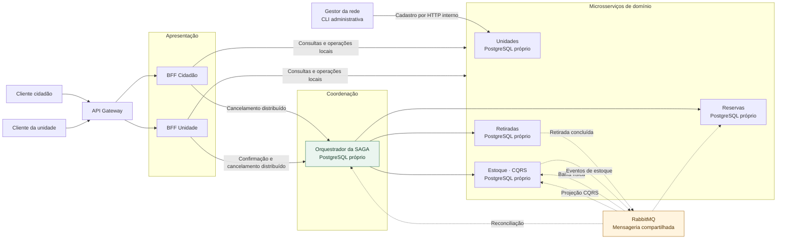

# GlicoAcesso - diagrama da arquitetura

**Etapa:** 2 — Arquitetura\
**Documento:** 02 - Diagrama de arquitetura\
**Versão:** 1.1\
**Última revisão:** 24 de novembro de 2026

O diagrama mostra a arquitetura lógica do GlicoAcesso. As fronteiras e responsabilidades seguem os documentos [00 - Decisões arquiteturais compartilhadas](./00-decisoes-compartilhadas.md) e [01 - Microsserviços](./01-microsservicos.md).

[Diagrama completo com a extensão de orientação da Parte 4 (SVG)](../arquitetura-glicoacesso.svg)

## 1. Visão geral

| Elemento | Como ler |
|---|---|
| Seta contínua | Chamada HTTP. As setas que saem do Orquestrador representam comandos internos da SAGA. |
| Seta tracejada | Evento assíncrono publicado ou entregue pelo RabbitMQ. |
| PostgreSQL próprio | Cada serviço indicado possui uma instância independente. O Orquestrador guarda as execuções e etapas. Reservas guarda o estado da solicitação. |

As setas dos BFFs para o grupo de domínio resumem os destinos. A tabela abaixo especifica quais serviços cada BFF usa.

## 2. Caminhos de entrada

| BFF | Consultas e operações locais | Operações coordenadas |
|---|---|---|
| Cidadão | Unidades, Estoque e Reservas. | Cancelamento distribuído. |
| Unidade | Unidades, Estoque, Reservas e Retiradas. | Confirmação e cancelamento distribuído. |

O API Gateway publica as rotas dos BFFs. Consultas, criação, rejeição e cancelamento de solicitação pendente sem efeitos distribuídos vão ao serviço responsável. O BFF Unidade registra a entrega no balcão diretamente em Retiradas. Na confirmação, Reservas valida e grava o aceite e a transição final para `CONFIRMADA`. O Orquestrador solicita essas transições, a alocação em Estoque e a preparação da autorização em Retiradas.

O gestor usa a CLI na rede administrativa para cadastrar uma unidade diretamente em Unidades. O profissional seleciona um item do catálogo e registra a quantidade recebida pelo painel da unidade. O lançamento segue por Gateway → BFF Unidade → Estoque. Estoque grava a entrada e emite um evento para atualizar a disponibilidade.

### Validações internas

Essas chamadas HTTP complementam as setas do diagrama macro:

| Origem | Destino | Validação |
|---|---|---|
| Reservas | Unidades | Unidade ativa e prazo de análise. |
| Reservas | Estoque | Permissão canônica para reservar o item na unidade. |
| Estoque | Unidades | Confirma que a unidade está ativa antes de registrar uma nova entrada. |
| Retiradas | Reservas | Estado canônico `CONFIRMADA` antes do registro da entrega. |

## 3. RabbitMQ e filas

Retiradas publica `retirada.concluida.v1` pela Outbox. O RabbitMQ entrega uma cópia em cada fila durável:

| Consumidor | Efeito |
|---|---|
| Reservas | Atualiza o estado da solicitação para `RETIRADA` quando aplicável. |
| Estoque | Registra a baixa física e encerra a alocação como consumida. |
| Orquestrador | Reconcilia um eventual cancelamento em andamento. |

Estoque publica seus próprios eventos pela Outbox. A projeção de disponibilidade os recebe em outra fila e atualiza o modelo de leitura do CQRS. A escrita canônica e a projeção ficam em tabelas distintas do PostgreSQL de Estoque.

## 4. Detalhes dos fluxos

- [Fluxo de reservas](./05-fluxo-reservas.md) e [SAGA](./06-saga.md)
- [API Gateway](./03-api-gateway.md) e [BFFs](./04-bffs.md)
- [Bancos](./09-bancos.md), [Outbox e Inbox](./11-outbox.md) e [CQRS](./12-cqrs.md)

## Extensão da Parte 4

Com o perfil `orientacao`, o portal encaminha `POST /api/cidadao/v1/orientacoes` pelo Gateway e BFF Cidadão. O serviço Orientação consulta o BFF para obter a projeção atual do Estoque, lê os guias indexados em PostgreSQL com pgvector e chama o provedor de embeddings e geração pela rede de saída. O banco da orientação fica em sua própria rede privada. O índice é compartilhado com o comando de ingestão por meio do volume nomeado. O perfil acrescenta dois serviços em execução e só o Gateway publica porta.

- [Arquitetura e contrato da orientação](../parte-4/01-orientacao-com-rag.md)
- [Validação e prova ao vivo da Parte 4](../parte-4/04-roteiro-de-entrega.md)
