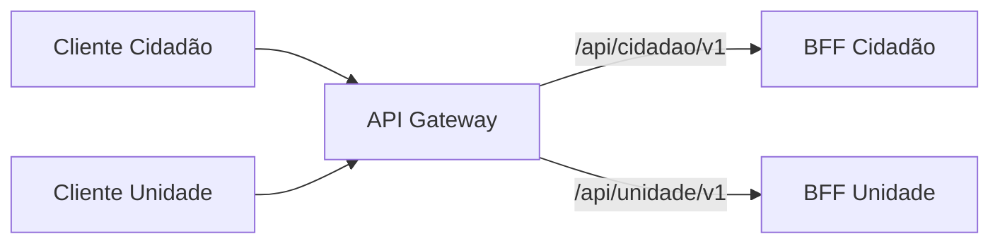

# GlicoAcesso - API Gateway

**Etapa:** 2 - Arquitetura
**Documento:** 03 - API Gateway
**Documento normativo:** [00 - Decisões arquiteturais compartilhadas](./00-decisoes-compartilhadas.md)

## 1. Papel na arquitetura

O API Gateway é o ponto único de entrada HTTP para os clientes externos. Ele recebe as chamadas, aplica a proteção de borda prevista para cada operação e encaminha a requisição ao BFF correspondente, conforme os documentos 00 e 02.

| Componente | Papel |
|---|---|
| API Gateway | Entrada HTTP, proteção da borda e roteamento. |
| BFF | Composição e adaptação da resposta para o cidadão ou para a equipe da unidade. |

Essa separação concentra o encaminhamento externo sem misturá-lo às agregações de cada público. O Gateway não substitui os BFFs, não contém regras de negócio, não acessa bancos e não coordena a SAGA.

## 2. Rotas externas

Os contratos dos BFFs usam os prefixos `/api/cidadao/v1` e `/api/unidade/v1` em `servers.url`. Combinando cada prefixo com os caminhos declarados, as operações atuais são:

| Cliente | Método e rota externa | Destino |
|---|---|---|
| Cidadão | `GET /api/cidadao/v1/explorar` | BFF Cidadão. Consulta exige `itemId` como parâmetro de query. |
| Cidadão | `GET /api/cidadao/v1/itens` | BFF Cidadão. Lista o catálogo público para selecionar o `itemId`. |
| Cidadão | `GET /api/cidadao/v1/unidades` | BFF Cidadão. Lista dados públicos das unidades ativas. |
| Cidadão | `GET /api/cidadao/v1/reservas/{reservaId}` | BFF Cidadão. |
| Cidadão | `POST /api/cidadao/v1/reservas` | BFF Cidadão. Cria uma solicitação autenticada. |
| Cidadão | `POST /api/cidadao/v1/reservas/{reservaId}/cancelar` | BFF Cidadão. Solicita o cancelamento da própria reserva. |
| Unidade | `GET /api/unidade/v1/painel/reservas/{reservaId}` | BFF Unidade. |
| Unidade | `GET /api/unidade/v1/painel/reservas` | BFF Unidade. Lista solicitações pendentes para decisão. |
| Unidade | `GET /api/unidade/v1/painel/estoque` | BFF Unidade. |
| Unidade | `GET /api/unidade/v1/unidade` | BFF Unidade. Consulta cadastro da unidade vinculada ao profissional. |
| Unidade | `PUT /api/unidade/v1/unidade` | BFF Unidade. Atualiza cadastro e informações de atendimento da unidade autenticada. |
| Unidade | `PUT /api/unidade/v1/unidade/horarios` | BFF Unidade. Atualiza horários da unidade autenticada. |
| Unidade | `PUT /api/unidade/v1/unidade/prazo-analise` | BFF Unidade. Atualiza o prazo de análise para novas solicitações. |
| Unidade | `PATCH /api/unidade/v1/unidade/status` | BFF Unidade. Ativa ou desativa a participação da unidade. |
| Unidade | `PUT /api/unidade/v1/painel/estoque/{unidadeId}/itens/{itemId}/permissao` | BFF Unidade. Configura se o item permite reserva. |
| Unidade | `POST /api/unidade/v1/painel/estoque/{unidadeId}/itens/{itemId}/entradas` | BFF Unidade. Registra entrada física no estoque. |
| Unidade | `POST /api/unidade/v1/painel/estoque/{unidadeId}/itens/{itemId}/ajustes` | BFF Unidade. Registra ajuste físico por variação assinada. |
| Unidade | `POST /api/unidade/v1/reservas/{reservaId}/decisao` | BFF Unidade. Aceita ou rejeita a solicitação. |
| Unidade | `POST /api/unidade/v1/reservas/{reservaId}/cancelar` | BFF Unidade. Solicita cancelamento com justificativa. |
| Unidade | `POST /api/unidade/v1/retiradas` | BFF Unidade. Registra a entrega presencial. |

Fontes: [contrato do BFF Cidadão](./api/bff-cidadao.yaml) e [contrato do BFF Unidade](./api/bff-unidade.yaml). Os prefixos identificam a família e seu destino lógico; métodos, parâmetros e respostas seguem o contrato de cada operação.

Os contratos de domínio também descrevem as operações que os BFFs encaminham aos serviços responsáveis. No tráfego externo, o Gateway expõe somente as rotas dos BFFs listadas acima; os clientes não acessam diretamente os serviços de domínio.

## 3. Rotas internas

Os endpoints sob `/internal/v1` pertencem à comunicação entre serviços e não são publicados pelo Gateway. As chamadas seguem diretamente do serviço chamador ao serviço responsável, conforme os fluxos existentes.

| Comunicação | Exemplo real do contrato |
|---|---|
| Reservas → Estoque | `POST /internal/v1/alocacoes` e `DELETE /internal/v1/alocacoes/{reservaId}`. |
| Reservas → Retiradas | `POST /internal/v1/autorizacoes` e `POST /internal/v1/autorizacoes/{reservaId}/cancelar`. |
| Reservas → Unidades | `GET /internal/v1/unidades/{unidadeId}` para validar unidade ativa e obter prazo de análise. |
| Reservas → Estoque | `GET /internal/v1/unidades/{unidadeId}/itens/{itemId}/permissao-reserva` para ler a permissão canônica antes de criar a solicitação. |
| Retiradas → Reservas | `GET /internal/v1/reservas/{reservaId}/estado`, antes de registrar uma entrega. |
| BFFs → Reservas | `GET /internal/v1/reservas/{reservaId}` para agregar a consulta da reserva com autorização por ator. |
| BFFs → Unidades | `GET /api/cidadao/v1/unidades` para listagem pública e `GET /internal/v1/unidades/{unidadeId}` para compor detalhes autorizados. |
| BFF Cidadão → Estoque | `GET /api/cidadao/v1/estoque/itens` para listar itens pesquisáveis. |
| BFF Unidade → Retiradas | `GET /internal/v1/autorizacoes/{reservaId}` para agregar a situação operacional da autorização. |
| BFF Unidade → Estoque | `GET /api/unidade/v1/estoque/{unidadeId}/itens` para compor o painel e os dados do item da reserva. |

Assim, a entrada externa segue **cliente → Gateway → BFF**; as integrações internas seguem **serviço → serviço**. A publicação e o consumo de eventos RabbitMQ também pertencem aos serviços, fora do encaminhamento HTTP do Gateway.

## 4. Autenticação e autorização

O diagrama de arquitetura prevê validação na borda e nos serviços responsáveis. Nas operações autenticadas, o Gateway participa da validação do token recebido e encaminha o contexto autenticado necessário ao BFF e ao serviço adequado. A identidade do cidadão vem desse contexto confiável, conforme o documento 05; um identificador arbitrário no corpo não substitui a autenticação.

Os YAMLs utilizam o esquema HTTP Bearer `bearerAuth`. Ele é exigido nas operações de reserva do cidadão e nas operações da unidade; as consultas públicas de itens, unidades e disponibilidade permanecem sem autenticação. A exigência respeita cada operação, sem tratar todos os endpoints como autenticados por uma regra global não definida.

A autorização de negócio continua no serviço responsável, com os BFFs apresentando apenas os dados e ações adequados ao ator. Por exemplo, Reservas valida a propriedade da solicitação ou o vínculo do profissional com a unidade. A proteção da borda não substitui essas verificações.

Os documentos não fixam um provedor de identidade, a configuração de validação dos tokens nem o formato de propagação da identidade entre componentes. Esses detalhes permanecem para alinhamento de implementação, preservando os requisitos já declarados nos contratos.

## 5. Responsabilidades transversais

| Responsabilidade | Limite adotado |
|---|---|
| Roteamento externo | Encaminhar cada família de rotas ao BFF do público correspondente. |
| Proteção da borda | Participar da autenticação e das verificações de acesso previstas, mantendo a validação específica nos serviços. |
| Rastreabilidade | Preservar o `correlationId` do fluxo. O documento 00 prevê sua geração na entrada, pelo BFF/Gateway, quando não recebido. |
| Convenções HTTP | Preservar métodos, parâmetros, corpos, respostas e `Idempotency-Key` definidos nos contratos, incluindo JSON UTF-8 e o versionamento dos caminhos. |
| Separação das APIs | Impedir a exposição pública dos endpoints internos dos serviços. |

O header `X-Correlation-Id` está explicitamente documentado como opcional na consulta interna do estado da reserva. O formato geral de transporte da correlação nas demais operações ainda não está detalhado nos OpenAPI. A tecnologia do Gateway, os endereços dos BFFs e a configuração física do roteamento também permanecem indefinidos.

## 6. O que não pertence ao Gateway

| Responsabilidade | Onde pertence |
|---|---|
| Regras e estados da Reserva | Reservas. |
| Saldo, alocação e disponibilidade | Estoque. |
| Autorização de retirada e registro da entrega | Retiradas. |
| Cadastro de unidade | Unidades. |
| Composição específica do cidadão | BFF Cidadão. |
| Composição operacional da unidade | BFF Unidade. |
| Orquestração da confirmação e do cancelamento | Reservas, pela SAGA. |

O Gateway permanece um componente de entrada, sem se tornar proprietário de dados de domínio ou um coordenador central do processo distribuído.

## 7. Fluxo de uma requisição

Exemplo: `GET /api/cidadao/v1/explorar?itemId={itemId}`.

1. O cliente envia a consulta ao Gateway.
2. O Gateway aplica as responsabilidades de borda pertinentes e encaminha a chamada ao BFF Cidadão, preservando o parâmetro e a correlação do fluxo.
3. O BFF consulta as informações necessárias de Unidades e da projeção de disponibilidade de Estoque, conforme o documento 05.
4. O BFF compõe os itens da resposta com identificação, endereço, horário e orientações da unidade, além de `disponivel`, `permiteReserva` e `atualizadoEm`, conforme seu contrato. `disponivel` deriva de quantidade projetada maior que zero; `permiteReserva` é uma regra independente. O timestamp é o recebido da projeção, não o horário de montagem da resposta.
5. O Gateway devolve a resposta do BFF ao cliente, preservando seu status e sua representação HTTP.

Essa consulta é informativa; as regras de validação e alocação continuam no modelo canônico de Estoque. A composição da resposta e suas diferenças por público são detalhadas no documento 04.

## 8. Relação com os demais documentos

| Referência | Detalhamento |
|---|---|
| [00 - Decisões compartilhadas](./00-decisoes-compartilhadas.md) | Regras comuns de comunicação, identidade e correlação. |
| [01 - Microsserviços](./01-microsservicos.md) | Fronteiras e propriedade das regras e dos dados. |
| [02 - Diagrama de arquitetura](./02-diagrama-arquitetura.md) | Visão geral dos componentes e dos caminhos externos e internos. |
| [04 - BFFs](./04-bffs.md) | Agregações e respostas específicas de cada público. |
| [05 - Fluxo de reservas](./05-fluxo-reservas.md) e [06 - SAGA](./06-saga.md) | Fluxos de negócio e coordenação interna, sob responsabilidade dos serviços. |
| [07 - HATEOAS](./07-hateoas.md) | Links e ações de Reserva conforme estado e ator. |
| [BFF Cidadão](./api/bff-cidadao.yaml) e [BFF Unidade](./api/bff-unidade.yaml) | Contratos das rotas de apresentação listadas neste documento. |
| [Unidades](./api/unidade.yaml), [Estoque](./api/estoque.yaml), [Reservas](./api/reserva.yaml) e [Retiradas](./api/retirada.yaml) | Endpoints e schemas dos serviços consumidos pelos BFFs e nas chamadas internas. |
