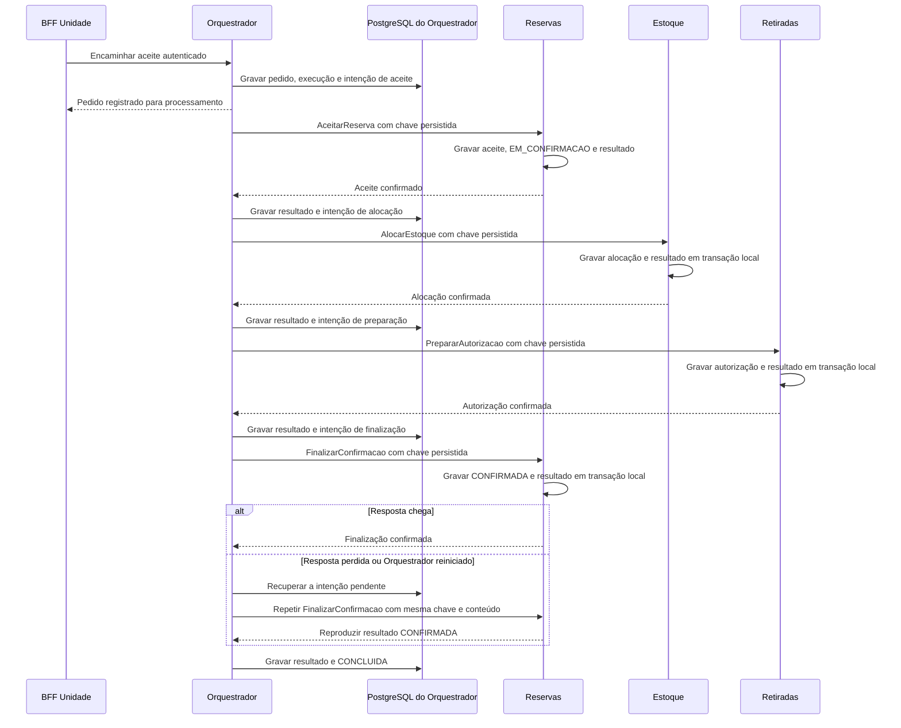

# GlicoAcesso - SAGA de confirmação: persistência e retomada

As gravações do Orquestrador e dos participantes ocorrem em transações separadas. A última etapa inclui a recuperação opcional de uma resposta perdida depois do ponto de compromisso.

[Especificação da SAGA](../06-saga.md) · [Recuperação e compensações](../08-saga.md)

