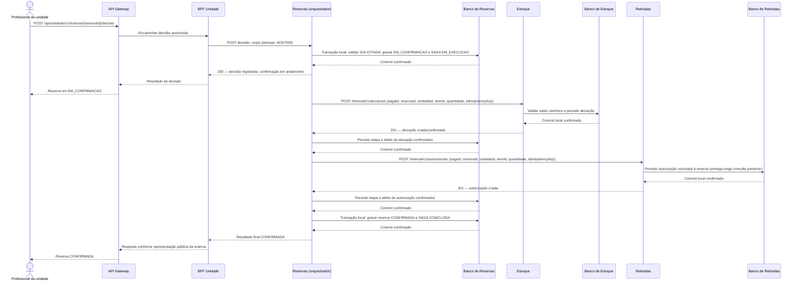

# GlicoAcesso - SAGA: caminho feliz da confirmação

**Referências:** [08 - Especificação complementar da SAGA](../08-saga.md), [06 - SAGA de confirmação e cancelamento](../06-saga.md) e contratos OpenAPI de [Reservas](../api/reserva.yaml), [Estoque](../api/estoque.yaml) e [Retiradas](../api/retirada.yaml).

O profissional aceita uma solicitação `SOLICITADA`. Reservas registra a execução e coordena os comandos internos. A reserva só fica `CONFIRMADA` após Estoque confirmar a alocação, Retiradas persistir a autorização e Reservas gravar a finalização. A autorização criada não basta para entregar: no balcão, Retiradas consulta o estado canônico de Reservas e exige `CONFIRMADA`. Este diagrama mostra somente a SAGA de confirmação.

Cada persistência ocorre no banco do serviço proprietário; não há transação compartilhada. Timeout nos comandos é resultado incerto e exige repetição idempotente para reconciliar os efeitos. O GET de estado de Reservas valida a entrega posterior e não consulta os resultados de alocação ou autorização nos participantes.
