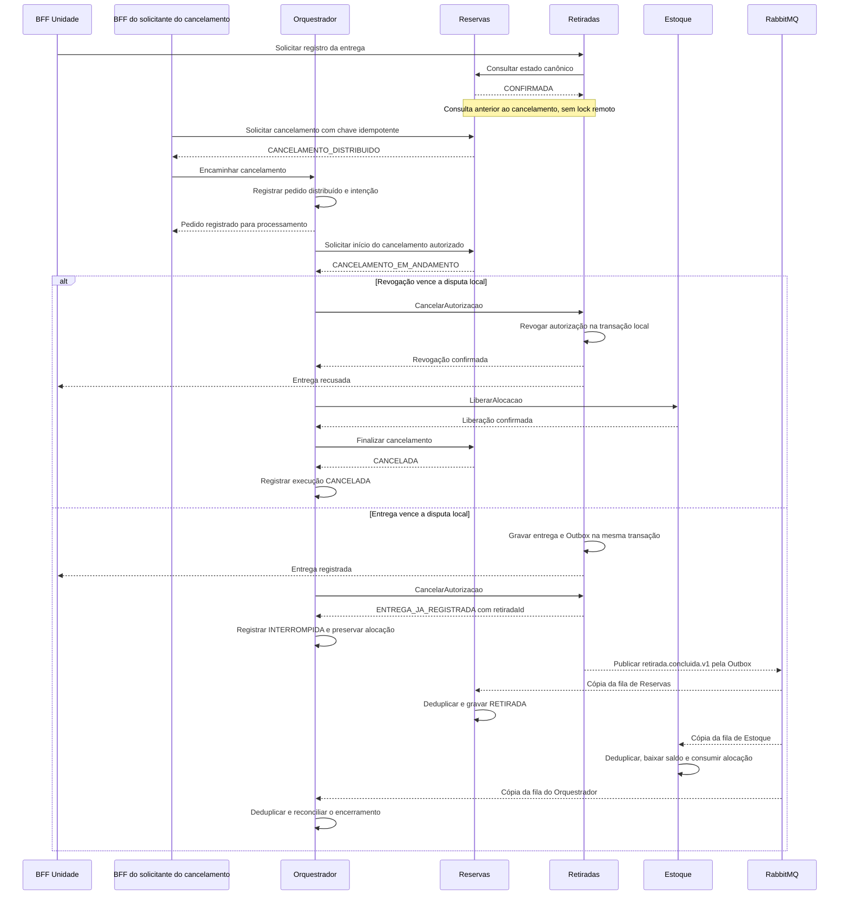

# GlicoAcesso - SAGA de cancelamento: disputa com a retirada

O BFF do ator autorizado encaminha o pedido de cancelamento distribuído ao Orquestrador. O diagrama detalha a disputa em Retiradas. Os três consumidores recebem cópias independentes, sem ordem global de entrega. O evento pode chegar ao Orquestrador antes ou depois da resposta do comando.

[Especificação da SAGA](../06-saga.md) · [Recuperação e compensações](../08-saga.md)

