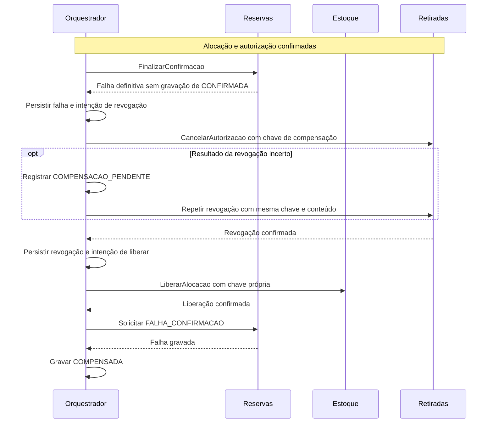

# GlicoAcesso - SAGA de confirmação: compensação antes do ponto de compromisso

Este cenário exige evidência conclusiva de que a finalização falhou antes de gravar `CONFIRMADA`. Perda de resposta exige recuperação por repetição idempotente.

[Especificação da SAGA](../06-saga.md) · [Recuperação e compensações](../08-saga.md)

