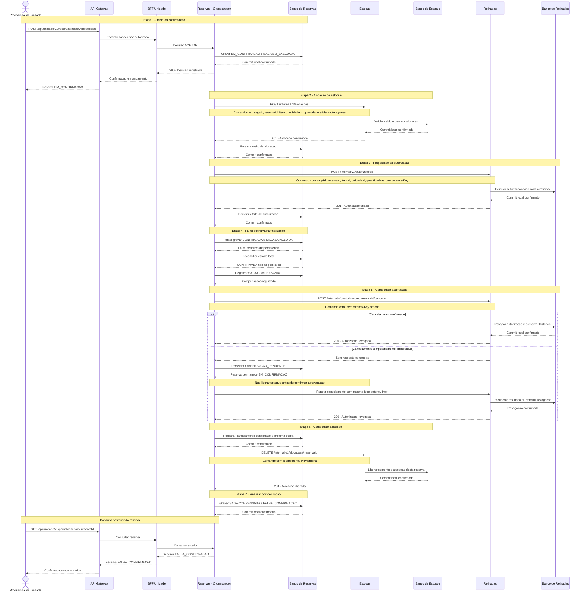

# GlicoAcesso - SAGA: compensação após falha de finalização

**Referências:** [08 - Especificação complementar da SAGA](../08-saga.md), [06 - SAGA de confirmação e cancelamento](../06-saga.md) e contratos OpenAPI de [Reservas](../api/reserva.yaml), [Estoque](../api/estoque.yaml) e [Retiradas](../api/retirada.yaml).

Este cenário considera alocação e autorização confirmadas, mas uma falha definitiva na finalização local da reserva. Reservas primeiro reconcilia que `CONFIRMADA` não foi persistida, registra a compensação e desfaz os efeitos na ordem inversa.

Se a preparação da autorização for rejeitada definitivamente antes de criar autorização, não há autorização a cancelar: Reservas libera a alocação e só conclui após confirmar essa liberação.

Timeout ou perda de resposta em qualquer comando deixa o resultado incerto. Reservas não presume que a operação falhou nem inicia a etapa seguinte sem reconciliação: repete o mesmo comando com a mesma `Idempotency-Key` e conteúdo para recuperar status e corpo originais.

Se uma compensação permanecer pendente, a reserva continua `EM_CONFIRMACAO`. A transição para `FALHA_CONFIRMACAO` só ocorre após a confirmação de todas as compensações obrigatórias.

A entrega física não faz parte deste fluxo.
