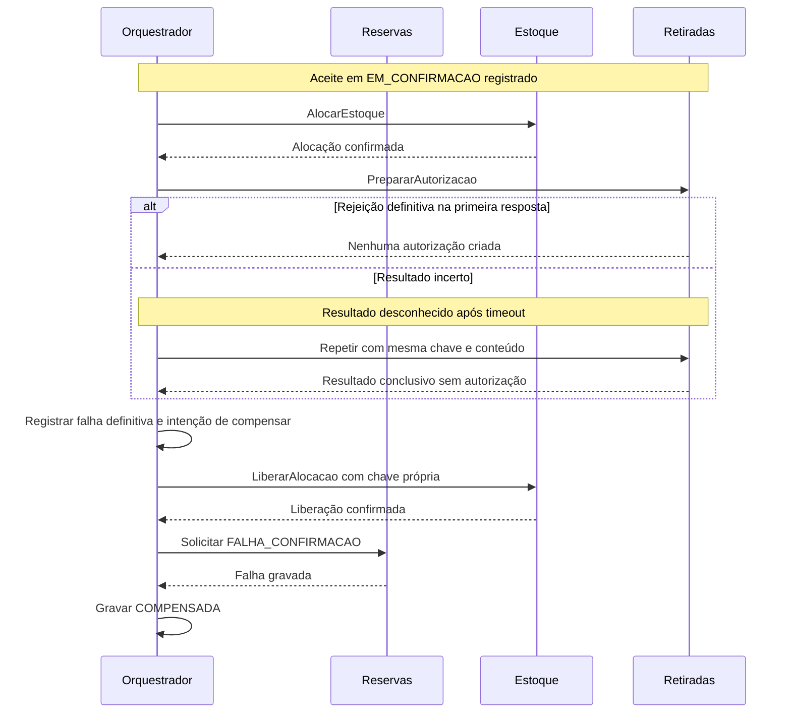

# GlicoAcesso - SAGA de confirmação: falha ao preparar autorização

Neste cenário, a autorização nunca foi criada. Se o resultado recuperado confirmar sua criação, a revogação deve preceder qualquer liberação.

[Especificação da SAGA](../06-saga.md) · [Recuperação e compensações](../08-saga.md)

