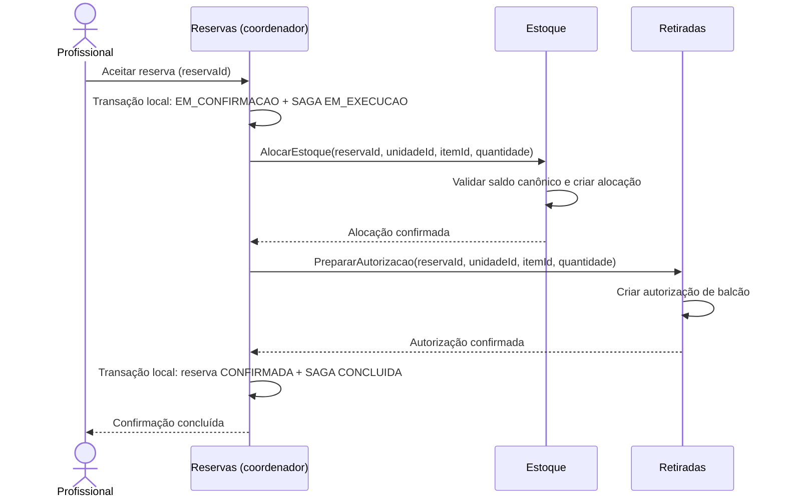

# GlicoAcesso - SAGA: caminho de sucesso

**Referência:** [06 - SAGA de confirmação e cancelamento](../06-saga.md)

Este diagrama mostra a confirmação após o profissional aceitar uma solicitação `SOLICITADA`. O estado só vira `CONFIRMADA` depois que Estoque confirma a alocação, Retiradas persiste a autorização e Reservas grava a finalização local. A autorização não permite entrega por si só: no balcão, Retiradas exige consulta canônica de `CONFIRMADA` e revalida a autorização local.

AlocarEstoque e PrepararAutorizacao são comandos internos idempotentes. As chamadas e gravações pertencem aos serviços correspondentes; não existe transação compartilhada.