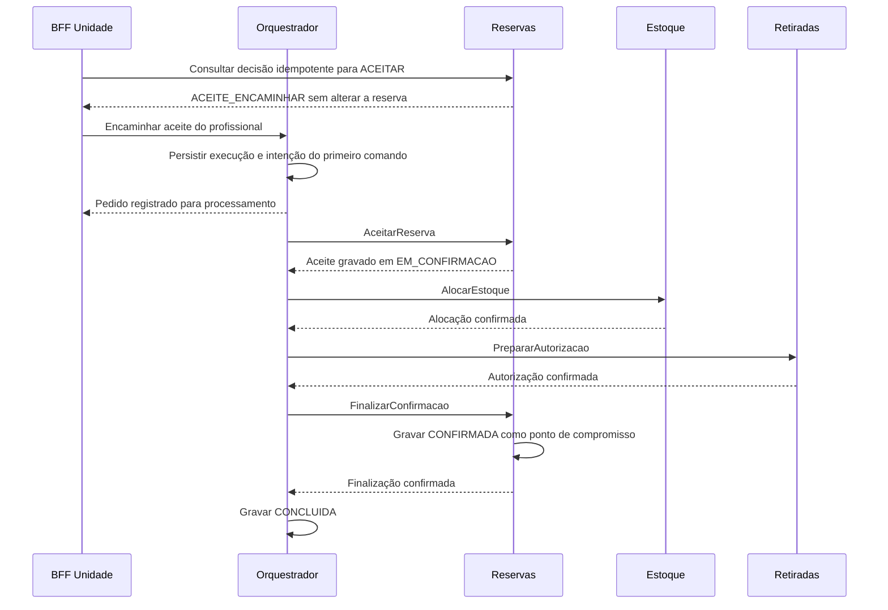

# GlicoAcesso - SAGA de confirmação: caminho de sucesso

A aceitação do pedido para processamento antecede o resultado consultado em Reservas. Cada etapa usa uma intenção durável e resultado idempotente.

[Especificação da SAGA](../06-saga.md) · [Recuperação e compensações](../08-saga.md)

