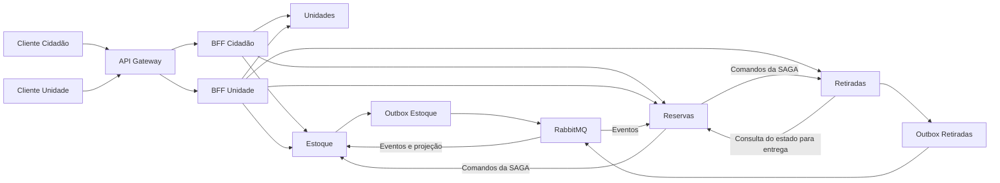

# GlicoAcesso — Resumo da Arquitetura

Este documento sintetiza a arquitetura definida para a Parte 2 e aponta onde consultar os detalhes. As decisões compartilhadas em [00 — Decisões compartilhadas](./00-decisoes-compartilhadas.md) são a referência transversal; este resumo não cria regras novas nem substitui os documentos temáticos.

## 1. Visão geral

O GlicoAcesso permite consultar unidades e disponibilidade informada, solicitar a reserva de um medicamento ou insumo e registrar sua retirada presencial. A arquitetura tem quatro microsserviços de domínio, um API Gateway e dois BFFs. Cada serviço possui uma instância PostgreSQL própria. RabbitMQ transporta eventos publicados pela Transactional Outbox; Inbox deduplica o consumo. Reservas orquestra a SAGA de confirmação. Estoque aplica CQRS à consulta de disponibilidade, mantendo escrita canônica e projeção no mesmo banco.

As setas representam chamadas e eventos entre serviços, não acesso cruzado a bancos. Cada serviço lê e grava apenas seu próprio PostgreSQL. O diagrama omite os bancos para manter a visão legível.

## 2. Microsserviços e propriedade dos dados

| Serviço | Responsabilidade | Fonte canônica principal |
|---|---|---|
| Unidades | Cadastro, atendimento, horários, orientações de retirada e prazo de análise. | Cadastro da unidade e seus dados de atendimento. |
| Estoque | Catálogo, saldos, permissões, movimentações e alocações; mantém a projeção de disponibilidade. | `itens`, `saldos`, `alocacoes` e `movimentacoes`. |
| Reservas | Solicitações, decisões, estados visíveis e coordenação da SAGA. | `reservas`, histórico e registros de execução e etapas. |
| Retiradas | Autorizações e registro da entrega física. | `autorizacoes` e `retiradas`. |

Cada serviço tem seu próprio banco PostgreSQL. Não há chaves estrangeiras nem consultas ou gravações diretas entre bancos. Identificadores de outros serviços são referências opacas; a integração ocorre por APIs ou eventos.

## 3. Entrada da arquitetura

O API Gateway é o ponto de entrada dos clientes: aplica a proteção de borda e encaminha as rotas ao BFF correspondente. O BFF Cidadão agrega dados e ações adequados ao cidadão; o BFF Unidade agrega consultas e operações da equipe. Os BFFs adaptam respostas e podem consultar mais de um serviço, mas não são donos de dados nem coordenam a SAGA. As regras de negócio continuam nos serviços responsáveis.

## 4. Fluxo de reserva

1. O cidadão consulta itens, unidades e disponibilidade. A disponibilidade é informativa e pode estar defasada.
2. Reservas valida a unidade ativa e a permissão canônica de reserva em Estoque, registra a solicitação como `SOLICITADA` e define seu prazo de decisão.
3. O profissional consulta as solicitações pendentes de sua unidade e decide aceitar ou rejeitar. A rejeição encerra a solicitação; o aceite inicia a confirmação distribuída.
4. Reservas coordena a alocação no Estoque e a criação da autorização em Retiradas. Só depois de ambas as etapas e da finalização local a reserva fica `CONFIRMADA`.
5. No balcão, Retiradas consulta o estado canônico de Reservas e exige `CONFIRMADA`; então registra a entrega e publica `retirada.concluida.v1`. Reservas muda a reserva para `RETIRADA` ao consumir esse evento.

## 5. SAGA

Reservas é o orquestrador da confirmação, que atravessa Reservas, Estoque e Retiradas. A sequência é: gravar `EM_CONFIRMACAO`, alocar a quantidade em Estoque, preparar a autorização em Retiradas e finalizar como `CONFIRMADA`. Se uma falha definitiva ocorrer depois de efeitos confirmados, as compensações seguem a ordem inversa: cancelar primeiro a autorização e, após confirmar essa revogação, liberar a alocação.

O cancelamento é um processo de negócio separado, com outra execução e `sagaId`, ainda que se aplique à mesma reserva. Ele não deve ser confundido com a compensação de uma confirmação que falhou. Se a revogação vencer a corrida com a retirada, a entrega é recusada. Se a retirada vencer, Reservas passa a `RETIRADA` e a execução de cancelamento termina como `INTERROMPIDA`.

Timeout não comprova falha remota: Reservas repete o mesmo comando com a mesma `Idempotency-Key` e conteúdo para recuperar o resultado original. Uma execução ou compensação pendente não é apresentada como falha final.

## 6. APIs e HATEOAS

Os contratos HTTP usam JSON e versionam as rotas públicas sob `/api/.../v1`; chamadas internas usam `/internal/v1` e não são expostas pelo Gateway. Os contratos OpenAPI dos quatro serviços e dos dois BFFs ficam em [api/](./api/). HATEOAS é aplicado ao recurso Reserva: os links indicam consultas e ações disponíveis de acordo com o estado e o ator, usando operações declaradas nos contratos dos BFFs.

## 7. Persistência

| Serviço | Estruturas principais | Separação importante |
|---|---|---|
| Unidades | `unidades`, `contatos_unidade`, `horarios_unidade` | Cadastro e atendimento pertencem a Unidades. |
| Estoque | `itens`, `saldos`, `alocacoes`, `movimentacoes` e projeção `disponibilidade` | `saldos` é a fonte canônica operacional. Disponibilidade é `estoqueFisicoAtual - quantidadeAlocada`; alocar não é movimentação física. |
| Reservas | `reservas`, `saga_execucoes`, `saga_etapas`, `historico_reserva` | `reservas` guarda o estado de negócio; execução e etapas registram o progresso técnico da SAGA. |
| Retiradas | `autorizacoes`, `retiradas` | A autorização preparada não é a entrega física registrada posteriormente. |

## 8. Consistência e dual write

Transações ACID são locais a cada banco; não há 2PC entre serviços. Há consistência eventual entre a entrega registrada em Retiradas e a atualização de Reservas e Estoque por eventos, além da defasagem da projeção de disponibilidade.

Gravar no PostgreSQL e publicar diretamente no RabbitMQ são operações separadas: uma pode ter sucesso sem a outra. A Transactional Outbox grava a alteração de domínio e o evento na mesma transação local; um publicador envia o evento depois do commit. A entrega é pelo menos uma vez, portanto consumidores precisam ser idempotentes.

## 9. Outbox, Inbox e eventos

| Serviço | Inbox | Outbox |
|---|---|---|
| Unidades | Não | Não |
| Reservas | Sim | Não |
| Estoque | Sim | Sim |
| Retiradas | Não | Sim |

Outbox preserva eventos para publicação confiável; Inbox registra o processamento para evitar aplicar a mesma mensagem duas vezes. `retirada.concluida.v1`, produzido por Retiradas, é consumido por Reservas e Estoque em filas independentes. Estoque valida a alocação, baixa o saldo e publica eventos que atualizam a projeção CQRS; estes incluem alocação criada ou liberada, entrada, ajuste, baixa de retirada e alteração da permissão.

## 10. CQRS

CQRS é usado somente em Estoque. O modelo de escrita canônico e a projeção `disponibilidade` ficam em tabelas diferentes do mesmo PostgreSQL. A projeção é atualizada assincronamente pelos eventos de Estoque; a meta é refletir mudanças em aproximadamente cinco segundos em condições normais, e `atualizadoEm` indica o instante do estado exibido.

`eventId` deduplica mensagens; `estoqueVersion` impede que uma atualização antiga substitua estado mais novo para a mesma combinação de unidade e item. A projeção pode ser reconstruída a partir de `saldos`. Os eventos propagam mudanças, mas não são a fonte única da verdade: o projeto não usa Event Sourcing.

## 11. Mapa da documentação

O índice abaixo usa os nomes reais dos arquivos atuais. O documento 00 é a base transversal; os documentos temáticos atuais vão de 01 a 12.

| Documento | O que responde |
|---|---|
| [00 — Decisões compartilhadas](./00-decisoes-compartilhadas.md) | Vocabulário, estados, fronteiras, eventos e regras comuns. |
| [01 — Microsserviços](./01-microsservicos.md) | Responsabilidades, propriedade dos dados e justificativa das fronteiras. |
| [02 — Diagrama de arquitetura](./02-diagrama-arquitetura.md) | Componentes, bancos e comunicação entre serviços. |
| [03 — API Gateway](./03-api-gateway.md) | Rotas externas e internas, autenticação e papel do Gateway. |
| [04 — BFFs](./04-bffs.md) | Agregações e diferenças entre as visões do cidadão e da unidade. |
| [05 — Fluxo de reservas](./05-fluxo-reservas.md) | Jornada da solicitação, decisão, cancelamento e retirada. |
| [06 — SAGA](./06-saga.md) | Orquestração, compensações, cancelamento e recuperação. |
| [07 — HATEOAS](./07-hateoas.md) | Links e ações do recurso Reserva por estado e ator. |
| [08 — SAGA complementar](./08-saga.md) | Detalhes complementares de recuperação e falhas da SAGA. |
| [09 — Bancos](./09-bancos.md) | Estruturas, integridade e isolamento dos quatro bancos. |
| [10 — Consistência](./10-consistencia.md) | Consistência local e eventual, dual write e riscos. |
| [11 — Outbox e Inbox](./11-outbox.md) | Persistência, publicação, consumo e catálogo de eventos. |
| [12 — CQRS](./12-cqrs.md) | Projeção de disponibilidade, defasagem e reconstrução. |

Contratos OpenAPI: [api/](./api/). Diagramas: [diagramas/](./diagramas/).

## 12. Decisões e detalhes ainda abertos

Os documentos definem as regras arquiteturais de domínio, SAGA, idempotência, Outbox e CQRS. Permanecem explicitamente sem fixação:

- provedor de identidade, configuração de validação dos tokens e formato geral de propagação da identidade;
- tecnologia e configuração física do Gateway, endereços de rede, portas, topologia e nomes físicos de filas, réplicas e formato de implantação;
- formato geral de transporte do `correlationId` nas operações que não o especificam;
- parâmetros operacionais de backoff, limite de tentativas, alertas e procedimento de falha/reprocessamento da SAGA e da publicação.

A recuperação de resultado remoto incerto não é uma decisão em aberto: a regra definida é repetir o mesmo comando com a mesma chave e conteúdo idempotentes. O documento 08 ainda registra confirmações de alinhamento e de implementação como pendências de responsáveis; elas não alteram essa regra arquitetural.
